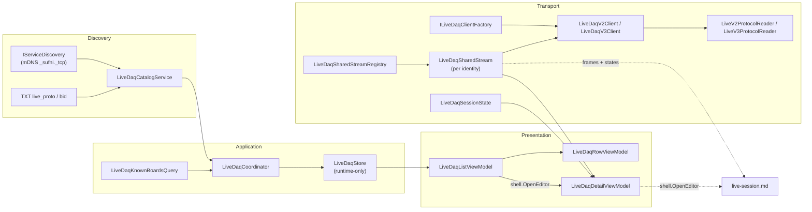

# Live DAQ Streaming

> Part of the [Sufni.App architecture documentation](../ARCHITECTURE.md). This file covers the live preview transport: the framed TCP protocol, discovery and catalog services, the runtime-only store, the per-identity shared stream, and the diagnostics tab. The recording / capture / save side that turns a live stream into a persisted recorded session lives in [Live Session Recording](live-session.md).

## Contents

- [Overview](#overview)
- [Data Flow](#data-flow)
- [Live Wire Protocol](#live-wire-protocol)
- [Transport Layer](#transport-layer)
- [Discovery & Catalog](#discovery--catalog)
- [Known-Board Query](#known-board-query)
- [Runtime Store](#runtime-store)
- [Coordinator](#coordinator)
- [View Models](#view-models)
- [Views](#views)
- [Design Decisions](#design-decisions)

## Overview

The live feature lets a user inspect a connected DAQ in a diagnostics tab. The user can also open a live-session tab on the same connection. This file covers frame delivery to those tabs: discovery, the per-identity shared transport, and the diagnostics tab. The recording side (`ILiveCaptureCoordinator`, analysis, the live signal pipeline and the `Session` save path) lives in [Live Session Recording](live-session.md).

The feature is a dedicated slice. A primary page lists known and discovered DAQs. Selection opens a diagnostics tab, and `Start Session` opens a second tab on the same transport. Desktop and mobile heads expose all three surfaces.

The feature is separate from the import pipeline. It does not use `ITelemetryDataStoreService.DataStores` for list state or share browse start/stop with the import page. The diagnostics tab also exposes v2 management actions (Set Time, Edit CONFIG, Replace Config). These actions use a separate management service and run only while the live client is disconnected.



## Data Flow

```
mDNS announcement
  -> LiveDaqCatalogService (requires TXT live_proto=2|3, reads TXT bid when present)
    -> LiveDaqCoordinator.Reconcile (merge with known boards from query)
      -> LiveDaqStore.ReplaceAll
        -> DynamicData -> LiveDaqListViewModel -> LiveDaqRowViewModel -> UI

User selects row
  -> shell.OpenEditor(EditorKey.LiveDaq)
    -> EditorFactory.CreateEditor(key, shell)

Diagnostics tab is created after shell deduplication
  -> LiveDaqSharedStream.AcquireLease() (retained until tab close)

User connects
    -> LiveDaqSharedStream.ConnectLiveAsync
      -> ILiveDaqClientFactory.Create(snapshot.ProtocolVersion)
      -> LiveDaqV2Client or LiveDaqV3Client ConnectAsync (TCP)
        -> StartPreviewAsync (protocol-specific start handshake)
          -> receive loop handles control frames and queues telemetry frames
            -> parse loop decodes telemetry frames into canonical LiveProtocolFrame records
              -> publish loop emits LiveDaqClientEvent frames
            -> LiveDaqSharedStream state/frames
              -> LiveDaqSessionState.ApplyFrame
                -> IUiTimerScheduler tick -> CreateSnapshot -> UI binding

User presses Start Session
  -> shell.OpenEditor(EditorKey.LiveSession)
    -> EditorFactory.CreateEditor(key, shell)
      -> handed off to live-session.md (capture / analysis / save)

Tab closes
  -> lease released
    -> shared stream disconnects only when the last diagnostics/live-session observer closes

Management action on a v2 endpoint while disconnected
  -> LiveDaqDetailViewModel.SetTime / EditConfig / SelectConfigFile / UploadConfig
    -> LiveDaqCoordinator (picker validation + reserved MGMT workflow)
      -> IDaqManagementService (domain operations)
    -> IDialogService (CONFIG editor, opened by the view model)
    -> ViewModelBase.Notifications / ErrorMessages
```

Each LIVE connection resolves its endpoint from the current catalog by identity.
The tab snapshot supplies presentation only. A stale online snapshot cannot
connect after its catalog entry disappears.

The capture, analysis, save, and live-session view-model side of this flow continues in [Live Session Recording](live-session.md#data-flow).

## Live Wire Protocol

The live transport uses framed TCP streams separate from the framed management protocol used by import, remote trash, Set Time, and Replace Config. LIVE and MGMT share the DAQ's single-client TCP port, so only one live or management connection can be active at a time. The app supports live v2 and live v3 in parallel; `LiveDaqCatalogService` records the protocol version from TXT `live_proto`, and `ILiveDaqClientFactory` selects the matching client. Both clients publish the same canonical `LiveProtocolFrame` records to the rest of the app.

### V2 Frame Header

Live v2 uses the legacy `"LIVE"` frame envelope. Every v2 message consists of a 16-byte header followed by a typed payload.

| Offset | Size | Field         | Description                                    |
| ------ | ---- | ------------- | ---------------------------------------------- |
| 0      | 4    | Magic         | `0x4556494C` (`"LIVE"` little-endian)          |
| 4      | 2    | Version       | Protocol version (currently `2`)               |
| 6      | 2    | FrameType     | Identifies the payload layout                  |
| 8      | 4    | PayloadLength | Byte count of the payload following the header |
| 12     | 4    | Sequence      | Monotonically increasing frame counter         |

### V2 Frame Types

| Type            | Value | Direction     | Payload size | Description                                                                |
| --------------- | ----- | ------------- | ------------ | -------------------------------------------------------------------------- |
| `StartLive`     | `1`   | client -> DAQ | 16           | Request to begin streaming with individual sensor mask and rate caps       |
| `StopLive`      | `2`   | client -> DAQ | 0            | Request to stop the active session                                         |
| `Ping`          | `3`   | client -> DAQ | 0            | Keep-alive ping                                                            |
| `Identify`      | `4`   | client -> DAQ | 0            | Request the board serial without starting a live session                   |
| `StartLiveAck`  | `16`  | DAQ -> client | 12           | Result code, session ID, accepted sensor mask                              |
| `StopLiveAck`   | `17`  | DAQ -> client | 4            | Confirms session stopped                                                   |
| `Error`         | `18`  | DAQ -> client | 4            | Error code for rejected or failed operations                               |
| `Pong`          | `19`  | DAQ -> client | 0            | Keep-alive pong                                                            |
| `SessionHeader` | `20`  | DAQ -> client | 72           | Accepted rates, calibration, IMU locations, requested and accepted sensors |
| `IdentifyAck`   | `21`  | DAQ -> client | 8            | 8-byte board serial used to derive the device GUID                         |
| `TravelBatch`   | `32`  | DAQ -> client | variable     | Suspension encoder data batch                                              |
| `ImuBatch`      | `33`  | DAQ -> client | variable     | IMU sensor data batch                                                      |
| `GpsBatch`      | `34`  | DAQ -> client | variable     | GPS fix records                                                            |
| `SessionStats`  | `48`  | DAQ -> client | 28           | Running session statistics (duration, sample counts)                       |

### V2 Start Request

`START_LIVE` carries a 16-byte payload of four `uint32` fields: `RequestedSensorMask`, `TravelHz`, `ImuHz`, `GpsFixHz`. The Hz fields cap each stream's rate; zero means use the device default. `RequestedSensorMask` is an individual sensor-instance mask: fork travel, shock travel, frame IMU, fork IMU, rear IMU, and GPS each have their own bit. The app derives the mask from the requested rate controls: nonzero travel requests both travel channels, nonzero IMU requests all IMU locations, and nonzero GPS requests GPS. The configuration the shared stream actually sends is described under [Stream Configuration](live-session.md#stream-configuration).

`LiveDaqStreamConfiguration` stores requested rates internally as millihertz. `LiveDaqV2Client` rounds those rates to whole-Hz wire values because v2 cannot express fractional hertz.

### V3 Frame Shape

Live v3 starts with a 7-byte client `LIV3` handshake. The DAQ replies before any framed message with a 24-byte server hello containing `LIV3`, protocol major/minor, feature flags, maximum payload size, unique board ID, and firmware semver. The app requires major version 3 and a compatible maximum payload, accepts any minor version, ignores unknown feature bits, and checks the hello's unique board ID against the discovered board ID when discovery supplied one.

After the server hello, live v3 uses the exact 12-byte compact header `[session_id:u8, frame_type:u8, frame_flags:u16, payload_length:u32, tx_sequence:u32]`. All integers are little-endian, flags are zero, and payloads are capped at 4096 bytes. `tx_sequence` starts at zero for each connection and is diagnostic only: gaps, repeats, and wrap do not affect receive correctness. Known frames are parsed strictly; unknown DAQ-to-client frame types are skipped by their declared payload length. The wire protocol includes capabilities request/response, device-state request/response, start request/result, stop request/result, session header/result, status, ping/pong, and error. The app sends capabilities, start, and stop requests; device-state and pong decoding remains supported without a requesting workflow. Data frames carry travel, IMU, temperature, GPS, battery, and marker batches using the shared SST v5 descriptor and compact-payload helpers.

Capabilities use a 16-byte header followed by ordered 24-byte stream records. The v3 start request contains a four-byte header followed by ordered 20-byte stream request records. The app requests travel, IMU, and GPS with optional rate overrides. Batch durations, GPS extensions, priority, and header-wait behavior use the protocol defaults. Temperature, battery, marker, and GPS diagnostics remain supported by the decoder but have no request controls.

`SESSION_HEADER` begins with its own 24-byte LIVE header fields and then carries direct SST v5 stream descriptors, source descriptors, and omission records; it does not contain an SST file metadata envelope. Requested streams and sensors remain client request state. Accepted streams, sensors, rates, extensions, and omissions come from the session header. `LiveV3ProtocolReader` maps the descriptor-owned compact data, status, and final-status records into canonical frames. Status and final records follow accepted descriptor order and preserve producer state/failure, sink backlog, and missed-count/time fields.

Temperature is decoded as its own low-rate canonical stream and is carried separately through capture, persistence, slicing, and recorded-session reprojection. Battery and marker frames are decoded and tolerated by consumers that do not retain them; marker history is saved by live capture. The UI does not request temperature, battery, or marker streams.

### Start Handshakes

A successful v2 start produces two frames in sequence: `START_LIVE_ACK` (result `Ok`, session ID, accepted stream-family mask) followed by `SESSION_HEADER` (full session parameters including accepted rates, calibration scales, IMU locations, and requested/accepted individual sensor masks). The ACK's accepted stream-family mask is canonical: after verifying that the header session id matches the accepted session, `LiveDaqV2Client` copies that mask into the canonical `LiveSessionHeader` published to all consumers instead of trusting the header payload's stream-mask field. A mismatched session id fails the start and the header is not emitted. Once the matching header establishes the active session, travel, IMU, GPS, and session-statistics frames are emitted only when their embedded session ID matches it. A foreign `STOP_LIVE_ACK` is also ignored, leaving the stop waiter pending until the active session's acknowledgement arrives. A rejected v2 start produces either a `START_LIVE_ACK` with a non-Ok result or an `ERROR` frame.

A successful v3 start is capabilities-first: the client sends the `LIV3` handshake, validates the server hello, requests capabilities once, sends record-based `START_REQ`, receives a pending `START_RESULT` with a nonzero session ID, then waits for the matching `SESSION_HEADER`. A denied `START_RESULT` maps to `LivePreviewStartResult.Rejected` with fixed-registry admission reasons and leaves the connection ready. `ERROR` surfaces code, offending frame type, and detail and closes the connection. A matching pre-header `SESSION_RESULT` fails only that start and also leaves the connection ready.

The DAQ may partially accept a start request. If at least one requested telemetry stream can run, the session header identifies the accepted stream/source subset and carries an omission record for each rejected stream, source, or extension. The app computes missing sensors as `RequestedSensorMask & ~AcceptedSensorMask` for diagnostics while preserving the requested and accepted stream masks separately. If no requested telemetry remains, the DAQ returns a denied start rather than a protocol error.

### Result Codes

| Code | Name             | Meaning                                   |
| ---- | ---------------- | ----------------------------------------- |
| 0    | Ok               | Request accepted                          |
| -1   | InvalidRequest   | Malformed or unsupported request          |
| -2   | Busy             | Another client is already streaming       |
| -5   | NoSensorsStarted | None of the requested sensors could start |

### Result Shape

`StartPreviewAsync` returns a sealed record hierarchy. `Started(header)` is the
successful result; shared connection ownership also supplies `Busy(holder)` and
`Closed(state)`. The `NotStarted` alternatives are:

- `Unavailable(reason)` for offline, not connected or not ready; these are
  expected availability states and do not log errors.
- `Rejected(code, message)` for a device admission decision.
- `Failed(reason, details)` for connection, negotiation, request, session mismatch,
  interruption or a device-ended startup. Each reason has fixed user text;
  exception and protocol diagnostics remain separate details.

- `LiveConnectionState.Disconnected(outcome)` owns the last unsuccessful outcome.
  The shared snapshot derives its error text from that state.
- Both live editors show failures with expandable details, and unavailable
  actions as notifications. Repeated state refreshes do not append the same failure again.
- Clients log exceptions at their boundary. The shared stream logs exceptions
  that escape connect/start and does not log typed results again.
- V3 capability negotiation carries typed outcomes to its waiters. The start
  caller does not rethrow or log a remote failure a second time.

## Transport Layer

All transport types live in `Sufni.App/Sufni.App/LiveDaq/Services/LiveStreaming/`.

### Protocol Reader

`LiveV2ProtocolReader` and `LiveV3ProtocolReader` are the protocol-specific frame readers. V2 builds client requests and decodes DAQ responses in the legacy `"LIVE"` frame envelope, including direct batch payloads. Client-direction v2 decoding lives in `TestSupport/LiveDaq/LiveV2RequestReader` for the fake device. V3 handles the `LIV3` handshake, server hello, 12-byte headers, capabilities/device-state/start/result control frames, and SST v5 descriptor/data payload decoding. Both readers translate wire payloads into canonical `LiveProtocolFrame` records before anything reaches `LiveDaqSharedStream`, diagnostics state, or live-session capture.

### Client

`LiveSessionHeader` exposes accepted rates, sensor topology, timing, calibration
and `ExpectsFinalStatus`. Capture uses that flag to detect an incomplete ending.
Discovery and client selection own the protocol version. V3 descriptors stay in
the reader's session decode context, not in the shared header.

`ILiveDaqClientFactory` creates `LiveDaqV2Client` or `LiveDaqV3Client` from the current `LiveDaqSnapshot.ProtocolVersion`. The selected client owns the TCP connection lifecycle: `ConnectAsync` -> `StartPreviewAsync` -> streaming -> `StopPreviewAsync` -> `DisconnectAsync`.

- **V2 session identity.** The v2 client adopts every valid matching session header, even after the start waiter is canceled. A later stop therefore targets the transport session.
- **V2 stop during start.** A `STOP_LIVE_ACK` that arrives while a newer start is pending completes that start as failed before the client clears its control state.
- **V3 phases.** The v3 client models awaiting hello, ready, start pending, awaiting session header, active, and stopping phases.
- **V3 terminal result.** A terminal result replaces the session decode context and returns the connection to ready. Denied starts, completed sessions, and session-ID wrap from 255 to 1 work without a reconnect.
- **V3 stop.** Stop waits for `STOP_RESULT` and then `SESSION_RESULT`, in that order.

Three background tasks run off the UI thread:

- The receive loop reads exact frame headers and payloads, handles control frames immediately, and pushes telemetry into a bounded raw channel.
- The parse loop decodes raw telemetry into canonical frames and writes them to a second bounded channel.
- The publish loop emits those frames as `LiveDaqClientEvent` values.

A terminal result enters the same pipeline as a non-droppable ordering barrier. The client publishes every retained earlier telemetry frame before session completion. Each queued telemetry frame keeps its own descriptor context, so the terminal reset cannot invalidate received data. Pressure can drop telemetry, which the bounded-channel counters record, but never lifecycle frames. A `SemaphoreSlim` gate serializes lifecycle state changes. Operations without a request ID keep one outstanding response slot until the matching response arrives.

`LiveDaqSharedStream` owns the client. It reuses one client per DAQ identity and fans out state and frames to the diagnostics tab and attached live-session tabs.

Clients consume start/stop acknowledgements, capabilities, pongs and error frames
at the transport boundary. `FrameReceived` publishes accepted session headers and
session data/status/results. Start and stop return domain outcomes. A v2 `ERROR`
also emits typed `PreviewRejected(reason)` for the shared stream's recoverable
disconnected state. Shared-stream and presentation code never interpret wire
control frames.

Both protocol clients serialize connect, disconnect and disposal with a connection
gate that is held through pipeline drainage. Concurrent callers cannot reuse or
dispose the lifecycle gate while an older loop still runs. Unexpected disconnect
closes the socket and completes pending operations, but keeps the loop handles
for cleanup. The pipeline caller awaits a v3 ERROR-triggered disconnect. A
reconnect drains the old pipeline before it replaces the reader context and
cancellation source.

### Drop Counters

`LiveDaqClientDropCounters` reports receive, parse, and subscriber-buffer pressure through `LiveDaqSharedStreamState`. `LiveCaptureCoordinator` forwards increasing pressure to its `LiveAnalysisScheduler`, which retains a timer wake-up until the quiet period ends; the counters are not copied into presentation state. Recording and display remain separate, so dropping a display update does not remove captured samples.

### Shared Stream

`LiveDaqSharedStreamRegistry` owns one `LiveDaqSharedStream` per DAQ identity key. A shared stream keeps the requested configuration, accepted session header, protocol version, connection state, and frame fan-out for its identity. Observers acquire a generic lease. Live-session observers also hold a configuration-lock lease, so the diagnostics tab cannot change rates during a capture. See [Configuration Lock](live-session.md#configuration-lock).

**Connection state.**

- `LiveConnectionState` has disconnected, connecting, connected, disconnecting and terminal `Closed(reason, details)` states.
- Closed reasons are offline discovery, protocol change, lost connection, transport failure and disposal. The closure supplies a safe message separately from diagnostic details. `IsClosed` derives from the state.
- Observer and configuration-lock acquisition return `LiveStreamLeaseResult.Acquired` or `Closed`, also after disposal. Pending starts and restarts of a terminal stream also return the typed closure.
- A disconnected stream can restart. A closed stream requires a fresh registry lookup and tab.

**Transport reservation.**

- Observer leases do not reserve the DAQ's single-client port. The registry owns a separate per-identity reservation and exposes it through `ObserveTransport`.
- A null holder means idle. A holder is `Streaming`, `Identify`, `Management(operation)` or `Import(batchId)`. Acquisitions return `Acquired(lease)` or `Busy(holder)`.
- LIVE reserves before it creates a client. It keeps the reservation through connection, reconfiguration and socket cleanup, and releases it after stop, failure or disposal.
- Stop, tab close and disposal join the retained client-cleanup task. A second close cannot release the reservation while an earlier disconnect is pending.
- A second LIVE start joins the existing lifecycle and socket. A replacement tab cannot connect while the former client still closes.
- A failed start disposes its client before it releases the port. A retry creates a fresh client.
- `AcquireManagementAsync`, `AcquireImportAsync` and `AcquireIdentifyAsync` give other callers the same arbitration. Diagnostics management acquires its reservation through `LiveDaqCoordinator`.
- Network sources reserve `Management(ListFiles)` for listing, `Identify` only when TXT identity is absent, and `Import(batchId)` through management-session cleanup.
- A busy acquisition returns the current holder and opens no competing socket.

**Catalog updates.** Catalog callbacks enqueue immutable entries and the stream instances that existed when the event arrived. One owned worker applies them in order and awaits closes. A stale disposed target does not block updates for another device. Registry disposal ends intake, drains the worker and disposes the remaining streams asynchronously.

**Lifecycle ownership.**

- The shared stream, not a caller, owns start, stop and reconfiguration. It records the latest desired running state and configuration, and admits one lifecycle operation at a time. Concurrent callers await that shared completion.
- Caller cancellation cancels only that caller's wait and returns a neutral result. Transport work and cleanup continue on the stream-owned lifetime, so no observer gets a half-canceled connection.
- A request during active lifecycle work updates the desired state. After the current transport step, the operation stops or replaces the client to match it.
- Stop cleanup reacquires the stream gate and rechecks the desired state before it publishes disconnected. If a restart arrived during stop, the same completion stays pending while a fresh client binding starts with the latest configuration.
- Subscriber buffers drain asynchronously on the thread pool and hold no dedicated thread.

**Client generations.** Each client binding receives a monotonically increasing generation. Lifecycle completions and client events can change or close the stream only when the client reference and generation match the active binding. The stream ignores events from detached or replaced clients and disposes their subscriptions before transport cleanup. An old connection therefore cannot publish frames, terminal state or errors into a newer connection.

**Release and eviction.**

- When the last observer releases its lease, the stream clears pending lifecycle ownership, detaches and disposes the client, and marks eviction pending.
- A lease acquired before eviction cancels the pending eviction. Otherwise the registry evicts and disposes the stream.
- If the transport drops or discovery loses the DAQ while observers are attached, the stream closes immediately and publishes terminal state. The registry evicts it, so the next attachment creates a fresh stream.
- A catalog refresh that changes the protocol version of an identity also closes and evicts the stream. The user must reopen the live tab to get a client for the new protocol.

### Session State

`LiveDaqSessionState` is a thread-safe accumulator of decoded sensor values for the diagnostics tab.

- It holds one immutable diagnostics record with the latest travel, IMU, GPS and queue values.
- `ApplyFrame()` reduces a canonical `LiveProtocolFrame` into a replacement record. The IMU map is immutable. One lock serializes record replacement and reset.
- `CreateSnapshot()` captures the record reference under that lock and builds the immutable `LiveDaqUiSnapshot` outside it.
- The snapshot captures connection state, accepted session parameters, formatted accepted rates and the latest raw values at one point in time. Connection and error text derive from the typed connection state.
- Displayed values are travel/IMU readings, GPS coordinates, fix time and status, queue depths, and sample freshness. Freshness uses the `TimeProvider` that the editor factory supplies to `LiveDaqSessionState`.
- Travel stays raw here. The detail view model applies calibration and `mm (percent)` formatting.
- `LiveTravelUiSnapshot` carries front/rear active flags. When only one travel channel is accepted, the inactive channel stays empty, so firmware neutral values never appear as measurements.

The recording side does not use `LiveDaqSessionState`. It subscribes to `ILiveDaqSharedStream.Frames` and fills its own capture stores. See [Capture Coordinator](live-session.md#capture-coordinator).

### GPS Preview State

`GpsPreviewState` interprets GPS fix modes for the diagnostics UI: mode 0 is no fix, mode 1 is 2D fix, and mode 2 is 3D fix. `LiveDaqSessionState` publishes it in `LiveDaqUiSnapshot`. Live-session media does not use this record. It renders the map from accepted GPS capability and projected `TrackPoint[]` values. See [Live Session Recording § GPS Preview State](live-session.md#gps-preview-state).

## Discovery & Catalog

The Apple heads link `AppleShared/BonjourBrowseLifecycle.cs`. The shared
application does not contain the Bonjour browse implementation.

### Announcement Metadata

DAQ discovery resolves DNS records without a connection to the single-client port.

- Socket discovery keeps Tmds's announced `Addresses`. Apple discovery resolves its Bonjour endpoint with `NSNetService` and keeps IPv4, IPv6 and interface scope.
- Incremental address callbacks replace the candidate set until resolution completes. Removal or browse stop cancels the resolver and rejects late callbacks.
- Native Bonjour callbacks use the main run loop. Adapter disposal drains scheduled native cleanup.
- The composition root selects `AnnouncedAddresses` for DAQ discovery and `ReachableTcpEndpoint` for sync-peer discovery.
- Socket discovery reads Tmds's typed `Instance` and `Txt` properties. Bonjour uses the endpoint string as its announcement key and copies native TXT bytes before the browse result is released.
- `ServiceAnnouncementMetadataReader` accepts string records or copied key/value bytes. It keeps the first duplicate key and uses an empty value for invalid UTF-8. Discovery metadata uses no reflection.
- `ServiceEndpoint` holds normalized, immutable address candidates and a port. LIVE, IDENTIFY and management pass the full candidate set to their TCP connection, so an unreachable first address falls through to the next one. Host/port labels are projections of that endpoint.

### Browse Ownership

`DaqBrowseOwner` gives reference-counted, lease-based browse ownership for `_sufni._tcp`. `AcquireBrowse()` returns a disposable lease. The first lease starts the `IServiceDiscovery` mDNS browse, and the last disposed lease stops it. Live and import can therefore browse at the same time without clearing each other's state. The lease uses `Interlocked.Exchange` for safe double-dispose.

When browsing stops, the socket and Bonjour adapters emit a removal for each retained announcement and then forget it. The catalog becomes empty, and active consumers show known boards as offline rows. A restarted browse begins with no stale endpoints. Resolution callbacks from an ended browse cannot republish presence.

### Board-ID Inspector

`LiveDaqBoardIdInspector` is a v2 compatibility helper for the network import path. It opens a short-lived v2 LIVE connection, sends `IDENTIFY`, and parses the matching `IDENTIFY_ACK` to get the board GUID. It returns `BoardIdInspection.Found | TimedOut | Unreachable`, uses an injected clock for its five-second deadline, and propagates caller cancellation. Import listing calls the inspector only when TXT `bid` is absent and the per-identity port reservation is idle.

### Catalog Service

`LiveDaqCatalogService` subscribes to `IServiceDiscovery` (keyed `"daq"`) for the shared DAQ browse that `DaqBrowseOwner` owns (`_sufni._tcp`). An announcement is live-capable only when TXT `live_proto` is `2` or `3`. The service ignores missing or unsupported values. A TXT `bid` of exactly 16 hex characters becomes the board GUID. Without `bid`, identity falls back to a protocol-qualified key such as `v3:192.168.0.50:1557`, so v2 and v3 announcements for one address never share an identity.

A `BehaviorSubject<IReadOnlyList<LiveDaqCatalogEntry>>` emits the entries. Each entry carries an identity key, display name, host, port, optional board ID, and `LiveProtocolVersion`.

- The service keys announcements by service instance name, or by endpoint when no name exists.
- Before publication, it orders announcements by that key and groups them by identity. Duplicate announcements for one board give one deterministic entry, independent of arrival order.
- If the selected announcement disappears, the service promotes a retained alternate under the same identity. Removal of the last announcement removes the entry.

## Known-Board Query

`LiveDaqKnownBoardsQuery` derives enriched board records from `IBoardStore`, `ISetupStore` and `IBikeStore`.

- The board snapshot's `SetupId` is the association authority. Boards without a known setup stay visible.
- On a relevant `StorePublication.Committed`, the query captures immutable inputs and builds the projection off-thread through `ITelemetryBikeProcessingContextFactory`.
- The result shares `BikeData` delegates with live-session capture. It exposes names, calibration and session contexts through keyed lookups and `Changes`.
- The query publishes on the UI dispatcher, replaces pending computations on newer commits, and cancels observation on disposal.
- The query reads only stores. A board-only sync arrival updates it immediately.

## Runtime Store

`LiveDaqStore` is a runtime-only in-memory `SourceCache<LiveDaqSnapshot, string>` keyed by identity key (board ID when known, else the protocol-qualified endpoint). It does not persist, has no `RefreshAsync()`, and its snapshots carry no `Updated` timestamp. View models receive the read-only `ILiveDaqStore`. `ILiveDaqStoreWriter` adds only `ReplaceAll`, which the coordinator uses for reconciliation.

The store captures each replacement as an array and queues one cache edit through
`IUiThreadDispatcher`. It queues every replacement, also from UI-thread callers,
so an earlier discovery update cannot overwrite a later reconciliation. Disposal
releases the cache and blocks queued publication after shutdown.

`LiveDaqSnapshot` is an immutable sealed record carrying identity key, display name, board ID, host/port, online status, setup name, bike name, and live protocol version.

## Coordinator

`LiveDaqCoordinator` owns live-catalog store writes, browse lifecycle, and the
[capture-save workflow](live-session.md#save-flow).

**Activate / Deactivate** — `MainPagesViewModel` calls `LiveDaqListViewModel.Activate` / `Deactivate` when the Live page becomes selected or deselected. The list view model forwards both calls to the coordinator. Activate acquires a browse lease and subscribes to catalog and known-board query changes. The replayed known-board records seed the store with offline rows. Deactivate disposes the subscriptions and the browse lease, clears the catalog entries and reconciles, so only known boards remain, offline.

**Reconcile** — the merge logic. It combines the current catalog entries and known-board records into one snapshot dictionary.

- Known boards always appear, offline when not discovered.
- A discovered DAQ whose identity matches a known board gets its setup and bike names.
- An unknown discovered DAQ appears with its catalog identity.
- The coordinator submits one replacement through the store's dispatcher-owned publication.

The shell opens diagnostics and live-session tabs. It deduplicates by
`EditorKey.LiveDaq` or `EditorKey.LiveSession` before the factory reads the
snapshot or context and acquires the shared stream or creates a capture coordinator.
A missing snapshot or session context produces no tab. Reselecting a diagnostics
tab with a closed stream replaces that tab and its stream reference. The shell
owns cleanup of the detached editor. Replacement does not wait for the old socket
to close, and the registry keeps the port busy until that cleanup finishes.
Reselect never replaces a live-capture tab, so captured data stays.

## View Models

**`LiveDaqListViewModel`** projects the store's `Connect()` stream through DynamicData (`Filter` -> `TransformWithInlineUpdate` -> `SortAndBind`) into a `ReadOnlyObservableCollection<LiveDaqRowViewModel>` sorted online-first, then by display name. It owns search filtering through a `BehaviorSubject`. `MainPagesViewModel` calls its `Activate` / `Deactivate`, which forward to the coordinator.

**`LiveDaqRowViewModel`** is a lightweight observable wrapper around a `LiveDaqSnapshot`. It exposes name, online status, endpoint, setup and bike. It does not inherit `ListItemRowViewModelBase`, because live DAQs are not deletable and need online/offline presentation.

**`LiveDaqDetailViewModel`** extends `TabPageViewModelBase`, one instance per open diagnostics tab.

- The constructor acquires a generic observer lease on the per-identity `ILiveDaqSharedStream`. Only tab close releases it. View unload stops foreground observation and timers but keeps the lease.
- It projects shared-stream frames through `LiveDaqSessionState`. An injected `IUiTimerScheduler` publishes a throttled `LiveDaqUiSnapshot` for the diagnostics bindings.
- It is the editable surface for connect, disconnect and requested-rate reconfiguration.
- Disconnect is disabled while a capture holds the configuration lock. The shared stream also returns `LiveDisconnectResult.Locked` to a direct stop request.
- A busy start shows the current port holder as a notification. A partial sensor start adds a notification that lists the missing sensors.

Connect, disconnect, requested-rate editing and capture-start availability are
computed getters over the shared connection state, configuration lock, management
availability and known-board query. State, catalog and setup notifications
invalidate bindings and command availability. The editor keeps no mutable copies
of these flags.

**Management ownership.** The view model runs management commands through one `managementOperation` `CancellableOperation`, separate from the connect operation. A new command cancels the one in flight, and unload or close cancels all of them. `LiveDaqCoordinator` retains the running management tasks and cancels and drains them on asynchronous disposal, before the registry is disposed.

`SetTimeAsync`, `ReadConfigAsync` and `WriteConfigAsync` resolve the current catalog
entry, reject offline or unsupported devices, reserve the port for the named
operation, and run the management service off-thread. The reservation ends only
after the service has disposed its socket.

- `SetTimeCommand` forwards the identity and shows the returned round-trip time.
- `EditConfigCommand` receives a parsed `DaqConfigDocument` and opens the CONFIG
  editor. Its save callback calls `SaveEditedConfigAsync`, which resolves the
  endpoint again instead of reusing the address from the read.
- `SelectConfigFileCommand` asks the coordinator to pick a file and validate the
  exact `CONFIG` filename. The view model holds one staged file, and the name and
  presence bindings derive from it.
- `UploadConfigCommand` forwards the staged bytes and clears the stage after the
  upload attempt.

`ObserveManagementAvailability` combines catalog presence and `SupportsManagement`
(v2 only) with the registry's transport holder. The view model projects that
immutable value on its UI dispatcher. A busy holder disables management and
Connect and appears in tooltips. An acquisition that becomes busy between display
and intent returns a typed `Busy` outcome. Unsupported and offline outcomes are
notifications. The coordinator logs transport and picker exceptions once and
returns fixed summaries with separate diagnostic details. Device rejections keep
the device message as diagnostic details. The CONFIG editor callback receives the
same `LiveDaqManagementResult` values and shows them through `LiveDaqMessages`.

The live-session tab view model (`LiveSessionDetailViewModel`) is described in [Live Session Recording § Live Session Detail View Model](live-session.md#live-session-detail-view-model).

## Views

Both desktop and mobile heads add the Live tab and bind to the same view models. Desktop-only live views live under `Sufni.App/Sufni.App/LiveDaq/DesktopViews/`; mobile/shared live views live under `Sufni.App/Sufni.App/LiveDaq/Views/`.

- `MainPagesDesktopView.axaml` / `CompactShellView.axaml` — both add a "Live" tab to the primary page set, bound to `LiveDaqsPage`
- `LiveDaqListDesktopView.axaml` / `LiveDaqListView.axaml` — list of known and discovered DAQs with search, notifications, and error bars
- `LiveDaqListItemButton.axaml` (desktop) — custom row control showing display name, setup/bike labels, endpoint, and an online/offline badge
- `LiveDaqDetailDesktopView.axaml` / `LiveDaqDetailView.axaml` — diagnostics tab with connection controls, requested rate inputs, accepted session info, a disconnected-only Device Management card (Set Time, Edit CONFIG, Replace Config, Upload CONFIG), notifications/error bars, and travel/IMU/GPS sensor sections
- `LiveDaqConfigEditorView.axaml` — CONFIG editor dialog launched from the detail tab on either head

## Design Decisions

1. **Separate from import** — the live feature does not reuse `ITelemetryDataStoreService.DataStores` or the import browse start/stop. Discovery, catalog, and browse ownership are independent seams.
2. **Runtime-only store** — `LiveDaqStore` has no persistence, no `RefreshAsync()`, and no optimistic-concurrency surface. It exists only to project discovered and known boards into the list.
3. **Custom row type** — `LiveDaqRowViewModel` does not inherit `ListItemRowViewModelBase` because live rows are not deletable and need online/offline presentation rather than the entity-list pattern.
4. **Per-identity shared stream** — one `LiveDaqSharedStream` owns the transport for one DAQ identity, and both the diagnostics tab and the live-session tab subscribe to it through leases.
5. **Throttled UI updates** — sensor data arrives at packet rate but UI binding updates are snapshot-based and throttled by `IUiTimerScheduler`, not by raw frame arrival.
6. **Lease-based browse** — browse ownership uses reference counting so import and live can browse concurrently without interfering.
7. **Coordinator activation** — the coordinator activates only when the Live page is selected and deactivates when another page is selected, avoiding always-on mDNS browse for a page that may never be visited.
8. **Protocol-specific clients behind a canonical frame model** — v2 and v3 wire parsing stays inside protocol-specific readers/clients. Everything above `ILiveDaqClientFactory` receives canonical live frames and does not branch on wire layout.
9. **Reserved v2-only management** — availability derives from catalog capability and port ownership. The coordinator arbitrates management against LIVE through the registry; v3 remains unsupported because MGMT v3 wire bytes are not specified.
10. **Capture coordinator and save workflow** — `ILiveCaptureCoordinator` owns capture through private recorder/projector parts, a bounded display feed and a keyed analysis scheduler. It publishes facts and analysis as `LiveCaptureState` on the UI thread; signal batches carry only signals and explicit resets. `LiveDaqCoordinator.SaveCaptureAsync` owns recording persistence and post-save reset. See [Live Session Recording](live-session.md).
11. **Diagnostics lock** — the diagnostics reducer uses one lock to order frame updates, shared-header changes and reset. Snapshot formatting runs outside the lock over the captured record. UI consumers never share the accumulator state.
