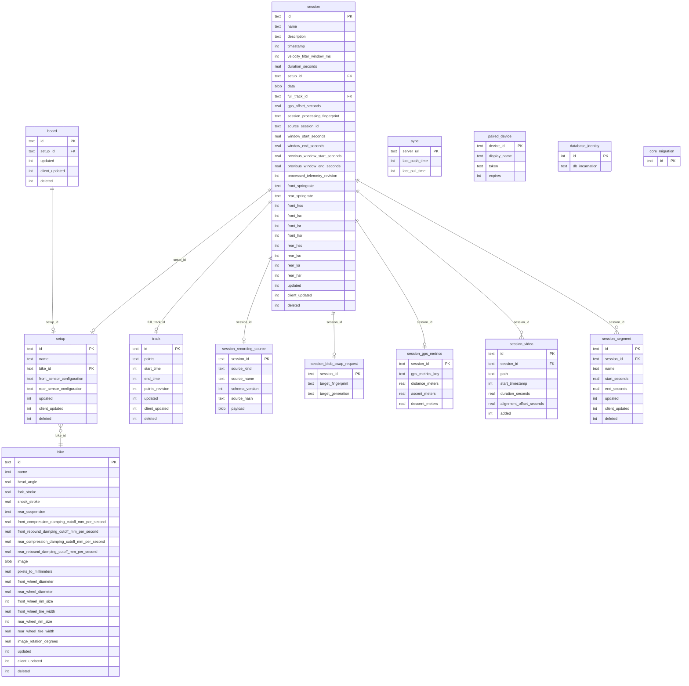

# Persistence & Serialization

> Part of the [Sufni.App architecture documentation](../ARCHITECTURE.md). This file covers the SQLite schema, the connection context, per-aggregate repositories, soft deletes, and conflict resolution semantics shared with [cross-device synchronization](sync.md).

## Schema

`database_identity` has one row (`id = 1`). The `database-incarnation`
core migration assigns its random `db_incarnation` once, including on existing
databases. Normal launches preserve it; creating a fresh database assigns a new
identity. Sync will use this identity to distinguish database resets.

`IStartupDatabase` exposes initialization and the reset file operation on the
connection context. Reset waits for initialization to settle, closes the
connection, and moves every remaining database/WAL/SHM file into a timestamped
sibling archive directory. SQLite may checkpoint and remove its sidecars on
close. The archive is retained; a separate connection creates the replacement
through the normal migration path and closes it. The existing context and its
consumers are not reinitialized; the replacement requires a new launch.

## SQLite Persistence Repositories

`SqliteConnectionContext` (`Sufni.App/Sufni.App/Infrastructure/SqliteConnectionContext.cs`) owns the single `SQLiteAsyncConnection` and the initialization gate. It receives the database path from the platform root (heads select `Environment.SpecialFolder.LocalApplicationData` + `Sufni.App/sst.db`) and starts `DatabaseMigrationRunner` through the background runner, which enables WAL mode, creates core tables, applies compatibility migrations/backfills and the derivation-window migration, performs startup cleanup, and applies the one-time track content migration.

The connection context supplies the injected clock to startup migrations.
Repositories and transaction runners receive `TimeProvider` for authored writes,
tombstones, merge timestamps and cleanup cutoffs. Transaction runners pass sampled timestamps into synchronous helpers; those
helpers do not read the wall clock.

The connection context is also the only app-owned transaction entry point for multi-statement repository writes. `RunInTransactionAsync(...)` awaits initialization, then delegates to sqlite-net's `RunInTransactionAsync(Action<SQLiteConnection>)`, so the connection/transaction lock is held for the whole callback. Transaction bodies use synchronous `SQLiteConnection` operations; raw `BEGIN TRANSACTION` / `COMMIT` / `ROLLBACK` statement sequences are not used.

Bike rows include presentation-owned damping speed cutoffs for front/rear compression and rebound. These values default to 200 mm/s, are synchronized and exported with the bike, and are backfilled on startup for legacy schemas. They are not session preferences and do not affect telemetry processing fingerprints.

Startup migration ensures bike rows use the single `rear_suspension` union JSON column. Legacy schemas with `rear_suspension_kind`, `linkage`, and/or `leverage_ratio` are backfilled into `RearSuspensionSpec` JSON, linkage shock stroke is reconciled against the bike-level `shock_stroke` column, draft rows preserve the selected mode when the payload is missing or unparseable, and the legacy columns are dropped after backfill.

The `session-domain-ownership` migration copies the launch snapshot's legacy
processing options into nullable `session.velocity_filter_window_ms`, without
changing authored timestamps or processed data. Its marker prevents later launches
from replaying old preferences over a newly authored option. Runtime preferences
and startup jobs no longer reset or recompute processing options. The same
migration drops the redundant `has_data` column and rewrites source hashes using
uncompressed SST content or live content without the setup display name. It preserves payloads, duplicate rows, session
ids and split references; stored processing fingerprints are left stale.

Startup migration does not repair or currentize stale `session_processing_fingerprint` values. Legacy, missing, malformed, or dependency-mismatched fingerprints remain classified as stale by the recorded-session projection so recompute can surface derived-data changes explicitly instead of silently rewriting fingerprint state at database initialization.

Persistence consumers inject narrow repository interfaces instead of a single database facade. `ISynchronizableRepository<T>` owns generic soft-delete CRUD for `Synchronizable` entities; `ISessionRepository`, `IRecordedSessionSourceRepository`, `ITrackRepository`, `ISessionVideoRepository`, `ISessionSegmentRepository`, and `IPairedDeviceRepository` own aggregate-specific operations and intent-specific projections; `ISyncDataStore` / `SynchronizationMergeEngine` owns sync timestamps, delta projection, remote apply, and merge conflict resolution. Read paths that only need ids, source snapshots, track payload metadata, full-track reference checks, or processing fingerprint inputs use those projections instead of loading whole aggregates or BLOB columns. `DatabaseMigrationRunner` is the only schema initializer/migrator, and repositories assume `SqliteConnectionContext` has run initialization before handing out the shared connection.

`DatabaseMigrationRunner` also ensures sync-delta indexes after core table
creation. Every `Synchronizable` table (`board`,
`bike`, `setup`, `session`, `track`, `session_segment`) has separate `updated` and `deleted`
indexes (`ix_<table>_updated`, `ix_<table>_deleted`) so `GetChangedAsync`
can scan changed rows and tombstones without a full table scan. Protocol v3
persists `sync.last_push_time` and `sync.last_pull_time` separately. Delta
projection is bounded to `(sinceExclusive, upperInclusive]` for both updates and
tombstones; the client deliberately subtracts one second from a positive cursor
when starting the next direction-specific snapshot, replaying the prior
whole-second bucket rather than losing rows that share its timestamp.

Two local-only revision columns identify exact payload generations without using
the sync-facing `Updated` timestamp: `session.processed_telemetry_revision` changes
when the processed BLOB or its fingerprint changes, and `track.points_revision`
changes when the full-track point payload changes. Startup migration normalizes both zero and
SQL-null legacy revisions to `1` for existing non-null payloads and to `0` when
the payload is absent, then drops every owned revision trigger and recreates the
current definitions. Trigger-level `WHEN` predicates avoid nested writes for
no-op watched assignments; effective content changes advance exactly one step,
and payload-aware fallback arithmetic prevents nullable legacy state from
remaining null after a watched write. An incoming revision assignment that
accompanies a watched write is restored or replaced by the SQLite-owned value.
These values are excluded from JSON/sync contracts and are not conflict versions.
Map and comparison readers now derive session windows from the selected full
track's exact points revision plus the window inputs. The session-window payload and its revision are not persisted or synced.

Repositories do not publish UI state. Workflow owners persist, prepare any
fresh database-computed snapshot fields, then publish through store writer
interfaces. Stores do not depend on repositories, perform writes, or classify
failures. Metadata save, GPS alignment and downloaded processed-data application
are owned by their session/track/sync workflows. Cross-aggregate SQL still runs
inside one `RunInTransactionAsync` callback before publication; sync endpoints
persist first and inbound appliers prepare and publish the resulting snapshots.

`ISynchronizableRepository<T>` operations on any `Synchronizable` subclass:

- `GetAllAsync<T>()` — returns all records where `Deleted == null`
- `GetChangedAsync<T>(long since)` — returns records where `Updated > since` OR (`Deleted != null` AND `Deleted > since`)
- `PutAsync<T>(item)` — upsert. Stamps `Updated = DateTimeOffset.UtcNow.ToUnixTimeSeconds()` and clears `Deleted` (resurrecting any tombstoned row with the same id).
- `DeleteAsync<T>(id)` — soft-deletes the row when it exists and is not already tombstoned.

`ISessionRepository` operations split metadata and processed-data handling, and store the values they are given: reprocessing produces a pure `ProcessedGeneration`, and import/live-save/recompute owners resolve track association and prepare the session before calling the repository. Incoming synchronized bytes are validated, prepared, committed and published by `SessionSyncApplier`. `session.data` is the authoritative local processed-telemetry cache; there is no separate `has_data` column. Metadata and sync-delta reads use `SessionMetadataRow`, projecting availability from `data IS NOT NULL` without selecting the BLOB. A payload-bearing `Session` derives `HasProcessedData` only from its loaded `ProcessedData`; metadata drafts carry no availability override. Persistence helpers map the declared entity schema, so projection-only fields cannot become writes. Duration remains a derived session column. GPS distance/ascent/descent and their input key live in device-local `session_gps_metrics`; metadata reads join that table without loading point JSON. The corresponding properties on `Session` are ignored by entity writes and JSON, and `SessionSnapshot` carries those joined values plus `GpsMetricsKey`. Metadata draft updates preserve `timestamp` and `gps_offset_seconds`; only creation/window editing sets the timestamp, and explicit alignment/window editing owns the offset. `gps_offset_seconds` is authored per-session state applied when deriving the session-window GPS track from a reusable full `Track`; it is stored on `session` rather than `track` because the same full ride track can back multiple recorded sessions or segments.

- `PutSessionAsync()` — updates user-authored session metadata columns and stamps `Updated`/`Deleted` like `PutAsync`. Existing derived summary metrics are preserved on metadata updates. Metadata SQL does not name the multi-megabyte `data` BLOB, so its fingerprint, linkage and local revision remain untouched. Soft-deleted-row reuse still restores the complete supplied aggregate through its dedicated insert/reuse path.
- `ImportProcessedSessionAsync(session, newFullTrack, source)` — classifies the recording and atomically inserts a new session, full track and source, or adds only the source to existing metadata. Duplicate source hashes preserve the existing recording. The returned session/source snapshots reflect the retained rows. Any failed write rolls back the transaction.
- `UpdateProcessedDerivedDataAsync(session, newFullTrack, expectedInputs)` — the recompute owner first validates its result fingerprint against a captured database input bundle. In one transaction the repository re-reads those scalar inputs and compares them with the expected bundle; a mismatch or missing dependency rolls back the generation and optional track together. On a match it writes only derived columns (`data`, fingerprint, duration, full-track id), preserving authored metadata and `updated`. The repository has no fingerprint-service dependency.
- `UpdateSessionPsstAsync(id, data, fingerprintJson, durationSeconds, expected)` — the legacy/fill write path. It atomically replaces the BLOB/fingerprint and supplied duration only while the stored fingerprint and telemetry revision match the captured guard. It preserves authored fields and never advances `updated`.
- `UpdateSessionProcessedGenerationAsync(id, data, fingerprintJson, generation, expected)` — the complete-generation swap path, with the same transaction guard. It replaces the BLOB, fingerprint, duration and full-track id together while preserving authored GPS alignment. Both write methods also compare the expected hub swap target and clear a matching request inside the successful write transaction; a replaced request or changed generation returns false without modifying any rows.
- `UpdateGpsAlignmentAsync(id, gpsOffsetSeconds)` — persists only the authored GPS offset, advancing `updated`; window points remain a read-time derivation.
- `GetSessionRawPsstAsync(id)` / `GetSessionRawPsstWithFingerprintAsync(id)` — return the latest raw MessagePack blob (sync transfer, consumer-side deserialization); the second also returns the fingerprint of those bytes so the session-data push can carry both. The revision-constrained `GetSessionRawPsstAsync(id, processedTelemetryRevision)` returns bytes only while that exact local payload generation still exists.
- `GetSessionsAsync()` / `GetSessionAsync(id)` / `GetActiveSessionIdsAsync()` / `GetIncompleteSessionIdsAsync()` / `GetIncompleteSessionIdsWithFingerprintAsync()` — metadata projections, active ids for recompute-all, ids of rows without processed data (the last pairs each id with its stored fingerprint as the session-data pull's download match target).
- `HasOtherActiveSessionWithFullTrackAsync(fullTrackId, excludingSessionId)` — a full-track reference projection used before deleting a previous generated track after recompute
- `GetProcessingInputBundleAsync(sessionId)` — a constrained join over session/setup/bike/source columns that builds the database-resident processing input bundle for transaction-time fingerprint checks without loading processed telemetry or source payload bytes

There is no `GetSessionPsstAsync` on the repository: consumers that need a `TelemetryData` fetch the raw blob and deserialize it themselves through `ISessionTelemetryProcessor`, so MessagePack knowledge stays out of the persistence layer.

`ISessionSyncApplier` (`Sessions/Coordination/SessionSyncApplier.cs`) owns incoming
processed generations on hub and client. `ApplyUploadedAsync` and
`ApplyDownloadedAsync` validate transferred MessagePack, submit the captured
fingerprint/revision guard, and publish the authoritative session after success.
Without a complete generation, they normalize the incoming duration and preserve
the current GPS metrics; they never reconstruct a session-window payload.
A complete generation supplies the accepted duration and full-track ID.
Invalid or superseded transfers leave persisted and published data unchanged.

`ITrackRepository.TryCommitGpsMetricsAsync` accepts a key and prepared GPS values.
Its transaction selects the current full track using the common overlap rule and
compares the complete current key before inserting/updating `session_gps_metrics`.
A changed window, selected track or deleted session rejects the write. Successful
metric writes never change `session.updated`. The table is not synchronized.

`ITrackRepository` owns track lookups: `FindTrackContainingTimestampAsync` resolves the session-window containment lookup — ordering by `(end_time - start_time)`, then `start_time`, then `id`, so the tightest covering window wins deterministically — and `GetTracksByIdsAsync` loads full track payloads for write-path metric derivation. `GetTracksByIdsAsync` chunks id lookups into raw `IN` queries of at most 500 ids and excludes soft-deleted rows. Read-only full-track display uses `GetTrackPayloadMetadataAsync(trackId)` followed by `GetTrackPayloadAsync(trackId, pointsRevision)`, so `IFullTrackPointReader` can cache deserialized point payloads by `(trackId, pointsRevision)` and retry once if the row changes between metadata and payload reads. Its exact-reader operation accepts a caller-supplied points revision and fails closed instead of substituting newer points. Session-to-track association is owned by the requesting import/live-save/recompute workflow, not the repository.

`IRecordedSessionSourceRepository` owns recorded-source rows:

- `GetRecordedSessionSourceAsync(id)` — load one full source payload
- `GetRecordedSessionSourceSnapshotsAsync()` / `GetRecordedSessionSourceSnapshotAsync(id)` — metadata-only source projections for stores and refreshes
- `GetSessionIdsMissingRecordedSourceAsync()` — returns non-deleted session ids whose recording source (`source_session_id`, or the session's own id) has no source row
- `GetMissingRecordingSourceIdsAsync()` — the same check, but returns the recording source ids instead of the session ids
- `GetReferencedSourceSessionIdsAsync()` — returns the distinct `source_session_id` values of live sessions that derive from another session's source
- `GetSourceBackedSessionIdsAsync()` — returns ids that currently own a recorded-source row without loading payload BLOBs; the source-sync query uses it to enumerate locally available source owners
- `DeleteOrphanedRecordedSessionSourcesAsync()` — in one transaction, removes source rows whose owner session no longer exists and that no live session references through `source_session_id`, and returns their ids
- `PutRecordedSessionSourceAsync(source)` — validates and inserts a source only when its session key is absent, returning the persisted metadata snapshot in the same transaction. An existing source retains its name, hash and payload. The processed-session transaction uses the same write-once insertion. Source deletion stays inside session transactions and orphan retention cleanup

`session_blob_swap_request` is local durable coordination state for the desktop
hub's push-direction processed-generation swaps. Each row stores the session id,
target fingerprint, and nullable serialized `SessionProcessedGeneration`; the
nullable column preserves compatibility with legacy fingerprint-only requests.
The merge engine inserts, replaces, or clears the request inside the same
transaction that accepts the corresponding deferred session metadata. Startup
adds the generation column when needed, removes requests for missing or
soft-deleted sessions, and recreates delete/soft-delete triggers that remove a
request with its owner session. Listing pending requests only reads the table; a
matching request is cleared after the validated generation write succeeds.

`session_video` links a local video file to a recorded session. It is local
state and is not synchronized. `ISessionVideoRepository` writes one row per
matched session in one transaction and updates the alignment offset. A clip is
live only while its session is live: `ISessionVideoRepository` reads the clips
of live sessions, and no delete cascades to clips. The unshipped private-video
copy migration is removed; its `session-video` marker remains recorded as applied. See [video.md](video.md).

`session_segment` holds saved segments: a name and a time range in seconds
from the session's telemetry start. It is a `Synchronizable` table. A segment
is live only while its session is live: `ISessionSegmentRepository` reads the
live segments of live sessions, and no delete cascades to segments. The unshipped
private-segment copy migration is removed; its `session-segment` marker remains recorded as applied. See [segments.md](segments.md).

The session derivation window lives on the session row. `source_session_id`,
`window_start_seconds`, and `window_end_seconds` describe the window; a null
`source_session_id` means the session uses its own source in full. The
`previous_window_*` columns keep the window before the last trim for undo.
These columns are synchronized with the session. Older builds stored trims and
splits in `private_session_source_range`. Startup copies them once
(`core_migration` id `session-derivation-window`): live rows that are not the
session's own full range are copied, then sessions without a range row take the
window stored in their processing fingerprint. The copy drops the range table.

After the derivation-window migration, startup drops `extension_schema_version`, the table
that held the schema versions of the old tables.

## JSON Serialization

`AppJson` (`Sufni.App/Sufni.App/Infrastructure/AppJson.cs`) centralizes System.Text.Json configuration behind a source-generated `AppJsonContext` and exposes two profiles:

- **Lenient** (`AppJson.Options` / `AppJson.Context`) — all local round-trips (entity, track, and preferences JSON columns; the processing dependency hash) and the entire sync client. Case-insensitive binding with a snake_case enum converter. Its output is deliberately **byte-stable**: `ProcessingDependencyHash` SHA-256s the `AppJson.Options`-serialized payload, so any change to the lenient options would silently invalidate every stored processing fingerprint. Treat the lenient profile as a wire/hash contract, not a tunable.
- **Hardened** (`AppJson.InboundOptions` / `AppJson.InboundContext`) — network-inbound deserialization on the desktop sync server only (the two `PATCH` session/source-data endpoints). Built from the .NET 10 `Strict` preset — reject duplicate keys and unmapped members, case-sensitive binding, required non-nullable members and constructor parameters — plus the same snake_case enum converter. Because the client always emits every snake_case key explicitly (including explicit nulls for optional members), well-formed first-party traffic is unaffected while malformed or truncated bodies are rejected at the trust boundary. See [Cross-Device Sync § Server](sync.md#server).

Bike persistence, sync, and export JSON carry `RearSuspensionSpec` union values, `LinkageSpec`, `LeverageRatioSpec`, and `WheelSpec`. Sync rows and schema-versioned bike export files require `rear_suspension`; missing unions, malformed unions, and the legacy `rear_suspension_kind` / `linkage` / `leverage_ratio` JSON triple are invalid outside the local SQLite startup migration. The pre-refactor mutable linkage classes are not serialization roots.

`ISessionRepository.ImportProcessedSessionAsync` performs the source-hash and
content-id classification inside the write transaction. An existing source hash
returns `AlreadyImported` without changing any rows. A live content-id session
with no source receives only the source row; its authored fields, clock and
processed data are preserved. If that retained row is soft-deleted, explicit
re-import restores the same id with the newly prepared recording, clears its
old window/deletion state and advances `Updated`, retaining `ClientUpdated`.
Revision triggers preserve payload-generation continuity. Restoration, source
insertion and the optional generated track commit or roll back together.
A new recording inserts those same values atomically. Concurrent imports therefore converge on one session, and
pre-upgrade random ids are retained when their source hash already exists.

## Soft Delete

`Synchronizable` entities (`Sufni.App/Sufni.App/SyncAndPairing/Models/Synchronizable.cs`) — `bike`, `setup`, `session`, `board`, `track`, `session_segment` — carry `Updated` (server timestamp), `ClientUpdated` (local timestamp), and nullable `Deleted` (soft delete timestamp). `paired_device`, `session_recording_source`, and `sync` are not `Synchronizable` and have their own lifecycles. The one-time `track-materializations` migration groups tracks by complete point
content, preserves an active row when one exists, and chooses the lowest old ID
within that state. It rekeys each survivor to its content ID and updates existing
session references without changing authored session clocks. Distinct points with
matching start/end times remain separate. Retained deleted rows with points are
rekeyed too; point-less tombstones keep their old identities. There is no per-launch track deduplication pass. The same migration drops
`session.track` and `track_projection_revision`, removes the retired revision
trigger, and rewrites queued generation JSON without the cached track or GPS metrics.
It copies legacy distance/ascent/descent into `session_gps_metrics` with an empty
key, then drops those columns from `session`. The old values remain visible until
the coordinator replaces them. Startup removes metric rows after their session
has been physically purged.

On database initialization, the `Cleanup()` pass permanently removes:

- `Synchronizable` rows with `Deleted` older than 1 day
- `session_segment` and `session_video` rows whose session row no longer exists
- `paired_device` rows whose `Expires` precedes the injected clock’s UTC time

Recorded-source orphan cleanup runs after initialization through
`RecordedSessionSourceRetentionCleanup`, not inside the schema cleanup pass. It
calls `DeleteOrphanedRecordedSessionSourcesAsync()`, which keeps every source
row that a live session references, and publishes the removed ids to the
recorded-source store. This lets a split/trimmed derived session keep using a source row whose
original owner session has been purged.

## Conflict Resolution

`MergeAsync<T>()` is invoked per entity inside the lock-held `MergeAllAsync(SynchronizationData)` transaction. It compares against a derived "content version" — `existing.ClientUpdated` if set, otherwise `existing.Updated` — so locally-authored rows that have not yet round-tripped through a sync still compare correctly.

The merge cases, in evaluation order:

1. **New entity** (not in local DB): persist with `ClientUpdated = entity.Updated`, `Updated = now`. Insert.
2. **Existing already locally deleted**: keep the local tombstone; if the remote tombstone is later (`entity.Deleted > existing.Deleted`), advance `existing.Deleted` to the remote value. Always bump `existing.Updated = now`. (No content is ever revived once locally deleted.)
3. **Remote delete with `entity.Deleted > existingContentVersion`**: accept the delete — set `existing.Deleted = entity.Deleted`, `existing.Updated = now`. (Note: `Updated` is set to *now*, not to the remote's `Updated`.)
4. **Stale remote delete** (`entity.Deleted <= existingContentVersion`): ignore the delete; only bump `existing.Updated = now`.
5. **Local wins** (`existingContentVersion > entity.Updated`): keep local content; bump `existing.Updated = now`.
6. **Remote wins** (otherwise): persist remote content with `ClientUpdated = entity.Updated`, `Updated = now`. Update.

This gives local client changes precedence in conflicts while accepting remote deletes that are newer than the local content.

Session merge accepts metadata, processed-generation fields, tuning fields, and `session_processing_fingerprint`, but it does not move the processed telemetry BLOB or raw recording source through `SynchronizationData`. Those payloads use the dedicated endpoints described in [Cross-Device Synchronization](sync.md). When the local row already holds a processed BLOB, both inbound merge paths defer the **whole processed generation** — fingerprint, duration and full-track id — while applying independent user metadata, including GPS alignment. Matching bytes and the accepted generation then move together through the session-data endpoint's [download-then-swap](sync.md#processed-blob-coherence-download-then-swap).
