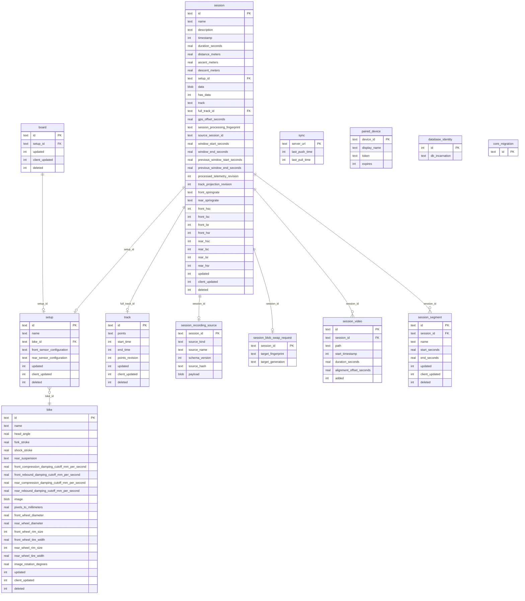

# Persistence & Serialization

> Part of the [Sufni.App architecture documentation](../ARCHITECTURE.md). This file covers the SQLite schema, the connection context, per-aggregate repositories, soft deletes, and conflict resolution semantics shared with [cross-device synchronization](sync.md).

## Schema

`database_identity` has one row (`id = 1`). The `database-incarnation`
core migration assigns its random `db_incarnation` once, including on existing
databases. Normal launches preserve it; creating a fresh database assigns a new
identity. Sync will use this identity to distinguish database resets.

`IStartupDatabase` exposes initialization and the reset file operation on the
connection context. Reset waits for initialization to settle, closes the
connection, and moves every remaining database/WAL/SHM file into a timestamped
sibling archive directory. SQLite may checkpoint and remove its sidecars on
close. The archive is retained; a separate connection creates the replacement
through the normal migration path and closes it. The existing context and its
consumers are not reinitialized; the replacement requires a new launch.

## SQLite Persistence Repositories

`SqliteConnectionContext` (`Sufni.App/Sufni.App/Infrastructure/SqliteConnectionContext.cs`) owns the single `SQLiteAsyncConnection` and the initialization gate. It receives the database path from the platform root (heads select `Environment.SpecialFolder.LocalApplicationData` + `Sufni.App/sst.db`) and starts `DatabaseMigrationRunner` through the background runner, which enables WAL mode, creates core tables, applies compatibility migrations/backfills and the derivation-window migration, performs startup cleanup, and repairs duplicate track ranges.

The connection context supplies the injected clock to startup migrations.
Repositories and transaction runners receive `TimeProvider` for authored writes,
tombstones, merge timestamps and cleanup cutoffs. Transaction runners pass sampled timestamps into synchronous helpers; those
helpers do not read the wall clock.

The connection context is also the only app-owned transaction entry point for multi-statement repository writes. `RunInTransactionAsync(...)` awaits initialization, then delegates to sqlite-net's `RunInTransactionAsync(Action<SQLiteConnection>)`, so the connection/transaction lock is held for the whole callback. Transaction bodies use synchronous `SQLiteConnection` operations; raw `BEGIN TRANSACTION` / `COMMIT` / `ROLLBACK` statement sequences are not used.

Bike rows include presentation-owned damping speed cutoffs for front/rear compression and rebound. These values default to 200 mm/s, are synchronized and exported with the bike, and are backfilled on startup for legacy schemas. They are not session preferences and do not affect telemetry processing fingerprints.

Startup migration ensures bike rows use the single `rear_suspension` union JSON column. Legacy schemas with `rear_suspension_kind`, `linkage`, and/or `leverage_ratio` are backfilled into `RearSuspensionSpec` JSON, linkage shock stroke is reconciled against the bike-level `shock_stroke` column, draft rows preserve the selected mode when the payload is missing or unparseable, and the legacy columns are dropped after backfill.

Startup schema migration no longer backfills `session_processing_fingerprint`.
Legacy processed rows are normalized by `ProcessingOptionsResetMigration`, the
post-initialization pass that recomputes source-backed sessions through the
normal recompute engine when needed. New source, derivation-window, or
dependency-hash mismatches remain stale so recompute can surface real
derived-data changes.

Startup migration does not repair or currentize stale `session_processing_fingerprint` values. Legacy, missing, malformed, or dependency-mismatched fingerprints remain classified as stale by the recorded-session projection so recompute can surface derived-data changes explicitly instead of silently rewriting fingerprint state at database initialization.

Persistence consumers inject narrow repository interfaces instead of a single database facade. `ISynchronizableRepository<T>` owns generic soft-delete CRUD for `Synchronizable` entities; `ISessionRepository`, `IRecordedSessionSourceRepository`, `ITrackRepository`, `ISessionVideoRepository`, `ISessionSegmentRepository`, and `IPairedDeviceRepository` own aggregate-specific operations and intent-specific projections; `ISyncDataStore` / `SynchronizationMergeEngine` owns sync timestamps, delta projection, remote apply, and merge conflict resolution. Read paths that only need ids, source snapshots, track payload metadata, full-track reference checks, or processing fingerprint inputs use those projections instead of loading whole aggregates or BLOB columns. `DatabaseMigrationRunner` is the only schema initializer/migrator, and repositories assume `SqliteConnectionContext` has run initialization before handing out the shared connection.

`DatabaseMigrationRunner` also ensures sync-delta indexes after core table
creation. Every `Synchronizable` table (`board`,
`bike`, `setup`, `session`, `track`, `session_segment`) has separate `updated` and `deleted`
indexes (`ix_<table>_updated`, `ix_<table>_deleted`) so `GetChangedAsync`
can scan changed rows and tombstones without a full table scan. Protocol v3
persists `sync.last_push_time` and `sync.last_pull_time` separately. Delta
projection is bounded to `(sinceExclusive, upperInclusive]` for both updates and
tombstones; the client deliberately subtracts one second from a positive cursor
when starting the next direction-specific snapshot, replaying the prior
whole-second bucket rather than losing rows that share its timestamp.

Three local-only revision columns identify the exact payload generation without
using the sync-facing `Updated` timestamp: `session.processed_telemetry_revision`
changes when the processed BLOB or its fingerprint changes,
`session.track_projection_revision` changes when the cached session-window track
or any of its projection inputs changes, and `track.points_revision` changes when
the full-track point payload changes. Startup migration normalizes both zero and
SQL-null legacy revisions to `1` for existing non-null payloads and to `0` when
the payload is absent, then drops every owned revision trigger and recreates the
current definitions. Trigger-level `WHEN` predicates avoid nested writes for
no-op watched assignments; effective content changes advance exactly one step,
and payload-aware fallback arithmetic prevents nullable legacy state from
remaining null after a watched write. An incoming revision assignment that
accompanies a watched write is restored or replaced by the SQLite-owned value.
These values are excluded from JSON/sync contracts; they are local
cache/read-coherence keys, not conflict versions.

Repositories do not publish UI state. The reactive boundary above SQLite is the
store writer layer: single-aggregate commit methods call repositories, re-read
the persisted snapshot when needed, and publish through the store cache;
publish-only writer methods re-read or remove cache entries after another owner
has already changed persistence. Cross-aggregate workflows such as setup import,
session delete, and processed-session save run all SQL rows in one
`RunInTransactionAsync` callback, then publish each affected store only after
the transaction commits. Sync merge and server endpoint handlers likewise change
SQLite first; inbound coordinators, appliers, or `IAppDataRefresher` then
use publish-only writer paths to reflect those already-persisted rows.

`ISynchronizableRepository<T>` operations on any `Synchronizable` subclass:

- `GetAllAsync<T>()` — returns all records where `Deleted == null`
- `GetChangedAsync<T>(long since)` — returns records where `Updated > since` OR (`Deleted != null` AND `Deleted > since`)
- `PutAsync<T>(item)` — upsert. Stamps `Updated = DateTimeOffset.UtcNow.ToUnixTimeSeconds()` and clears `Deleted` (resurrecting any tombstoned row with the same id).
- `DeleteAsync<T>(id)` — soft-deletes the row when it exists and is not already tombstoned.

`ISessionRepository` operations split metadata and processed-data handling, and store the values they are given: telemetry validation, summary-metric derivation, and session-window track association/generation happen in `SessionTelemetryWriter` before the repository is called. `session.data` is the authoritative local processed-telemetry cache; `session.has_data` remains in the row for schema compatibility and snapshot projection, but session reads derive the availability flag from `data IS NOT NULL` so the flag cannot drift away from the blob. Nullable summary columns (`duration_seconds`, `distance_meters`, `ascent_meters`, `descent_meters`) are derived list-summary cache values, not user-authored session metadata. `gps_offset_seconds` is per-session state applied when deriving the cached session-window GPS track from a reusable full `Track`; it is stored on `session` rather than `track` because the same full ride track can back multiple recorded sessions or segments.

- `PutSessionAsync()` — updates user-authored session metadata columns and stamps `Updated`/`Deleted` like `PutAsync`. Existing derived summary metrics are preserved on metadata updates. Metadata SQL does not name the multi-megabyte `data` BLOB or cached `track` JSON at all, so those processed-write-owned payloads, their fingerprint/linkage, and their local revisions remain untouched. Soft-deleted-row reuse still restores the complete supplied aggregate through its dedicated insert/reuse path.
- `PutProcessedSessionAsync(session, newFullTrack, source)` — persists a processed session in one lock-held `RunInTransactionAsync` callback. It writes a new full `Track` when supplied, stamps `session.full_track_id`, writes all session metadata plus `data`, `session_processing_fingerprint`, and the summary-metric values already set on the session, and optionally inserts/replaces the matching `RecordedSessionSource`. If any write fails, the session, full-track, and source write roll back together.
- `UpdateProcessedDerivedDataAsync(session, newFullTrack, expectedInputFingerprint)` — the derived-only write used by recorded-session recompute. In one lock-held transaction it re-reads the row, recomputes the **DB-input** part of the processing fingerprint from the freshly read setup/bike/source/version state, and compares it to `expectedInputFingerprint`; on a mismatch (a passive dependency change) it rolls back and returns `null`. When the expected fingerprint carries a derivation window, the source row is resolved by `DerivationWindow.SourceSessionId` rather than by the session id. The preference-stored processing option is deliberately **not** re-checked here — it is not a DB column and is guarded by the recompute engine's commit-time check. On a match it writes **only** the derived columns (`data`, `session_processing_fingerprint`, the four summary metrics, cached `track`, `full_track_id`), optionally inserts `newFullTrack`, stamps `updated`, and never touches user-metadata columns, returning the fresh row.
- `UpdateSessionPsstAsync(id, data, fingerprintJson, metrics)` — the legacy/fill write path: overwrites the BLOB-bound pair (`data` and `session_processing_fingerprint`) plus supplied summary metrics on a non-deleted row, with **no `updated` bump** so a sync swap/fill creates no metadata-sync feedback edge; the values arrive pre-validated/pre-computed from `SessionTelemetryWriter`
- `UpdateSessionProcessedGenerationAsync(id, data, fingerprintJson, generation)` — the generation-aware swap path. One SQLite `UPDATE` replaces `data`, fingerprint, all four summary metrics, `full_track_id`, normalized `gps_offset_seconds`, and cached `track` together, again without an `updated` bump. The caller validates the transferred MessagePack before this statement, so an invalid payload cannot partially install metadata from the target generation.
- `UpdateSessionTrackAsync(id, points, metrics, gpsOffsetSeconds?)` — replaces the cached session-window `track` JSON and the supplied summary metrics, optionally updates the per-session GPS offset, and stamps `updated`; callers that omit the offset preserve the existing `gps_offset_seconds`
- `GetSessionRawPsstAsync(id)` / `GetSessionRawPsstWithFingerprintAsync(id)` — return the latest raw MessagePack blob (sync transfer, consumer-side deserialization); the second also returns the fingerprint of those bytes so the session-data push can carry both. The revision-constrained `GetSessionRawPsstAsync(id, processedTelemetryRevision)` returns bytes only while that exact local payload generation still exists.
- `GetSessionsAsync()` / `GetSessionAsync(id)` / `GetActiveSessionIdsAsync()` / `GetSessionTrackAsync(id)` / `GetIncompleteSessionIdsAsync()` / `GetIncompleteSessionIdsWithFingerprintAsync()` — metadata projections, active ids for recompute-all, latest cached session-window track points, and ids of rows without processed data (the last pairs each id with its stored fingerprint as the session-data pull's download match target). The revision-constrained `GetSessionTrackAsync(id, trackProjectionRevision)` likewise returns no value rather than advancing to a newer projection.
- `HasOtherActiveSessionWithFullTrackAsync(fullTrackId, excludingSessionId)` — a full-track reference projection used before deleting a previous generated track after recompute
- `GetProcessingInputBundleAsync(sessionId)` — a constrained join over session/setup/bike/source columns that builds the database-resident processing input bundle for transaction-time fingerprint checks without loading processed telemetry or source payload bytes

There is no `GetSessionPsstAsync` on the repository: consumers that need a `TelemetryData` fetch the raw blob and deserialize it themselves through `ISessionTelemetryProcessor`, so MessagePack knowledge stays out of the persistence layer.

`ISessionTelemetryWriter` (`Sufni.App/Sufni.App/Sessions/Processing/Services/SessionTelemetryWriter.cs`) sits in front of `ISessionRepository` for processed-data writes and owns the domain computation that precedes persistence:

- `PutProcessedSessionAsync` / `UpdateProcessedDerivedDataAsync` — prepare the session, then delegate to the matching repository transaction. Preparation links a session without a `full_track_id` to an active track whose `[start_time, end_time]` window contains the session timestamp (`ITrackRepository.FindTrackContainingTimestampAsync`), derives `duration_seconds` from the processed telemetry metadata, derives GPS distance/ascent/descent from the session-window points (the supplied generated track, or points regenerated from the linked full track), **and now persists those resolved points as the cached session-window `track`** so import, live-save, and recompute all store the polyline at derivation time instead of through a later lazy load-path patch.
- `PatchSessionPsstAsync(id, bytes, fingerprint)` — the **hub fill sink**. It rejects an `InvalidDataException` (mapped to a sync 400) when the fingerprint does not ordinal-match the row's stored `session_processing_fingerprint`; it then deserializes the MessagePack before any repository write. On acceptance it refreshes `duration_seconds` from the blob, preserves existing GPS metrics unless a cached session-window track allows recomputation, and writes through `UpdateSessionPsstAsync`.
- `SwapSessionPsstAsync(id, bytes, fingerprint)` — the legacy/fingerprint-only **sync swap commit**. The caller has already matched the downloaded fingerprint against its target; the writer validates MessagePack, recomputes metrics, and overwrites the row's blob and fingerprint coherently.
- `SwapSessionPsstAsync(id, bytes, fingerprint, generation)` — the protocol-v3 generation commit. It validates MessagePack first, then delegates to `UpdateSessionProcessedGenerationAsync` so the blob, fingerprint, summary metrics, full-track linkage, GPS offset, and cached track swap atomically. See [download-then-swap](sync.md#processed-blob-coherence-download-then-swap).
- `PatchSessionTrackAsync(id, points, gpsOffsetSeconds?)` — recomputes GPS distance/ascent/descent from the supplied projected points and the persisted `duration_seconds` column when it is present. For legacy rows where `duration_seconds` is null but the processed BLOB exists, it reads only the BLOB duration before deriving metrics so a GPS/track edit does not erase the session duration. It then calls `UpdateSessionTrackAsync`, passing a GPS offset only when the caller is intentionally realigning the session-window GPS segment.

`ITrackRepository` owns track lookups: `FindTrackByTimeRangeAsync(startTime, endTime)` returns the active track whose cached `start_time` and `end_time` exactly match the supplied values (GPX import uses this to skip already-imported tracks before writing), `FindTrackContainingTimestampAsync` resolves the session-window containment lookup — ordering by `(end_time - start_time)`, then `start_time`, then `id`, so the tightest covering window wins deterministically — and `GetTracksByIdsAsync` loads full track payloads for write-path metric derivation. `GetTracksByIdsAsync` chunks id lookups into raw `IN` queries of at most 500 ids and excludes soft-deleted rows. Read-only full-track display uses `GetTrackPayloadMetadataAsync(trackId)` followed by `GetTrackPayloadAsync(trackId, pointsRevision)`, so `IFullTrackPointReader` can cache deserialized point payloads by `(trackId, pointsRevision)` and retry once if the row changes between metadata and payload reads. Its exact-reader operation accepts a caller-supplied points revision and fails closed instead of substituting newer points. Session-to-track association is owned by the processed-write pipeline (`ISessionTelemetryWriter`), not the repository.

`IRecordedSessionSourceRepository` owns recorded-source rows:

- `GetRecordedSessionSourceAsync(id)` — load one full source payload
- `GetRecordedSessionSourceSnapshotsAsync()` / `GetRecordedSessionSourceSnapshotAsync(id)` — metadata-only source projections for stores and refreshes
- `GetSessionIdsMissingRecordedSourceAsync()` — returns non-deleted session ids whose recording source (`source_session_id`, or the session's own id) has no source row, or whose source row hash differs from the persisted processing fingerprint's `SourceHash`
- `GetMissingRecordingSourceIdsAsync()` — the same check, but returns the recording source ids instead of the session ids
- `GetReferencedSourceSessionIdsAsync()` — returns the distinct `source_session_id` values of live sessions that derive from another session's source
- `GetSourceBackedSessionIdsAsync()` — returns ids that currently own a recorded-source row without loading payload BLOBs; startup normalization uses it to enumerate recomputable source-backed sessions
- `DeleteOrphanedRecordedSessionSourcesAsync()` — in one transaction, removes source rows whose owner session no longer exists and that no live session references through `source_session_id`, and returns their ids
- `PutRecordedSessionSourceAsync(source)` — insert/replace a recorded source outside the processed-session transaction for source sync; source deletion stays inside session transactions and orphan retention cleanup

`session_blob_swap_request` is local durable coordination state for the desktop
hub's push-direction processed-generation swaps. Each row stores the session id,
target fingerprint, and nullable serialized `SessionProcessedGeneration`; the
nullable column preserves compatibility with legacy fingerprint-only requests.
The merge engine inserts, replaces, or clears the request inside the same
transaction that accepts the corresponding deferred session metadata. Startup
adds the generation column when needed, removes requests for missing or
soft-deleted sessions, and recreates delete/soft-delete triggers that remove a
request with its owner session. Listing pending requests only reads the table; a
matching request is cleared after the validated generation write succeeds.

`session_video` links a local video file to a recorded session. It is local
state and is not synchronized. `ISessionVideoRepository` writes one row per
matched session in one transaction and updates the alignment offset. A clip is
live only while its session is live: `ISessionVideoRepository` reads the clips
of live sessions, and no delete cascades to clips. The unshipped private-video
copy migration is removed; its `session-video` marker remains recorded as applied. See [video.md](video.md).

`session_segment` holds saved segments: a name and a time range in seconds
from the session's telemetry start. It is a `Synchronizable` table. A segment
is live only while its session is live: `ISessionSegmentRepository` reads the
live segments of live sessions, and no delete cascades to segments. The unshipped
private-segment copy migration is removed; its `session-segment` marker remains recorded as applied. See [segments.md](segments.md).

The session derivation window lives on the session row. `source_session_id`,
`window_start_seconds`, and `window_end_seconds` describe the window; a null
`source_session_id` means the session uses its own source in full. The
`previous_window_*` columns keep the window before the last trim for undo.
These columns are synchronized with the session. Older builds stored trims and
splits in `private_session_source_range`. Startup copies them once
(`core_migration` id `session-derivation-window`): live rows that are not the
session's own full range are copied, then sessions without a range row take the
window stored in their processing fingerprint. The copy drops the range table.

After the derivation-window migration, startup drops `extension_schema_version`, the table
that held the schema versions of the old tables.

## JSON Serialization

`AppJson` (`Sufni.App/Sufni.App/Infrastructure/AppJson.cs`) centralizes System.Text.Json configuration behind a source-generated `AppJsonContext` and exposes two profiles:

- **Lenient** (`AppJson.Options` / `AppJson.Context`) — all local round-trips (entity, track, and preferences JSON columns; the processing dependency hash) and the entire sync client. Case-insensitive binding with a snake_case enum converter. Its output is deliberately **byte-stable**: `ProcessingDependencyHash` SHA-256s the `AppJson.Options`-serialized payload, so any change to the lenient options would silently invalidate every stored processing fingerprint. Treat the lenient profile as a wire/hash contract, not a tunable.
- **Hardened** (`AppJson.InboundOptions` / `AppJson.InboundContext`) — network-inbound deserialization on the desktop sync server only (the two `PATCH` session/source-data endpoints). Built from the .NET 10 `Strict` preset — reject duplicate keys and unmapped members, case-sensitive binding, required non-nullable members and constructor parameters — plus the same snake_case enum converter. Because the client always emits every snake_case key explicitly (including explicit nulls for optional members), well-formed first-party traffic is unaffected while malformed or truncated bodies are rejected at the trust boundary. See [Cross-Device Sync § Server](sync.md#server).

Bike persistence, sync, and export JSON carry `RearSuspensionSpec` union values, `LinkageSpec`, `LeverageRatioSpec`, and `WheelSpec`. Sync rows and schema-versioned bike export files require `rear_suspension`; missing unions, malformed unions, and the legacy `rear_suspension_kind` / `linkage` / `leverage_ratio` JSON triple are invalid outside the local SQLite startup migration. The pre-refactor mutable linkage classes are not serialization roots.

## Soft Delete

`Synchronizable` entities (`Sufni.App/Sufni.App/SyncAndPairing/Models/Synchronizable.cs`) — `bike`, `setup`, `session`, `board`, `track`, `session_segment` — carry `Updated` (server timestamp), `ClientUpdated` (local timestamp), and nullable `Deleted` (soft delete timestamp). `paired_device`, `session_recording_source`, and `sync` are not `Synchronizable` and have their own lifecycles. Startup cleanup also soft-deletes duplicate active tracks that share the same cached start/end seconds, keeps one canonical row, repoints non-deleted sessions to it, and clears affected cached session-window tracks so they regenerate from the canonical full track.

On database initialization, the `Cleanup()` pass permanently removes:

- `Synchronizable` rows with `Deleted` older than 1 day
- `session_segment` and `session_video` rows whose session row no longer exists
- `paired_device` rows whose `Expires` precedes the injected clock’s UTC time

Recorded-source orphan cleanup runs after initialization through
`RecordedSessionSourceRetentionCleanup`, not inside the schema cleanup pass. It
calls `DeleteOrphanedRecordedSessionSourcesAsync()`, which keeps every source
row that a live session references, and publishes the removed ids to the
recorded-source store. This lets a split/trimmed derived session keep using a source row whose
original owner session has been purged.

## Conflict Resolution

`MergeAsync<T>()` is invoked per entity inside the lock-held `MergeAllAsync(SynchronizationData)` transaction. It compares against a derived "content version" — `existing.ClientUpdated` if set, otherwise `existing.Updated` — so locally-authored rows that have not yet round-tripped through a sync still compare correctly.

The merge cases, in evaluation order:

1. **New entity** (not in local DB): persist with `ClientUpdated = entity.Updated`, `Updated = now`. Insert.
2. **Existing already locally deleted**: keep the local tombstone; if the remote tombstone is later (`entity.Deleted > existing.Deleted`), advance `existing.Deleted` to the remote value. Always bump `existing.Updated = now`. (No content is ever revived once locally deleted.)
3. **Remote delete with `entity.Deleted > existingContentVersion`**: accept the delete — set `existing.Deleted = entity.Deleted`, `existing.Updated = now`. (Note: `Updated` is set to *now*, not to the remote's `Updated`.)
4. **Stale remote delete** (`entity.Deleted <= existingContentVersion`): ignore the delete; only bump `existing.Updated = now`.
5. **Local wins** (`existingContentVersion > entity.Updated`): keep local content; bump `existing.Updated = now`.
6. **Remote wins** (otherwise): persist remote content with `ClientUpdated = entity.Updated`, `Updated = now`. Update.

This gives local client changes precedence in conflicts while accepting remote deletes that are newer than the local content.

Session merge accepts metadata, processed-generation fields, tuning fields, and `session_processing_fingerprint`, but it does not move the processed telemetry BLOB or raw recording source through `SynchronizationData`. Those payloads use the dedicated endpoints described in [Cross-Device Synchronization](sync.md). When the local row already holds a processed BLOB, both inbound merge paths defer the **whole processed generation** — fingerprint, four summary metrics, full-track id, GPS offset, and cached session-window track — while applying independent user metadata. Matching bytes and the accepted generation then move together through the session-data endpoint's [download-then-swap](sync.md#processed-blob-coherence-download-then-swap).
