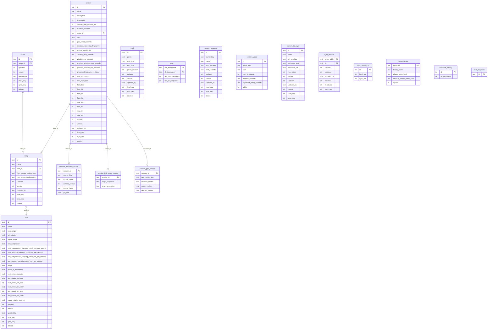

# Persistence & Serialization

> Part of the [Sufni.App architecture documentation](../ARCHITECTURE.md). This file covers the SQLite schema, the connection context, per-aggregate repositories, soft deletes, and conflict resolution semantics shared with [cross-device synchronization](sync.md).

## Schema

`database_identity` has one row (`id = 1`). The `database-incarnation` core migration assigns its random `db_incarnation` once, also on an existing database. Normal launches keep it, and a fresh database gets a new identity. Pairing, refresh and run-start responses carry this identity, so sync cursors detect a database reset. Run-start verifies it before a transfer uses a cursor.

`IStartupDatabase` exposes initialization and reset on the connection context. Reset waits for initialization to settle and closes the connection. It then moves every remaining database, WAL and SHM file into a timestamped sibling archive directory. SQLite can checkpoint and remove its sidecars on close. The archive is kept. A separate connection creates the replacement through the normal migration path and closes it. The existing context and its consumers stay unchanged; the replacement takes effect at the next launch.

On an older database, the `sync-authority` migration:

- sets `version = 1` and an empty unknown-writer `updated_by`, keeps authored `updated`, and allocates initial `local_seq` and `sync_seq` values;
- copies current tombstones into `sync_deletion` before payload cleanup, and creates `sync_sequence`, which holds the two transactionally allocated counters;
- copies legacy custom map layers from preferences into `custom_tile_layer`;
- hashes legacy paired-device refresh tokens and drops the plaintext `token` column;
- drops `client_updated` and recreates the `sync` cursor table, so the next exchange is a full baseline.

After migration, startup rewrites the preference document. It keeps the selected layer and other device-local values, and removes custom definitions and the old sync clock. The migration marker stops stale preferences from overwriting later layer edits. Refresh-token rotation atomically compares the presented hash and updates expiry. It keeps the previous hash for one recovery use until the client uses the new refresh token.

Every local authored write sets its row version above both the payload and ledger versions. It also stamps the shared installation identity and advances sequences. Derived generation writes advance sequences but keep version, timestamp and writer. GPS metric writes stay local and advance nothing. A delete writes the payload tombstone and the ledger entry atomically. Ledger entries are never purged; an explicit restore writes a version above them.

Hub and client use the same authored-history merge rule. Push selects by `local_seq` and pull selects by `sync_seq`, including deletion-ledger entries. Cursors are keyed by `(hub_thumbprint, db_incarnation)`. Each direction updates its own column atomically and leaves the other unchanged. An unseen hub or incarnation starts at zero, independent of its network address. Explicit pairing clears all cursors before it accepts new credentials, so a re-pair to the same hub also starts a baseline.

## SQLite Persistence Repositories

The composition root gives `SqliteConnectionContext` (`Sufni.App/Sufni.App/Infrastructure/SqliteConnectionContext.cs`) one schema initializer. `DatabaseMigrationRunner.cs` sits beside that root, composes the schema across slices, and is the only schema initializer and migrator. The context owns the single `SQLiteAsyncConnection`, the initialization gate, connection lifetime and archive/reset. Reset runs the same initializer on a fresh connection. `SyncAndPairing/Services/PersistenceGuards` holds the synchronized-row checks that repositories and the merge engine share.

The context receives a `SQLiteConnectionString` from the platform root. The heads select `Environment.SpecialFolder.LocalApplicationData` + `Sufni.App/sst.db`. The context starts `DatabaseMigrationRunner` through the background runner. The runner enables WAL mode, creates core tables, applies column backfills and the core migrations, and then runs startup cleanup.

Startup migrations and cleanup use the injected clock. Repositories and transaction runners receive `TimeProvider` for authored writes, tombstones, merge timestamps and cleanup cutoffs. Transaction runners pass sampled timestamps into synchronous helpers; those helpers never read the wall clock.

The connection context is the only app-owned transaction entry point for multi-statement repository writes. `RunInTransactionAsync(...)` awaits initialization and delegates to sqlite-net's `RunInTransactionAsync(Action<SQLiteConnection>)`. The connection and transaction lock is therefore held for the whole callback. Transaction bodies use synchronous `SQLiteConnection` operations. The app never issues raw `BEGIN TRANSACTION` / `COMMIT` / `ROLLBACK` statement sequences.

`SetupPersistenceTransactionRunner` checks that the setup's bike exists before a save writes; a missing or deleted bike returns `BikeMissing` without writing. Import writes its embedded bike in the same transaction. The runner checks board ownership before save/import writes. An occupied board returns `BoardInUse` without changing the setup, bike or board rows. Reassignment and deletion clear the previous board only if its active owner is still the setup being changed. An already-correct assignment does not advance the board version. Setup deletion checks active session references in the same transaction and returns `InUse` without deleting or clearing associations. Successful writes return only changed board IDs for coherent store publication. `BikePersistenceTransactionRunner` checks active setup references in the bike delete transaction and returns `InUse` without deleting the bike.

Bike rows hold presentation-owned damping speed cutoffs for front/rear compression and rebound. They default to 200 mm/s and are synchronized and exported with the bike. Startup fills missing values on older databases. They are not session preferences and do not affect telemetry processing fingerprints.

Bike rows store the rear suspension in the single `rear_suspension` union JSON column. On an older database, startup converts `rear_suspension_kind`, `linkage` and `leverage_ratio` into `RearSuspensionSpec` JSON and then drops those columns. It reconciles the linkage shock stroke with the bike-level `shock_stroke` column. A draft row keeps its selected mode when the payload is missing or unparseable.

On an older database, the `session-domain-ownership` migration:

- copies the legacy processing option from the launch preferences into a null `session.velocity_filter_window_ms`, without changing authored timestamps or processed data; its marker stops later launches from replaying old preferences;
- drops the redundant `has_data` column;
- rewrites source hashes from uncompressed SST content, or from live content without the setup display name. Payloads, duplicate rows, session ids and split references stay unchanged, and stored processing fingerprints stay stale.

Startup never repairs or updates a stale `session_processing_fingerprint`. The recorded-session projection classifies legacy, missing, malformed or dependency-mismatched fingerprints as stale. Recompute then surfaces the derived-data change explicitly.

Persistence consumers inject narrow repository interfaces, not one database facade:

- `ISynchronizableRepository<T>` owns generic soft-delete CRUD for `Synchronizable` entities.
- `ISessionRepository`, `IRecordedSessionSourceRepository`, `ITrackRepository`, `ISessionVideoRepository`, `ISessionSegmentRepository` and `IPairedDeviceRepository` own aggregate operations and intent-specific projections.
- `ISyncDataStore` / `SynchronizationMergeEngine` owns sync sequences and cursors, delta projection, remote apply and merge conflict resolution.

Read paths that need only ids, source snapshots, track payload metadata, full-track reference checks or processing inputs use those projections. They do not load whole aggregates or BLOB columns. Repositories assume that `SqliteConnectionContext` has run initialization before it hands out the shared connection.

The `sync-authority` migration creates `local_seq` and `sync_seq` indexes on every synced table and on the deletion ledger. Startup also maintains `updated` and `deleted` indexes. Delta projection is bounded to `(sinceExclusive, upperInclusive]`. `sync.last_push_sequence` and `sync.last_pull_sequence` advance independently. A run captures its push bound before any network work. The next run selects a concurrent edit beyond that bound.

Two local-only revision columns identify exact payload generations without the sync-facing `Updated` timestamp:

- `session.processed_telemetry_revision` changes when the processed BLOB or its fingerprint changes.
- `track.points_revision` changes when the full-track point payload changes.

Startup sets a zero or null revision to `1` when the payload exists and to `0` when it is absent. It then drops every owned revision trigger and recreates the current definitions. Trigger `WHEN` predicates skip no-op watched writes, so an effective content change advances exactly one step. Payload-aware fallback arithmetic stops a null legacy revision from staying null after a watched write. SQLite restores or replaces an incoming revision assignment that comes with a watched write. JSON and sync contracts exclude these values, and they are not conflict versions. Map and comparison readers derive session windows from the selected full track's points revision and the window inputs. The session-window payload and its revision are never persisted or synced.

`ISessionRepository.GetImportCheckpointAsync(sourceHash)` reads source and session metadata without BLOBs. A restarted import uses it to republish a committed recording without processing or writing it again. `ImportProcessedSessionAsync` still classifies atomically, so a checkpoint miss never replaces the transactional duplicate guard.

Repositories do not publish UI state. Workflow owners persist, prepare any fresh database-computed snapshot fields, and then publish through store writer interfaces. Stores do not depend on repositories, perform writes or classify failures. Session, track and sync workflows own metadata save, GPS alignment and downloaded processed-data application. Cross-aggregate SQL runs inside one `RunInTransactionAsync` callback before publication. Sync endpoints persist first; inbound appliers then prepare and publish the resulting snapshots.

`ISynchronizableRepository<T>` operations on any `Synchronizable` subclass:

- `GetAllAsync()` / `GetAsync(id)` — return all records, or one record, where `Deleted == null`.
- `GetChangedAsync(sinceExclusive, upperInclusive)` — returns records whose `local_seq` is in that bounded range, including retained tombstones.
- `PutAsync(item)` — upsert. Advances the authored version above both the current row and its deletion ledger, stamps the injected clock's UTC seconds and the installation writer identity, assigns transport sequences, and clears `Deleted`. This restores a tombstoned or purged identity.
- `DeleteAsync(id)` / `DeleteAsync(item)` — stamps an authored deletion and writes its durable ledger entry when the row exists and is not already tombstoned.

`ISessionRepository` separates metadata from processed data and stores the values it is given:

- Reprocessing produces a pure `ProcessedGeneration`. Import, live-save and recompute owners prepare the optional content track and the session before they call the repository.
- `SessionSyncApplier` validates, prepares, commits and publishes incoming synchronized bytes.
- `session.data` is the authoritative local processed-telemetry cache. Metadata and sync-delta reads use `SessionMetadataRow`, which projects availability from `data IS NOT NULL` without selecting the BLOB.
- A payload-bearing `Session` derives `HasProcessedData` only from its loaded `ProcessedData`. Metadata drafts carry no availability override.
- Persistence helpers map the declared entity schema, so projection-only fields cannot become writes. Duration is a derived session column.
- Device-local `session_gps_metrics` holds GPS distance, ascent, descent and their input key. Metadata reads join it without loading point JSON. Entity writes and JSON ignore the matching `Session` properties. `SessionSnapshot` carries the joined values and `GpsMetricsKey`.
- Metadata draft updates preserve `timestamp` and `gps_offset_seconds`. Only creation and window editing set the timestamp; the explicit alignment command owns the offset. Split copies the current alignment to the new session; trim and undo keep it.
- `gps_offset_seconds` is authored per-session state. It applies when the session-window GPS track is derived from a reusable full `Track`. It lives on `session`, not `track`, because one full ride track can back several recorded sessions or segments.

Operations:

- `PutSessionAsync()` — updates user-authored metadata columns, stamps the authored write like `PutAsync` and clears `Deleted`. It preserves processing options, GPS alignment, timestamps and derived summary metrics; their own commands own those writes. Metadata SQL never names the `data` BLOB, so fingerprint, linkage and local revision stay untouched. A session id that has no row is inserted with the complete supplied aggregate. A soft-deleted row receives the same metadata update.
- `SetProcessingOptionAsync(id, windowMilliseconds)` / `RestoreProcessingOptionAsync(id, expectedWindowMilliseconds, previousWindowMilliseconds)` — write only `velocity_filter_window_ms` as an authored change. The restore applies only while the stored value equals the expected value.
- `ImportProcessedSessionAsync(session, newFullTrack, source)` — classifies by source hash and content id inside the write transaction and returns `Inserted` or `Exists`:
  - An existing source hash returns `Exists` without changing any rows; the coordinator reports `AlreadyImported`.
  - A live content-id session without a source receives only the source row. Its authored fields, clock and processed data stay unchanged.
  - A soft-deleted content-id session is restored with the newly prepared recording. The import clears its old window and deletion state and advances its authored version beyond the ledger. Revision triggers keep payload-generation continuity.
  - A new recording inserts session, full track and source atomically.
  - Any failed write rolls back the whole transaction. Concurrent imports therefore converge on one session, and older random ids stay when their source hash already exists.
- `UpdateProcessedDerivedDataAsync(session, newFullTrack, expectedInputs)` — the recompute owner validates its result fingerprint against a captured database input bundle. In one transaction the repository re-reads those scalar inputs and compares them with the bundle. A mismatch or missing dependency rolls back the generation and the optional track together. On a match it writes only `data`, fingerprint and duration, and preserves authored metadata and `updated`. The repository has no fingerprint-service dependency.
- `UpdateSessionPsstAsync(id, data, fingerprintJson, durationSeconds, expected)` — the missing-BLOB fill. It atomically replaces the BLOB, fingerprint and supplied duration only while the stored fingerprint and telemetry revision match the captured guard. It preserves authored fields and never advances `updated`.
- `UpdateSessionProcessedGenerationAsync(id, data, fingerprintJson, generation, expected)` — the complete-generation swap, with the same guard. It replaces BLOB, fingerprint and duration together and preserves authored GPS alignment. Both guarded writes also compare the expected hub swap target and clear a matching request in the same transaction. A replaced request or changed generation returns false without changing any rows.
- `UpdateGpsAlignmentAsync(id, gpsOffsetSeconds)` — persists only the authored GPS offset and advances `updated`. Window points stay a read-time derivation.
- `GetSessionRawPsstAsync(id)` / `GetSessionRawPsstWithFingerprintAsync(id)` — return the latest raw MessagePack blob for sync transfer; the second also returns the fingerprint of those bytes. `GetSessionRawPsstAsync(id, processedTelemetryRevision)` returns bytes only while that exact local generation still exists.
- `GetSessionPsstPayloadMetadataAsync(id)` — returns data availability, telemetry revision and fingerprint without the BLOB.
- `GetSessionsAsync()` / `GetSessionAsync(id)` / `GetActiveSessionIdsAsync()` / `GetIncompleteSessionIdsAsync()` / `GetIncompleteSessionIdsWithFingerprintAsync()` — metadata projections, active ids for recompute-all, and ids of rows without processed data. The last pairs each id with its stored fingerprint as the download match target of the session-data pull.
- `GetProcessingInputBundleAsync(sessionId)` — a constrained join over session, setup, bike and source columns. It builds the processing input bundle for transaction-time fingerprint checks without loading processed telemetry or source payload bytes.

The repository has no `TelemetryData` read. Consumers fetch the raw blob and deserialize it through `ISessionTelemetryProcessor`, so MessagePack knowledge stays out of the persistence layer.

`ISessionSyncApplier` (`Sessions/Coordination/SessionSyncApplier.cs`) owns incoming processed generations on hub and client:

- `ApplyUploadedAsync` and `ApplyDownloadedAsync` validate the transferred MessagePack, submit the captured fingerprint/revision/input guard, and publish the authoritative session after success.
- The shared acceptance rule requires the incoming fingerprint to match the current processing inputs and keeps an equivalent current local generation.
- Missing source or dependency inputs defer the transfer. The transaction rechecks the captured input bundle, so a concurrent calibration or processing-option change rejects it.
- A missing-BLOB fill normalizes the incoming duration and keeps the current GPS metrics. A fill whose row gained a BLOB in the meantime is superseded.
- Replacing a held BLOB requires a complete target generation, which supplies the accepted duration. Neither path reconstructs a session-window payload; track selection is derived locally.
- Invalid or superseded transfers leave persisted and published data unchanged.

`ITrackRepository.TryCommitGpsMetricsAsync` accepts a key and prepared GPS values. Its transaction selects the current full track with the common overlap rule. It compares the complete current key before it inserts or updates `session_gps_metrics`. A changed window, selected track or deleted session rejects the write. Metric writes never change `session.updated`. The table is not synchronized.

`ITrackRepository.GetTrackSnapshotsAsync` loads active metadata without point JSON and optionally filters IDs in chunks of 500. Full-track display calls `GetTrackPayloadMetadataAsync(trackId)` and then `GetTrackPayloadAsync(trackId, pointsRevision)`. The second returns no value when that revision is unavailable. `DeleteIfUnselectedAsync` checks every active session against the current track catalog with `SessionTrackSelection`. It deletes only an unselected candidate, in the same transaction. The session-delete transaction runs the same check after it deletes its session. Session-to-track association is derived, never persisted.

`IRecordedSessionSourceRepository` owns recorded-source rows:

- `GetRecordedSessionSourceAsync(id)` — loads one full source payload
- `GetRecordedSessionSourceSnapshotsAsync()` / `GetRecordedSessionSourceSnapshotAsync(id)` — metadata-only source projections for stores and refreshes
- `GetSessionIdsMissingRecordedSourceAsync()` — returns non-deleted session ids whose recording source (`source_session_id`, or the session's own id) has no source row
- `GetMissingRecordingSourceIdsAsync()` — the same check, but returns the recording source ids
- `GetReferencedSourceSessionIdsAsync()` — returns the distinct `source_session_id` values of live sessions that derive from another session's source
- `GetSourceBackedSessionIdsAsync()` — returns ids that own a recorded-source row without loading payload BLOBs; the source-sync query uses it to enumerate local source owners
- `DeleteOrphanedRecordedSessionSourcesAsync()` — in one transaction, removes source rows whose owner session no longer exists and that no live session references through `source_session_id`, and returns their ids
- `PutRecordedSessionSourceAsync(source)` — validates the source and inserts it only when its session key is absent. It returns the persisted metadata snapshot from the same transaction. An existing source keeps its name, hash and payload. The processed-session transaction uses the same write-once insert. Source deletion happens only inside session transactions and orphan retention cleanup

`session_blob_swap_request` is local durable coordination state for the desktop hub's push-direction processed-generation swaps:

- Each row stores the session id, the target fingerprint and the serialized `SessionProcessedGeneration`. Every request requires a complete target generation. On an older database, `sync-authority` deletes fingerprint-only requests and keeps their sessions and held BLOBs.
- The merge engine inserts, replaces or clears the request in the transaction that accepts the deferred session metadata.
- Startup removes requests for missing or soft-deleted sessions. It also recreates the delete and soft-delete triggers that remove a request with its session.
- Listing pending requests only reads the table. A matching request is cleared after the validated generation write succeeds.
- An equivalent or ineligible incoming generation is ignored as terminal. Its owner clears the request only if the target fingerprint still matches, so a newer request survives completion of the old transfer.

`session_video` links a local file to an immutable recording source through `owner_key`. One source/file pair shares one owner-relative alignment offset. `ISessionVideoRepository.LinkAsync` writes distinct source links in one transaction. Re-import keeps an existing ID, added time and alignment. Session deletion and startup purge leave links intact. On an older database, the `track-materializations` migration converts session links to source links. It collapses duplicates by the widest-window policy and drops `session_id`. See [video.md](video.md).

`session_segment` holds source-owned named ranges. `owner_key` is the immutable source hash, and both anchors are source-relative. Reads return non-deleted segments without joining sessions. The picker derives visibility from the source identity and the current session window. Session deletion and physical purge keep these rows. Only explicit segment deletion creates a tombstone. On an older database, the `track-materializations` migration converts session-relative anchors and drops `session_id`. It keeps segment IDs and authored clocks. See [segments.md](segments.md).

The session derivation window lives on the session row. `source_session_id`, `window_start_seconds` and `window_end_seconds` describe the window. A null `source_session_id` means the session uses its own source in full. The `previous_window_*` columns keep the window before the last trim for undo. These columns are synchronized with the session. On an older database, the `session-derivation-window` migration copies each live, non-full range from `private_session_source_range`. Sessions without a range row take the window stored in their processing fingerprint. The migration then drops the range table. Startup also drops `extension_schema_version`, which held the old tables' schema versions.

## JSON Serialization

Live-capture source JSON belongs to `Sufni.Telemetry.TelemetryCodec` and its source-generated context. The library payload maps legacy dense and current segment shapes to captures. Frozen fixtures pin its bytes. Source identity clears only `Metadata.SourceName` before it re-encodes through the same codec.

`AppJson` (`Sufni.App/Sufni.App/AppJson.cs`) centralizes System.Text.Json configuration behind a source-generated `AppJsonContext` at the composition root. It owns one lenient profile (`AppJson.Options` / `AppJson.Context`):

- All local round-trips use it: entity and track JSON columns and the processing dependency hash. The entire sync client uses it too.
- It binds case-insensitively and uses a snake_case enum converter.
- Its output is **byte-stable**. `ProcessingDependencyHash` computes SHA-256 over the `AppJson.Options`-serialized payload. Any change to these options silently invalidates every stored processing fingerprint. Treat the profile as a wire and hash contract, not a tunable.

`SynchronizationProtocol.ConfigureJson` configures the server's request and response options. It rejects duplicate keys and unmapped members, uses case-sensitive names, and requires non-nullable members and constructor parameters. It keeps snake_case enum output and ASP.NET's response naming policy. The binary session/source PATCH paths validate their metadata headers separately. Tests exercise this production configuration.

Bike persistence, sync and export JSON carry `RearSuspensionSpec` union values, `LinkageSpec`, `LeverageRatioSpec` and `WheelSpec`. Sync rows and schema-versioned bike export files require `rear_suspension`. A missing or malformed union, or the legacy `rear_suspension_kind` / `linkage` / `leverage_ratio` JSON triple, is invalid outside the local SQLite startup migration.

## Soft Delete

`Synchronizable` entities (`Sufni.App/Sufni.App/SyncAndPairing/Models/Synchronizable.cs`) — `bike`, `setup`, `session`, `board`, `track`, `session_segment`, `custom_tile_layer` — carry authored `Version`, `Updated`, `UpdatedBy`, nullable `Deleted`, device-local `LocalSequence` and hub `SyncSequence`. `paired_device`, `session_recording_source` and `sync` are not `Synchronizable` and have their own lifecycles.

On an older database, the one-time `track-materializations` migration:

- groups tracks by complete point content and keeps one row per group: an active row when one exists, else the lowest old ID. It rekeys that row to its content ID without changing authored session clocks. Distinct points with matching start and end times stay separate. Deleted rows with points are rekeyed too; point-less tombstones keep their IDs;
- drops `session.track`, `track_projection_revision` and `full_track_id`, and rewrites queued swap-request generation JSON without the cached track or GPS metrics;
- removes the fractional window origin from `gps_offset_seconds`, without changing session clocks or effective track positioning. Readers derive the fractional origin from `window_start_seconds`;
- copies legacy distance, ascent and descent into `session_gps_metrics` with an empty key, then drops those columns from `session`. The old values stay visible until the GPS metrics workflow replaces them.

On database initialization, the `Cleanup()` pass permanently removes:

- `Synchronizable` rows with `Deleted` older than 1 day
- `session_gps_metrics` rows whose session row no longer exists
- `paired_device` rows whose `Expires` precedes the injected clock's UTC time

`RecordedSessionSourceRetentionCleanup` runs recorded-source orphan cleanup after initialization, outside the schema cleanup pass. It calls `DeleteOrphanedRecordedSessionSourcesAsync()`, which keeps every source row that a live session references. It publishes the removed ids to the recorded-source store. A split or trimmed session therefore keeps its source row after the original owner session is purged.

## Conflict Resolution

`SynchronizationMergeEngine.Merge` serves both push and pull inside one transaction. `SynchronizationMergeOrder` compares authored history in this order:

1. Higher `version` wins.
2. At equal version, deletion beats content.
3. Between two contents or two deletions, later `updated` wins, then the higher `updated_by` using ordinal string ordering.
4. Equal history is a no-op. Neither side re-stamps authored metadata.

Accepted writes allocate a local sequence. The hub also allocates its acceptance sequence, while a client keeps the received hub sequence. Accepted replicas get a local sequence too, so a later pairing from cursor zero includes every locally held fact. A replica that returns to its originating hub is a merge no-op. It allocates no sequence and does not circulate.

`SynchronizationData.deletions` carries durable ledger entries even after payload purge. Content at or below a ledger version is rejected; explicitly restored content above it can win. A historical deletion can stay without hiding newer active content. Soft deletion preserves the retained payload. Repeating the same exchange changes neither rows nor sequence counters.

Session merge accepts metadata, processed-generation fields, tuning fields and `session_processing_fingerprint`. It never moves the processed telemetry BLOB or the raw recording source through `SynchronizationData`; those payloads use the dedicated endpoints in [Cross-Device Synchronization](sync.md). When the local row already holds a processed BLOB, both inbound merge paths defer the **whole processed generation** (fingerprint and duration). They still apply independent user metadata, including GPS alignment. Matching bytes and the accepted generation then move together through the session-data endpoint's [download-then-swap](sync.md#processed-blob-coherence-download-then-swap).
