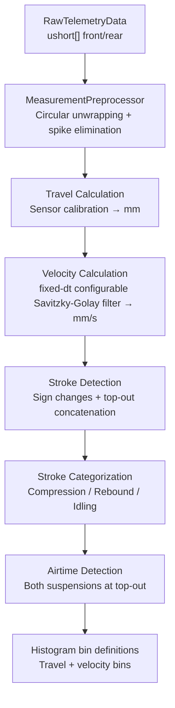

# Signal Processing & Suspension Kinematics

> Part of the [Sufni.App architecture documentation](../ARCHITECTURE.md). This file covers the signal-processing pipeline that turns raw SST samples into analysis-ready telemetry, the linkage kinematics solver, and the sensor calibration strategy.

## Signal Processing Pipeline



`TelemetryData.FromRecording(RawTelemetryData, Metadata, BikeData)` (`Sufni.Telemetry/TelemetryData.cs`) orchestrates the entire pipeline. `BikeData` is a record carrying nullable `FrontMaxTravel` / `RearMaxTravel` (`double?`) and nullable calibration functions `FrontMeasurementToTravel` / `RearMeasurementToTravel` (`Func<ushort, double>?`), and `FrontMeasurementWraps` / `RearMeasurementWraps` flags that select the linear vs. circular preprocessing path; the nullables are populated only for the suspensions actually present on the bike.

Channel presence is decided before preprocessing: a channel needs a calibration
and travel limit, and its raw samples must not be entirely zero or entirely
`0xFFFF`. This rule applies across the whole channel, including all of its
segments. Mixed samples remain present. A calibrated stationary channel stays
present even when stroke detection finds no active strokes. An absent side is
recorded by `Suspension.Present = false` and uses the single-channel UI.
Dense recordings with fewer than five samples mark both sides absent.

Unprocessable recordings raise `TelemetryProcessingException` with a closed
`TelemetryProcessingFailureReason`: `NoTravelData`, `RecordCountMismatch`, or
`VelocitySamplesMissing` for an empty derived velocity trace. Libraries do not
log; these exceptions propagate to the application workflow.

Processing selects dense or segmented travel from the actual runs and travel-gap
metadata, independently of the source file version. Live processing keeps its
captured metadata; imported metadata is derived once after applying the
requested source window.

The pipeline produces histogram **bin definitions** only. Other derived values are lazy:

- `Calculate*` methods on the static partial `TelemetryStatistics` class (e.g., `CalculateTravelHistogram`, `CalculateVelocityHistogram`, `CalculateTravelFrequencyHistogram`, `CalculateBalance`, `CalculateVelocityBands`) compute histogram tallies, statistics, FFT frequency histograms, balance, vibration summaries and velocity bands on demand.
- `PositionVelocityTraceBuilder.Build` (`Sufni.Telemetry/PositionVelocityTraces.cs`) builds position/velocity traces and heatmaps. It clips each compression and rebound stroke to the analysis range; the statistics code selects only whole strokes inside the range.
- The nonserialized `StrokeCoarseIndexes` of each `TelemetryData` result derives the coarse travel/velocity indexes once. Active-suspension travel histograms, sample-averaged velocity histograms and sample damping highlights reuse them for that result's lifetime.
- Recorded-session views request analysis results through the per-open `IRecordedSessionAnalysisResultState`. Its keys combine the telemetry generation with the semantic inputs of each analysis family. `RecordedSessionAnalysisComputer` runs the computation off the UI path. Plot controls render immutable result records, so theme and overlay refreshes do not recalculate statistics.
- The recorded IMU display projection depends only on the telemetry generation. The computer calls `ImuDisplaySignalProcessor.ProcessRecorded(TelemetryData)` once for vibration RMS and frame pitch/roll; the Signals rows share that projection.
- Front and rear sides are processed independently and in parallel, for dense and SST v5 segment-aware recordings. Shared objects passed to those workers are immutable or side-specific.
- Velocity-band and balance calculations accept presentation-owned damping speed cutoffs, with separate compression and rebound thresholds. Compression values compare against the compression cutoff, rebound values against the negative rebound cutoff. Exact threshold values count as high speed.
- Histogram binning has one interval contract: interior bins are `[lower, upper)`, the final edge belongs to the last bin, and out-of-range values clamp to the nearest bin. `HistogramBuilder.Digitize(...)` and `DigitizeValue(...)` both use it, so per-sample indexes and scalar statistics agree on bin edges.

### Measurement Preprocessing

`MeasurementPreprocessor.Process(ushort[], MeasurementSensorType, sampleRate)` (`Sufni.Telemetry/MeasurementPreprocessor.cs`) is the first stage of the pipeline, called for each present suspension before travel conversion. The selected path is `Linear` or `Rotational`, picked by `MeasurementPreprocessor.SensorTypeForWrapping(bool)` from `BikeData.FrontMeasurementWraps` / `BikeData.RearMeasurementWraps`. Those flags are sourced from each sensor configuration's `MeasurementWraps` property — only the rotational sensor types currently set them. The preprocessor rents temporary integer buffers from `ArrayPool<int>.Shared` and returns them before leaving the stage; spike elimination likewise pools its transient inclusion bitmap.

- **Linear path** (`MeasurementWraps == false`, the default): convert each `ushort` straight to `int`, run `SpikeElimination.EliminateSpikesAsInt`, clamp every result back into `[0, 4095]` (the 12-bit ADC range).
- **Rotational path** (`MeasurementWraps == true`, rotary sensors): unwrap the 12-bit (4096-step) circular ADC into a continuous `int` signal — each step's delta to the previous sample is examined, and a `±4096` offset is accumulated whenever the delta crosses the half-range (`±2048`) so wrap-arounds become continuous deltas. Run `SpikeElimination.EliminateSpikesAsInt` on the unwrapped integer signal, then re-wrap each result modulo 4096 back to `ushort`.

`SpikeElimination.EliminateSpikesAsInt` (`Sufni.Telemetry/SpikeElimination.cs`) runs the stages described in [Spike Elimination](acquisition.md#spike-elimination). It edits samples in place and returns the number of detected sudden changes. The pipeline stores that count as the per-suspension `AnomalyRate` (anomalies per second) on the `Suspension` record; no UI consumes it.

The preprocessor return record `MeasurementPreprocessorResult(Samples, AnomalyCount)` feeds directly into `SuspensionTraceProcessor.Process` inside `TelemetryData.FromRecording(...)`.

### Travel Calculation

Each preprocessed sample is then passed through the sensor's `MeasurementToTravel` function (see [Sensor Calibration](#sensor-calibration)) to produce travel in millimeters. Values are clamped to `[0, MaxTravel]`.

### Velocity Calculation

A Savitzky-Golay filter (`Sufni.Telemetry/Filters.cs`) computes the smoothed first derivative of the travel signal unless the session's processing option disables it. Positive velocity = compression (fork/shock compressing), negative = rebound (extending).

- **Option.** The nullable `session.velocity_filter_window_ms` column is authored session state. `SessionSnapshot.ProcessingOptions` derives the library options from it: null means the default 25 ms, the valid range is 0–1000 ms, and 0 disables the filter in favour of unfiltered slope velocity.
- **Window size.** The target sample count is `sampleRate * windowSeconds`, rounded to an odd value and clamped to the recording length. It is then raised to the minimum of 5 when needed. Recordings with fewer than 5 samples skip processing.
- **Filter.** The polynomial order is 3 and the derivative order is 1. The implementation uses recursive Gram polynomial basis functions. It applies each weight row to the window with `TensorPrimitives.Dot` (SIMD).
- **Boundaries.** The filter precomputes one weight row per evaluation offset in the fixed-size window. Edge samples reuse the first/last `windowSize` data points with an off-centre weight row instead of shrinking the window.
- **Cache.** `SavitzkyGolay.Create(...)` validates the parameters and returns a shared immutable filter from `Sufni.Telemetry.Caching.SingleFlightLruCache`, keyed by `(windowSize, derivative, polynomial)`. The cache retains at most 64 entries and 16 MiB of coefficients (`windowSize * windowSize * 8` bytes). A larger table is shared with concurrent callers but not retained.
- **API.** The library exposes only the fixed-step `Process(data, dt)`; recorded processing calls it without a `time[]` array.
- **Live.** `LiveSignalPipeline.ComputeVelocityAppend` calls the same filter with unit spacing, then divides each derivative by its local mean timestamp interval. Live batches have fixed spacing inside a batch but can have gaps between batches. The live pipeline owns this normalization, including clipped edge windows. Uniform samples agree with direct fixed-dt processing within the tolerated low-bit range.

### Stroke Detection

`StrokeAnalyzer.Analyze()` (`Sufni.Telemetry/StrokeAnalyzer.cs`) identifies strokes by finding sign changes in velocity. Adjacent strokes where both have max position < 5mm (near full extension) are concatenated — this prevents small oscillations at top-out from fragmenting the data into many tiny strokes. Strokes too short AND too brief to qualify as any category are silently discarded.

Published strokes record start/end sample indices, timeline bounds and aggregated statistics (`StrokeStat`: sum/max travel, sum/max velocity, bottomout count, sample count). Internal `StrokeCandidate` values retain travel delta, duration and airtime-candidate flags during processing; those scratch values never enter the published `TelemetryData` graph. Processing leaves the legacy `DigitizedTravel` and `DigitizedVelocity` arrays empty. When a coarse-index consumer first runs, `StrokeCoarseIndexes` accepts the legacy travel/velocity arrays only as one complete, in-range pair matching the stroke's source range; otherwise it derives both arrays from the processed samples. Segment-aware derivation uses the stroke's original segment-local coarse velocity-bin domain so gapped recordings retain their established histogram semantics. Legacy fine digitized velocity is skipped during decoding.

### Stroke Categorization

- **Compression**: length >= 5mm
- **Rebound**: length <= -5mm
- **Idling**: |length| < 5mm AND duration >= 0.1s

Only compressions and rebounds are published in `Strokes` and MessagePack-serialized. Internal idling candidates live only through the pipeline run that computes airtimes; the resolved `Airtimes[]` is serialized.

### Airtime Detection

An idling stroke is marked as an air candidate during stroke categorization when: max travel <= 5mm, duration >= 0.2s, and the next stroke's max velocity >= 500 mm/s (landing impact). The first and last strokes in the recording cannot be tagged as air candidates because the categorization rule requires both a previous and a next stroke. When both suspensions are present, airtimes are confirmed by pairing front and rear candidates whose sample ranges overlap by >= 50%; any remaining unpaired candidate from either side is still confirmed if the average of the two suspensions' mean travel during that idling is <= 4% of the averaged max travel. When only one suspension is present, every air candidate from that suspension becomes an airtime.

### Processing Parameters

Stroke and histogram defaults in `Sufni.Telemetry/Parameters.cs`:

Spike thresholds belong to `SpikeElimination`; velocity-filter defaults and bounds belong to `TelemetryProcessingOptions`.

| Constant                          | Value    | Description                                                   |
| --------------------------------- | -------- | ------------------------------------------------------------- |
| `StrokeLengthThreshold`           | 5 mm     | Min travel to classify as compression/rebound                 |
| `IdlingDurationThreshold`         | 0.10 s   | Min duration for an idling stroke                             |
| `AirtimeDurationThreshold`        | 0.20 s   | Min duration for airtime candidate                            |
| `AirtimeVelocityThreshold`        | 500 mm/s | Min landing impact velocity                                   |
| `AirtimeOverlapThreshold`         | 0.50     | Front/rear overlap ratio for airtime                          |
| `AirtimeTravelMeanThresholdRatio` | 0.04     | Max mean travel as ratio of max for single-suspension airtime |
| `BottomoutThreshold`              | 3 mm     | Distance from max travel to count as bottomout                |
| `TravelHistBins`                  | 20       | Number of travel histogram bins                               |
| `VelocityHistStep`                | 100 mm/s | Coarse velocity histogram bin width                           |
| `DeepTravelThresholdRatio`        | 0.75     | Travel ratio above which deep-travel stroke counts start      |

### Serialized Structure

`TelemetryCodec` owns processed MessagePack and live-source JSON encoding/decoding,
and normalizes legacy processed segments. `RecordedLiveCaptureSourcePayload`
in the telemetry library maps current and legacy source shapes to/from captures. `TelemetryData.BinaryForm` and `FromBinary` delegate to it. Library
records remain the persisted shapes with `[MessagePackObject]` attributes. Frozen
schema fixtures pin the complete current graph and rewrites of the committed
legacy fixtures byte for byte.

Telemetry, suspension, metadata, stroke/statistics, airtime and processed segment
properties are init-only. The parallel pipeline constructs completed side values
before publishing the graph. Replacing a telemetry value creates its own lazy
coarse-index cache. Travel, velocity, bin, stroke, segment, airtime, marker, GPS and temperature
collections use `ImmutableArray`; processing copies mutable raw-source arrays at
publication. Statistics consume read-only spans/lists without copying entire
traces. Travel rendering takes its own mutable buffer at the plot boundary.
IMU metadata, locations, legacy dense samples and segment samples also use
immutable arrays in init-only records. Parsers and capture builders assemble
these values before publication; canonicalization returns a replacement value.

The persisted graph is:

```
TelemetryData
├── Metadata (SourceName, Version, SampleRate, Timestamp, Duration)
├── Front: Suspension
│   ├── Present, MaxTravel, AnomalyRate
│   ├── Travel[], Velocity[]
│   ├── TravelBins[], VelocityBins[]
│   ├── Strokes (Compressions[], Rebounds[])
│   └── Segments[] (FirstDenseIndex, FirstSourceIndex, StartSeconds, SampleCount), HasGaps
├── Rear: Suspension (same structure)
├── Airtimes[] (Start, End in seconds)
├── ImuData: RawImuData? (v4/v5/live capture)
├── GpsData: GpsRecord[]? (v4/v5/live capture)
├── Markers: MarkerData[] (v4/v5/live capture)
└── TemperatureAverages: TemperatureAverage[] (V4/V5/live samples, averaged by location)
```

Suspension `Travel[]` and `Velocity[]` are always the flat dense processed arrays for that side. `ProcessedSuspensionSegment` stores a range over those arrays (`FirstDenseIndex`, `SampleCount`) plus the source timeline anchor (`FirstSourceIndex`, `StartSeconds`); segments carry no travel/velocity arrays of their own. `SuspensionTimeSeriesSampler` samples segment-aware data by combining the segment range with the flat arrays. `TelemetryData.FromBinary(...)` also reads segments without `SampleCount`. It infers the count from the next segment's `FirstDenseIndex` or the flat array length.

Each written `Stroke` map contains only `Start`, `End`, `Stat`, `StartSeconds`, and `EndSeconds`. `StrokeFormatter` also reads the legacy coarse travel/velocity digitization fields and skips fine velocity indexes. It never writes them, so rewritten legacy results drop the duplicate arrays.

`RawImuData` is written as compact encoding version 1: a six-field indexed array containing the version, sample rate, indexed metadata entries, binary active-location IDs, indexed per-location segments with six-value sample arrays, and `HasGaps`. Processed data serializes one segment/sample graph and never serializes the dense `Records` list. `RawImuDataFormatter` also reads the legacy named-map dense-only, segment-only, and dense-plus-segment shapes; a rewrite adapts dense-only values through `SampleSegments`.

The serialized form is accessed via `TelemetryData.BinaryForm` and stored as a derived BLOB in the `session.data` column. The original recording source is persisted separately so the BLOB can be regenerated when processing inputs change. Stream-gap and final-status metadata stay on the raw source; processed suspensions retain the segment boundaries and `HasGaps` needed for analysis.

### Recorded Session Derivation

Recorded sessions have two durable data layers:

- **Recording source** — `RecordedSessionSource` in `session_recording_source`, keyed by `session_id`. Imported SST sessions store compressed original SST bytes (`SourceKind = ImportedSst`). Saved live captures use source schema version 1 and store a JSON payload (`SourceKind = LiveCapture`) containing capture metadata, raw front/rear segments, segment-only IMU data, GPS data, temperature samples, and markers. The codec also reads schema-v1 payloads with flat travel or dense IMU records. It restores empty IMU collections for missing fields before processing or canonical hashing, and empty temperature arrays for missing or null ones before processing. The live-capture source excludes `BikeData`; processing resolves calibration again from the current setup and bike.
- **Processed telemetry** — MessagePack `TelemetryData` in `session.data`, derived from the recording source plus the current setup/bike calibration and the current `TelemetryProcessingVersion`.
- **Derivation window** — optional columns on the session row
  (`source_session_id`, `window_start_seconds`, `window_end_seconds`) saying
  that the session derives from `[StartSeconds, EndSeconds)` of
  `SourceSessionId`'s recording source. A null `source_session_id` means no
  window: the session uses its own source in full. `SessionSnapshot.DerivationWindow`
  exposes the window and `RecordingSourceSessionId` the effective source id.
  The window is source-absolute, not nested: splits of splits still point
  back to the original source timeline. Trim and split write these columns
  (see [Trim and split](ui-workflows.md#trim-and-split)).

`RecordedSessionSourceFactory` is the only app-layer factory for persisted recording sources: imports call `CreateImportedSst(...)`, while live saves call `CreateLiveCapture(...)`.

`RecordedSessionReprocessor.ReprocessAsync(input, ct)` is the single recorded-session derivation path for import, recompute, and live-save persistence:

- **Input.** `RecordedSessionDerivationInput` captures session/setup/bike snapshots, source metadata, read-only payload memory, and the session's processing option. It contains no projected fingerprint or staleness state.
- **Imported SST.** The reprocessor decompresses the source bytes and parses them with `RawTelemetryData.FromByteArray`. It applies a derivation window with `RawTelemetryData.Slice(...)`, rebuilds `Metadata` from the effective raw file, and calls `TelemetryData.FromRecording(...)`.
- **Live capture.** The reprocessor decodes the payload through `TelemetryCodec` and rebuilds `LiveTelemetryCapture`. It applies a window with `LiveTelemetryCapture.Slice(...)` and calls `TelemetryData.FromLiveCapture(...)`.
- **Bike context.** The reprocessor first asks `ITelemetryBikeProcessingContextFactory` for the shared context, keyed by structural `ProcessingDependencyInputs` from the setup and bike. `ProcessingDependencyHash` serializes the same normalized inputs into the fingerprint's dependency hash, which the context carries. The context also carries the calibrated `BikeData`.
- **Fingerprint.** Each derivation combines the context hash with the loaded source metadata, window and processing option of that pass. It never reuses the projection's fingerprint or dependency hash.
- **Failures.** The context retains typed rear-calibration failures. The reprocessor returns them as a processing failure without running telemetry or logging them again. It logs a `TelemetryProcessingException` once with session/source identity and maps it to a processing failure.
- **Result.** `RecordedSessionReprocessResult` is `Processed | Failed(reason, details)`. `Processed` carries the typed fingerprint and a complete `ProcessedGeneration`: the decoded/serialized telemetry payload and optional projected GPS points. The generation creates a prepared session with normalized duration, without I/O or mutation of its input snapshot.
- **Ownership.** Import, live-save and recompute own track creation/reuse, repository commits and publication; none decodes the generated bytes again. `TrackCoordinator` owns the device-local GPS metrics. `SessionSyncApplier` owns incoming sync byte validation, guarded fill/swap persistence and publication. `SessionCoordinator` owns GPS alignment.

Source identity uses SHA-256 of the uncompressed SST bytes; the filename and
compression representation do not affect it. Live-source identity hashes the
normalized payload with `Metadata.SourceName` cleared, excluding the setup's
display name while retaining captured samples and timing. Stored payloads and
names remain unchanged. Both source factories assign new sessions a UUIDv5 of the
source hash in a permanent session namespace; existing source/session ids are not
rewritten. Renaming a file or setup does not change the new recording id.
Sources are write-once: a processed fingerprint with a
different source hash is stale, and never authorizes replacing the captured source.
On older databases, the one-time `session-domain-ownership` migration
rewrites hashes in place. It preserves duplicate imports, session/source ids and
derivation-window references.

`ProcessingFingerprintService` records the inputs used for the derived BLOB: fingerprint schema version, `TelemetryProcessingVersion.Current`, `TelemetryCalibrationVersion.Current`, setup id, bike id, `GpsTrackPointProjection.ProjectionVersion`, a deterministic dependency hash, the recorded-source hash, the session's clamped velocity-filter option (`TelemetryProcessingOptions.ClampedVelocityFilterWindowMilliseconds`), and the optional normalized derivation window. The window field is omitted when no derivation window is present. Because the option and normalized window are part of the fingerprint, changing only the velocity-filter window or source window makes the stored BLOB stale and recomputable. The dependency hash includes the setup's front/rear sensor configuration, the bike geometry needed for processing, rear suspension kind, linkage joints/links/shock definition, and leverage-ratio points. Fields that do not affect processing, such as display names, notes, bike images, and damping speed cutoffs, are not part of the hash. Track-projection-version changes make GPS-derived generated tracks stale/recomputable even if the suspension processing inputs are unchanged.

Fingerprint schema v4 includes `CalibrationVersion`, independently of the
library processing version. `TelemetryCalibrationVersion.Current` is 1 and
covers app-owned sensor/suspension calibration. A version mismatch makes a
source-backed result recomputable and a source-less result stale, and rejects
an outdated derived commit. A golden derivation test pins version 1 to front
linear-fork and rear leverage-ratio travel values. Legacy fingerprints remain
readable but require recomputation when a source is available.

`IProcessingDependencyHashIndex` keeps that setup/bike dependency hash reactive. It subscribes to setup and bike store changes, stores the current hash per setup id, and emits only when a setup's processing-relevant hash changes. `RecordedSessionProjection` uses that index to avoid recomputing every session for display-only bike/setup edits, while `RecordedSessionDomainQuery` uses the same cached hash for command-side staleness checks.

Transaction-time commit checks do not trust the in-memory projection alone.
`ISessionRepository.GetProcessingInputBundleAsync(sessionId)` projects the
database-resident processing inputs — session id/setup id, setup sensor JSON,
bike geometry/rear suspension, recorded-source metadata for the effective source session, the session filter option, and the normalized derivation window when present — without loading the processed BLOB or source payload. The recompute owner calls `ProcessingFingerprintService.CreateCurrentDatabaseInputs(SessionProcessingInputBundle)` outside persistence and compares it with the result fingerprint. It passes the validated bundle to `UpdateProcessedDerivedDataAsync`, which atomically compares current scalar database values with that snapshot. Either mismatch makes the engine retry with fresh inputs. Calibration JSON remains a scalar value in the bundle, so equality never depends on deserialized object identity. Replacing this derived generation leaves the session’s authored `updated` timestamp and metadata unchanged.

When the stored fingerprint is missing, uses an older processing version, references different processing inputs, has a different normalized derivation window, or the processed BLOB is absent while the raw source exists, the recorded session has the single recomputable `Stale` state. Missing setup/bike dependencies make it stale but not recomputable. A missing raw source is displayed separately as "No Raw"; the app can still load existing processed data, but it cannot regenerate it until the source is restored. If the source is missing and the persisted processed state is known to be stale, `SessionStaleness.MissingRawSource(ProcessedStateStale: true)` keeps the stale flag while still reporting the session as not recomputable. The source-less stale check compares the same database inputs as the source-backed path — **including the clamped velocity-filter option and normalized derivation window** — so changing either marks a source-less session stale too; it simply cannot be acted on until the source returns.

Recompute-all selects only non-current sessions; missing or unavailable sessions
are skips, and superseded per-session work stops without publishing. A completed
fingerprint is the restart checkpoint. No in-memory bulk run is resumed after
process restart: startup derives staleness again, and the next explicit request
skips generations already current. There is no separate durable recompute queue.

`SessionCoordinator.SetProcessingOptionAsync` commits the session column, publishes
the snapshot, and starts recompute in the same UI publication turn. A failed or
unrecomputable change restores the previous value only if the stored option still
matches this request; a superseded request does not restore it. Metadata editing
preserves the current option. Live saves write it with the session, and splits
inherit it. Runtime preferences contain no processing options. The startup
`session-domain-ownership` migration copies legacy values from the launch
preferences document into the session column.

Derivation is **deterministic for a fixed processing binary**: `TelemetryData.FromRecording` / `FromLiveCapture` are pure functions of `(recorded-source bytes, derivation window, setup configuration, bike geometry, GpsTrackPointProjection.ProjectionVersion, TelemetryProcessingVersion, TelemetryProcessingOptions)`, and recompute persistence is serialized per session through `SessionRecomputeEngine`, the single derived-data writer (see [recompute flow](ui-state.md#recorded-session-projection)). Reproducibility is **scoped to that binary/runtime**, not guaranteed bit-for-bit across CPU architectures — low-bit floating-point differences in the FFT and Savitzky-Golay output are tolerated by design. This is why cross-device coherence is defined on the **fingerprint, never on the BLOB bytes**: two devices that recompute the same source with the same inputs on the same build produce the same fingerprint and are treated as in sync even if their serialized bytes differ in the last bits (see [Cross-Device Sync](sync.md#processed-blob-coherence-download-then-swap)). The fingerprint is the identity of the derived data; the bytes are not.

`TelemetryProcessingVersion.Current` is `6`. A source-backed BLOB with an older version is recomputable, so each device regenerates it once on the current binary. Source-less older BLOBs remain readable. The processing version controls recompute eligibility only; it is not a database schema version.

### Processed Telemetry Read Cache

`ISessionProcessedTelemetryReader` is the decoded-telemetry read path for session detail loads and the cross-session `ISessionContentReader`. Its latest-content operation asks `ISessionRepository.GetSessionPsstPayloadMetadataAsync(...)` for the lightweight processed-payload metadata before loading the raw processed BLOB, while its exact operation accepts a caller-supplied `ProcessedTelemetryRevision` and never advances to a newer revision. While a `SessionDetailViewModel` is loaded it retains its session id; retained sessions reuse one decoded `TelemetryData` instance for the same `(sessionId, ProcessedTelemetryRevision)` key, and a key change replaces the retained lazy decode. Unretained reads decode one-off. The view model releases the retention on unload. Because the same `TelemetryData` instance can be shared by plots, mobile detail building, and segment matching, consumers must treat decoded telemetry as read-only.

### Shared Caching

`Sufni.Telemetry.Caching.SingleFlightLruCache<TKey, TValue>` is the shared
primitive for bounded reusable computations. It keeps pending producers
separate from retained LRU values, so count and weight limits apply only after
successful completion. Callers may use count-only, weight-only, or combined
limits and may reject successful values from retention with a predicate while
still sharing that producer result with current waiters. Waiter cancellation is
independent: producers run with their own non-cancelable lifetime, and faulted
or canceled producers remain retryable. Oversize values are shared but not
retained. `Clear()` detaches pending generations without canceling their
existing waiters, and detached late completions cannot populate the current
retained state.

---

## Suspension Kinematics

The `Sufni.Kinematics` library models bike suspension linkages to compute how wheel travel relates to shock compression.

### Linkage Model

A linkage is stored as an immutable `LinkageSpec` (`Sufni.Kinematics/LinkageSpec.cs`) made of ordered `JointSpec` values, ordered `LinkSpec` constraints, a shock `LinkSpec`, and the linkage's shock stroke. Joint specs have a nullable type that determines behavior during solving:

| JointType       | Behavior                     |
| --------------- | ---------------------------- |
| `Fixed`         | Immovable frame attachment   |
| `BottomBracket` | Immovable (treated as fixed) |
| `HeadTube`      | Fork crown pivot             |
| `Floating`      | Free to move during solving  |
| `RearWheel`     | Rear axle position           |
| `FrontWheel`    | Front axle position          |

Each `LinkSpec` connects two joints by name. The internal `LinkageResolver` validates referenced joint names, duplicate joints/links, the shock endpoints, and degenerate link lengths, then produces a fresh mutable `ResolvedLinkage` runtime graph for the solver. `ResolvedLink` stores the Euclidean length constraint. The shock link is special — its length is varied during solving to simulate compression.

Linkages are stored inside the `bike.rear_suspension` union JSON. The persisted JSON is pure spec data; deserialization has no side effects and does not resolve object references until the public solver validates and resolves them.

### Kinematic Solver

`KinematicSolver` (`Sufni.Kinematics/KinematicSolver.cs`) uses iterative constraint satisfaction (Gauss-Seidel relaxation) to find valid joint positions through the full range of shock compression.

Entry point: static `KinematicSolver.Solve(LinkageSpec, steps=200, iterations=1000)`.
Each call resolves fresh internal runtime state; the immutable spec is never
mutated and no reusable solver instance retains coordinates.

For each of the 200 steps (0% to 100% shock compression):

1. Set the shock's target length: `maxLength - (shockStroke * step / (steps-1))`
2. Run 1000 iterations of `EnforceLength()` on every link

`EnforceLength()` corrects each link toward its target along the link axis. When both endpoints are free (`movableEndpointCount == 2`), each moves by half the error so the link length matches in a single pass. When only one endpoint is free, that endpoint receives the *full* correction (`correctionScale = 1.0`). Multiple iterations are still required for the system to converge because every move perturbs the neighboring links sharing those joints.

Output: `KinematicSolution`, a deeply immutable set of `JointPath` values mapping each joint name to its X,Y positions across all steps. Consumers read the paths through `JointPaths` or `TryGetPath`.

The app layer wraps solving in `IKinematicSolutionCache` (`Sufni.App/Sufni.App/Bikes/Services/KinematicSolutionCache.cs`), a capacity-64 single-flight LRU keyed by `(LinkageSpec, steps, iterations)`. Editor analysis, save validation, rear calibration, and telemetry bike-processing context creation all request immutable solutions through this cache instead of independently solving the same linkage.

`CoordinateList` publishes copied read-only coordinate series. Standard editor
joint names are constants in `JointNames`.

Invalid calculation inputs raise `KinematicCalculationException` with
`MissingJointPath` or `DegenerateGeometry`; linkage and leverage-ratio validation
raise their own typed exceptions. Libraries do not log. Editor analysis
classifies these expected input failures as `Unsolvable`, while unexpected
exceptions become a typed analysis failure at the app boundary.

The bike editor keys analysis requests by the immutable rear-suspension spec.
Initial loads and resets request changed specs immediately; geometry edits and
curve changes debounce for 200 ms using the injected clock. Repeated requests
for the same spec share the current result/task, so metadata edits and saves do
not recalculate plots. A replacement request cancels its predecessor and ignores
late results; unload/close cancels pending work. Save validation remains on the
coordinator and returns no analysis presentation data.

### Bike Characteristics

`BikeCharacteristics` (`Sufni.Kinematics/BikeCharacteristics.cs`) derives datasets from the `KinematicSolution` returned by `KinematicSolver`:

- **`LeverageRatioData`** = recomputed on each access from the current immutable `KinematicSolution`. For each step `i`, the ratio is `(wheelTravel[i] - wheelTravel[i-1]) / (shockStroke[i] - shockStroke[i-1])`, where wheel travel is the per-step Euclidean distance from the rear wheel's initial position and shock stroke is the per-step reduction of the shock-eye-to-shock-eye distance from its initial value. **X-coordinate convention:** each ratio is a finite difference over a segment, so its X value is the segment's wheel-travel *midpoint* (`LeverageRatioDerivation`). The plotted curve therefore deliberately starts and ends half a segment inside the 0…max-travel span; the same convention applies to user-supplied leverage-ratio curves. Pinned by `LeverageRatioData_PinsMidpointXConvention_AtCurveEndpoints` in `Sufni.Kinematics.Tests`.
- **`AngleToTravelDataset(centralJoint, adjacentJoint1, adjacentJoint2)`** — angle at a specified joint vs. rear wheel travel across the full range, used for visualizing pivot behavior.
- **`AngleToShockStrokeDataset(...)`** — the same angle paired with shock stroke instead of wheel travel.
- **`ShockStrokeToWheelTravelDataset()`** — used by `RearTravelCalibrationBuilder` to derive rear max travel from a linkage solve.

Front and rear max travel for the processing pipeline do **not** live on `BikeCharacteristics`. Front max travel is computed inside the front sensor configuration itself (e.g., `LinearForkSensorConfiguration.MaxTravel = bike.ForkStroke * sin(headAngle)` — see [Sensor Calibration](#sensor-calibration)). Rear max travel is produced by `RearTravelCalibrationBuilder` from either the linkage solve (`ShockStrokeToWheelTravelDataset.Y[^1]`) or the leverage-ratio curve (`LeverageRatioSpec.WheelTravelAt(maxShockStroke)`).

### Utilities

- **`CoordinateRotation`** — 2D point rotation about an arbitrary centre, plus rotated-rectangle bounding-box computation, used by the bike image canvas and the linkage editor
- **`GroundCalculator`** — computes rotation angle to level ground contact points given wheel positions and radii
- **`EtrtoRimSize`** — ETRTO standard rim sizes (507/559/584/622mm) with tire diameter calculation
- **`GeometryUtils`** — distance and angle calculations using dot product, with float clamping to avoid NaN from precision errors

---

## Sensor Calibration

Four sensor types convert raw ADC counts to millimeters of travel through the `ISensorConfiguration` strategy pattern.

`ISensorConfiguration` (`Sufni.App/Sufni.App/Setups/Models/SensorConfigurations/SensorConfiguration.cs`) defines the front-suspension calibration surface used directly by the telemetry pipeline:

- `Type` — `SensorType` enum discriminator (`LinearFork`, `RotationalFork`, `LinearShock`, `LinearShockStroke`, `RotationalShock`)
- `MeasurementToTravel` — `Func<ushort, double>` calibration closure
- `MaxTravel` — physical suspension limit in mm

Polymorphic JSON deserialization is single-pass. `SensorConfiguration.FromJson(json)` delegates to the app JSON context, whose converter peeks at the `Type` discriminator and materializes the concrete data record. The bike-aware overload `SensorConfiguration.FromJson(json, BikeSnapshot)` reuses that data-only parse and binds only front sensor configurations to the supplied bike so their calibration closures can include fork geometry. Rear shock payloads (`LinearShockSensorConfiguration`, `RotationalShockSensorConfiguration`) stay data-only at deserialization time; their closure is built later by [`RearTravelCalibrationBuilder`](#rear-travel-calibration), which keeps the linkage and leverage-ratio rules out of the sensor-configuration types.

For example, `LinearForkSensorConfiguration` stores `Length` (sensor physical range) and `Resolution` (ADC bit depth). Its calibration:

```csharp
// Computed once during FromJson():
measurementToStroke = Length / (Math.Pow(2, Resolution) - 1); // ADC count → mm of fork stroke
strokeToTravel = Math.Sin(headAngle * Math.PI / 180.0);    // fork stroke → vertical wheel travel

// Applied per sample:
MeasurementToTravel = measurement => measurement * measurementToStroke * strokeToTravel;
MaxTravel = bike.ForkStroke * strokeToTravel;
```

The denominator is the ADC's full-scale count for an `n`-bit sensor: `2^Resolution - 1`.

For front sensors, bike context (head angle and fork stroke) is bound immediately after the data record is deserialized, making the closure self-contained for the processing pipeline.

| Implementation                       | Parameters                                   | Calibration                                                            |
| ------------------------------------ | -------------------------------------------- | ---------------------------------------------------------------------- |
| `LinearForkSensorConfiguration`      | Length, Resolution                           | Linear potentiometer on fork, projected by head angle                  |
| `RotationalForkSensorConfiguration`  | MaxLength, ArmLength                         | Rotary encoder on fork, cosine-based rigid-arm geometric projection    |
| `LinearShockSensorConfiguration`     | Length, Resolution                           | Rear shock payload (`SensorType.LinearShock` for linkage bikes, `SensorType.LinearShockStroke` for leverage-ratio bikes) consumed by `RearTravelCalibrationBuilder`; maps shock stroke to wheel travel via linkage interpolation or `LeverageRatioSpec.WheelTravelAt(...)` |
| `RotationalShockSensorConfiguration` | CentralJoint, AdjacentJoint1, AdjacentJoint2 | Rear shock payload consumed by `RearTravelCalibrationBuilder`; resolves angle-to-shock-stroke from linkage motion, then converts to wheel travel |

### Rear Travel Calibration

`IRearTravelCalibrationBuilder` / `RearTravelCalibrationBuilder` (`Sufni.App/Sufni.App/Bikes/Services/RearTravelCalibrationBuilder.cs`) extends the `ISensorConfiguration` strategy pattern for the rear shock, where shock-stroke ADC counts have to be converted to wheel travel through either a linkage solve or a leverage-ratio curve. Its entry point, `TryBuild(SetupSnapshot, BikeSnapshot)`, returns the sealed `RearTravelCalibrationResult` (`Built`, `NotApplicable`, or `Failed`). Failure carries `RearCalibrationFailureReason.Configuration | Calculation` and optional diagnostic details. The builder logs once with setup/bike identity, at Warning for invalid configuration and Error for unexpected calculation failure. `TelemetryBikeProcessingContextFactory` retains a failed rear outcome in `RearFailure` and feeds the successful `RearTravelCalibration(MaxTravel, MeasurementToTravel, MeasurementWraps)` into `TelemetryBikeData.Create(...)` to build the `BikeData` used by `TelemetryData.FromRecording(...)` and live-capture processing. Calibration is invoked at processing-context construction time — never at sensor-configuration deserialization time, so the rear `LinearShockSensorConfiguration` / `RotationalShockSensorConfiguration` instances persisted on a `Setup` carry only their JSON parameters.

The build flow:

1. Pattern-match `BikeSnapshot.RearSuspension` into the five app cases: hardtail or an unconfigured rear sensor returns `NotApplicable`; configured linkage and leverage-ratio drafts fail with a configuration reason; complete linkage and leverage-ratio specs continue.
2. Deserialize `SetupSnapshot.RearSensorConfigurationJson` as a data-only `SensorConfiguration` payload and pattern-match it against the suspension spec:
   - `LinearShockSensorConfiguration` with `SensorType.LinearShock` + `RearSuspensionSpec.Linkage`, or `SensorType.LinearShockStroke` + `RearSuspensionSpec.LeverageRatio` — compatible.
   - `RotationalShockSensorConfiguration` + `Linkage` — compatible.
   - Any other combination — incompatible, returns a setup-level error.
3. Compute the per-sample shock stroke from the payload (linear: `Length / (2^Resolution - 1)`; rotational: `2π / 4096` rad per ADC count, then a cubic polynomial fit of the linkage's angle-to-shock-stroke dataset).
4. Convert shock stroke to wheel travel through the suspension spec: linkage suspensions resolve `LinkageSpec` through `IKinematicSolutionCache.GetOrSolve(...)` and interpolate `BikeCharacteristics.ShockStrokeToWheelTravelDataset()`, while leverage-ratio suspensions call `LeverageRatioSpec.WheelTravelAt(...)`. The rotational-shock linkage path builds one `BikeCharacteristics` over the cached solution and reuses it for both angle-to-shock-stroke and shock-stroke-to-wheel-travel datasets.
5. For leverage-ratio bikes, `LeverageRatioShockStrokeRules.TryValidate` checks that the bike's configured shock stroke matches the curve's `MaxShockStroke` within tolerance before the calibration is accepted; the resulting `MaxTravel` is the wheel travel at that validated stroke, not a separately configured number.

The `MeasurementWraps` flag on the produced `RearTravelCalibration` is `true` for the rotational-shock path (the rotary encoder reports modulo-4096 angles) and `false` for the linear-shock paths; `TelemetryBikeData.Create` copies it onto `BikeData.RearMeasurementWraps`, which selects the [Measurement Preprocessing](#measurement-preprocessing) path for the rear samples.

### Leverage-Ratio CSV Import

`LeverageRatioCsvParser` (`Sufni.App/Sufni.App/Bikes/Services/LeverageRatioCsvParser.cs`) parses the leverage-ratio curve a user can attach to a leverage-ratio rear suspension when no full linkage is modelled. The expected CSV format:

| Header / column   | Meaning                                       |
| ----------------- | --------------------------------------------- |
| `shock_travel_mm` | Shock stroke in mm (monotonically increasing) |
| `wheel_travel_mm` | Wheel travel in mm at that shock stroke       |

Other rules: header is required and matched case-insensitively, BOM is stripped, comma or semicolon delimiter (auto-detected from the header line), `.` decimal separator only (decimal commas are rejected), invariant-culture `double` parsing, blank lines skipped. Rows are validated through `LeverageRatioValidation.Validate(...)` after parsing so format and curve-shape errors surface together.

`Parse(Stream)` and `Parse(string)` both return a `LeverageRatioParseResult` discriminated record:

- `Parsed(LeverageRatioSpec Value)` — the points were valid; the wrapped `LeverageRatioSpec` (`Sufni.Kinematics/LeverageRatio/LeverageRatioSpec.cs`) exposes `MaxShockStroke`, `MaxWheelTravel`, and `WheelTravelAt(shockStroke)` for downstream consumers.
- `Invalid(IReadOnlyList<LeverageRatioParseError> Errors)` — one error per offending line; each error carries an optional 1-based line number plus a human-readable message.

The parser is wired into the bike editor flow: `BikeEditorService.ImportLeverageRatioAsync(...)` (`Sufni.App/Sufni.App/Bikes/Services/BikeEditorService.cs`) opens the CSV picker, runs `LeverageRatioCsvParser.Parse` on a background task, and surfaces the result to `LeverageRatioEditorViewModel.ApplyImportResult` as a `LeverageRatioImportResult` (`Imported` / `Invalid` / `Failed` / `Canceled`). The imported curve is what `RearTravelCalibrationBuilder` later reads from `BikeSnapshot.RearSuspension` when building the rear calibration closure.
