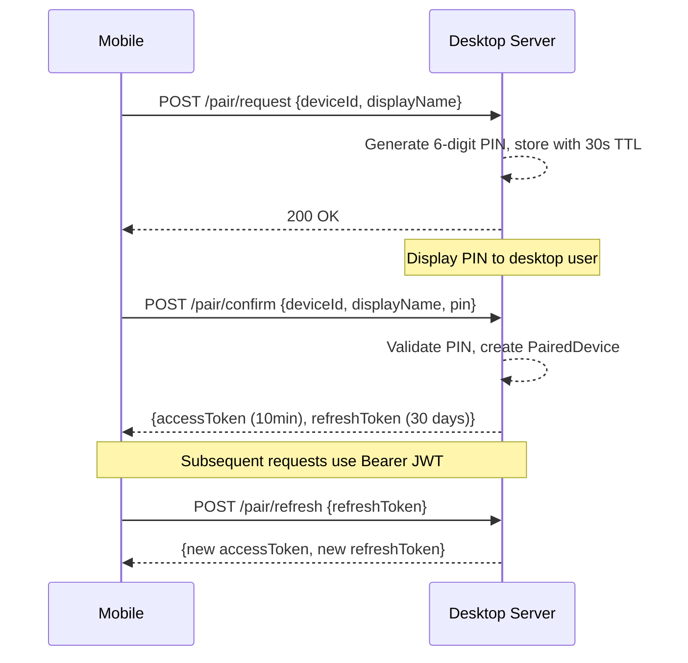

# Cross-Device Synchronization

> Part of the [Sufni.App architecture documentation](../ARCHITECTURE.md). This file covers the desktop sync server, the mobile client, and the pairing flow that connects them. Conflict semantics for the entity payloads live in [Persistence](persistence.md#conflict-resolution).

Desktop acts as a hub server; mobile devices sync with it.

## Pairing Flow

`ILocalDeviceIdentity` supplies one installation identity from secure storage's
existing `DeviceId` key on every platform. Concurrent callers share initialization;
a new ID is returned only after persistence completes. Pairing reads this identity
rather than generating its own. Unpairing does not replace it.

The pairing client uses an injected `TimeProvider` for temporary discovery
resolution deadlines. The inbound coordinator owns pending PINs and publishes
`PairingChallenge` with one absolute `ExpiresAt`. The server prompt projects its
remaining fraction with an injected UI timer; late subscription cannot extend
validity, and confirmation clears the prompt.

The mobile coordinator returns expected states for no discovered server and
rejected or expired PINs (HTTP 401). Other request/confirmation/unpair failures
carry a closed reason and optional diagnostics, logged once at the coordinator.
Local credentials are still cleared before the remote unpair request; a network
failure leaves the device locally unpaired and produces a fixed notification.
`PairingClientState` is `Unpaired | AwaitingPin | Paired`, derived from the pending
request and the HTTP owner's paired peer. `PairingClientCoordinator.InitializeAsync`
loads installation/display identity and stored credentials once; `AppStartup`
awaits it before creating pages.

`SyncCoordinator.ConfirmPairingAndSyncAsync` drains an earlier run and clears the
cursor table before accepting new pairing credentials. The installation pairs
with one hub, so every explicit re-pair starts a full baseline, including a
return to the same certificate and incarnation. A cursor-reset failure prevents
confirmation. After successful confirmation, typed progress lets the view model
clear the PIN and ask the shell to go back immediately, while the coordinator
retains and awaits the initial sync. Shutdown drains that entire operation. There
is no pair-to-sync event subscription or discarded sync task. The coordinator has
no navigation dependency.



Pairing request, confirmation, refresh and remote unpair are awaited
`IInboundSyncCoordinator` commands with typed outcomes. PINs are bound to the
requesting device and normalized display name and expire after 30 seconds.
Confirmation persists the paired device and publishes it before returning tokens.
Confirmation and refresh responses include the hub database incarnation, which
the client persists alongside its pairing credentials.

The hub persists SHA-256 refresh-token hashes, never the raw tokens. Rotation
retains the previous hash for one recovery request while the current refresh
token has not been used. Using the current token replaces that recovery slot;
using the previous token consumes it. Both paths issue a fresh token and update
the published device expiry. The repository checks and rotates credentials in one
transaction. `sync-authority` hashes legacy tokens and drops their plaintext column.

Both directions use the same version/deletion/timestamp/writer ordering from
[Persistence § Conflict Resolution](persistence.md#conflict-resolution). The hub
preserves authored timestamps and versions. Deletion ledger entries travel in
`SynchronizationData.deletions` after payload purge, and older content cannot
revive them. Incoming session publication reads the committed winner, so a stale
remote deletion cannot hide a retained local session.

## Server

`SynchronizationServerService` (`Sufni.App/Sufni.App.Desktop/SyncAndPairing/Services/SynchronizationServerService.cs`) embeds ASP.NET Core Kestrel on port 5575 with:

- **TLS**: Self-signed ECDSA P-256 certificate (password stored in `SecureStorage`), served with TLS 1.2 and TLS 1.3 enabled
- **JWT**: HS256 with a 64-byte random secret (stored in `SecureStorage`); `ISynchronizationTokenService` shares that persisted signing key between token issuance and bearer validation
- **Discovery**: mDNS advertisement as `_sstsync._tcp`
- **Rate limiting**: the anonymous `/pair/*` surface is throttled per remote IP by a fixed-window limiter — 10 requests per PIN-TTL window (30 s) — bounding PIN guesses per source per PIN lifetime. Excess requests get `429` with a `Retry-After` header and are logged; the partition key fails closed to `"unknown"` when the peer IP is unavailable.
- **Strict inbound JSON**: request bodies bind with a hardened profile (reject duplicate keys, reject unmapped members, case-sensitive names, required non-nullable members and constructor parameters). Well-formed first-party traffic is unaffected because the client emits every snake_case key explicitly; responses and other serialization stay on the lenient profile. See [Persistence § JSON Serialization](persistence.md#json-serialization).

`AppStartup` starts the server after the database and store refresh are ready,
with stores initialized. Pairing and data endpoints directly await their owners. Server startup is no
longer driven by a view attaching. `AppShutdown` stops advertising, stops Kestrel
and disposes its application before disposing the shared service provider.
Server startup returns `ServerStartResult.Started | Failed(reason, details)`.
The service logs a startup failure once and cleans up a partially started host;
startup consumes the result directly and remains blocked without starting repair
jobs. The forwarding-only pairing server coordinator has been removed. An empty advertisable-address list retains the existing
warning and advertisement attempt.

All sync HTTP requests, including pairing, carry `X-Sufni-Sync-Protocol: 6`.
Both the anonymous pairing group and the JWT-protected sync group reject missing
or mismatched protocol headers with `426 Upgrade Required`. Protocol v3 gives
push and pull separate persisted watermarks and bounds each metadata snapshot
with one sampled `upper_bound`. Protocol v4 adds the session derivation window
columns to the session payload. They are authored metadata like `timestamp`:
the merge engine writes them in both remote-update variants, including the one
that keeps the held processed generation. Protocol v5 adds the saved-segment
list. Protocol v6 carries the app calibration version in processing fingerprints
the authored session filter option and source-owned segment anchors. It removes
stored session-track links/windows and GPS metrics from the session payload, and rejects older peers. The client installs the header on each peer’s
`HttpClient`, so new endpoint groups must either stay behind that service or
explicitly add the same version gate. Kestrel caps sync request bodies at 256
MiB.

| Endpoint                       | Method | Auth | Purpose                                                     |
| ------------------------------ | ------ | ---- | ----------------------------------------------------------- |
| `/pair/request`                | POST   | No   | Start pairing, generates 6-digit PIN with 30s TTL           |
| `/pair/confirm`                | POST   | No   | Confirm PIN, returns access + refresh tokens                |
| `/pair/refresh`                | POST   | No   | Rotate both access and refresh tokens                       |
| `/pair/unpair`                 | POST   | No   | Revoke pairing (validates `deviceId` + refresh token in body) |
| `/sync/run/start`             | POST   | JWT  | Verify the hub incarnation and announce the run ID and ordered phase list |
| `/sync/run/end`               | POST   | JWT  | Complete the matching observed run |
| `/sync/push`                   | PUT    | JWT  | Receive one bounded `SynchronizationData` snapshot from mobile |
| `/sync/pull`                   | GET    | JWT  | Return changes in `(since, upper_bound]`                    |
| `/session/incomplete`          | GET    | JWT  | List session IDs the hub needs a blob for: missing-blob **fills** and held-blob **push-swaps** |
| `/session/data/{id}`           | GET    | JWT  | Download a processed telemetry blob as `application/octet-stream`; `X-Sufni-Processing-Fingerprint` carries the fingerprint of those bytes |
| `/session/data/{id}`           | PATCH  | JWT  | Upload a processed telemetry blob as `application/octet-stream` with optional `X-Sufni-Processing-Fingerprint`. Commits a matching generation; returns **204** for applied or ignored data and **409** for a pending or invalid transfer |
| `/session/source/incomplete`   | GET    | JWT  | List recorded-source ids this peer should upload: ordinary missing source rows plus referenced derivation source ids absent locally |
| `/session/source/data/{id}`    | GET    | JWT  | Download a recorded-source payload as `application/octet-stream`; source kind/name/schema/hash travel in `X-Sufni-Source-*` headers |
| `/session/source/data/{id}`    | PATCH  | JWT  | Upload a recorded-source payload as `application/octet-stream` with source kind/name/schema/hash in `X-Sufni-Source-*` headers |

Authorization is enforced as a route group — `MapGroup("").RequireAuthorization()` wrapping the ten JWT endpoints — not a per-endpoint attribute. The four `/pair/*` endpoints form a separate anonymous, rate-limited group. `/pair/unpair` stays in that anonymous group and authenticates by matching `deviceId` + refresh token in its body, because a device revoking itself may no longer hold a valid access token.

Session BLOB and recorded-source upload endpoints await `IInboundSyncCoordinator`.
The coordinator serializes inbound writes through their publication. BLOBs use
`ISessionSyncApplier` for generation validation, guarded persistence and session
publication. Source uploads validate the hash, persist write-once captured content,
and publish the snapshot returned by the repository before acknowledgement.
There are no data-arrival events or startup subscriptions. Invalid source/BLOB
payloads and pending generations return 409, missing sessions return 404, and apply
failures return 500. Invalid wire headers or content types remain 400.

The server uses `TimeProvider` for certificate renewal; token issuance uses it
for JWT lifetime. The inbound coordinator owns PIN and refresh-token expiration
through its injected clock. JWT bearer authentication retains
the framework's lifetime validation.

## Client

Outbound sync accepts cancellation through server discovery, transfer loops and
HTTP sends/body reads. A canceled run is neutral. Each committed row batch publishes before the next
phase; source transfers publish committed sources while draining cancellation. The shared token
refresh is allowed to finish and persist rotated credentials before a canceled
caller exits; cancellation does not abandon a credential rotation midway.
The sync coordinator retains its active run for shutdown and releases its state
subscriptions on disposal. The inbound coordinator owns the interruption timer.

`SynchronizationPeer` uses its injected clock for certificate validity and the
30-second token-refresh margin. Sync delta bounds use database sequences.

`SyncCoordinator` runs the client workflow through `IBackgroundTaskRunner` in six phases after discovery. The coordinator owns phase sequencing, persistence, cursor writes and publication. Push and pull have independent sequence cursors. At run start the client captures its local sequence upper bound. Its first run after cursor reset pulls the baseline before pushing; subsequent runs push then pull. This lets upgraded replicas retain the newer authored content before their first outbound selection. Edits made after the captured bound remain for the next run.

1. **Push local changes** — select rows and deletion ledger entries whose `local_seq` lies in `(lastPushSequence, capturedUpperBound]`, PUT that bounded snapshot to `/sync/push`, then advance only `last_push_sequence` after success
2. **Pull remote changes** — GET `/sync/pull?since=` from the pull sequence, receive the server's `sync_seq` upper bound, and merge rows and deletion ledger entries in one SQLite transaction. Advance only `last_pull_sequence`, and only after processed-BLOB swap handling leaves the pull complete
3. **Push incomplete sessions** — for each session id the server advertises (a missing-blob *fill* or a held-blob *push-swap*), upload the local blob **and its stored fingerprint**; the server commits a fill or a push-swap when the fingerprint matches its target, returns 409 for a mismatched or pending transfer, and ignores an equivalent or ineligible generation with 204
4. **Pull incomplete sessions** — download blobs for two kinds of target and commit each only when the downloaded fingerprint matches the target (otherwise keep what is local and retry later): **fills** (local rows with no blob, target = the row's own stored fingerprint) and **swaps** (rows whose held blob has a different current-schema fingerprint than the one just pulled, target = the accepted remote fingerprint — see *Processed-BLOB coherence* below)
5. **Push incomplete recorded sources** — for each source id the server advertises, upload the local `RecordedSessionSourcePayload`
6. **Pull incomplete recorded sources** — for each local source id produced by `IRecordedSessionSourceSyncQuery`, download the server's `RecordedSessionSourcePayload`

Discovery resolves an atomic `PeerEndpoint` and captures an `ISynchronizationPeer`
for the entire run. That peer owns its HTTP client, certificate pin, credentials
and single-flight refresh. Address rediscovery updates only its endpoint; pairing
replacement creates a new peer. A run links cancellation to the captured peer’s
lifetime, so later requests cannot switch to a newly paired hub. Re-pairing and
unpairing cancel old transfers, await an already-started credential rotation, and
dispose the old client before another pairing can write secure credentials.
Unpairing clears local credentials before its remote revocation request, which
still validates the old peer’s certificate. The legacy persisted `ServerUrl` is
removed at initialization; an endpoint comes only from discovery.

The client captures a `PeerIdentity` from the peer’s pinned certificate thumbprint
and the database incarnation returned with its tokens. Both cursors use this identity;
address changes preserve them, while a different hub or incarnation starts a
baseline from zero. Run-start verifies the incarnation even while the access token is still current.
The client proposes the identity's cursor-dependent phase order. A mismatched
incarnation returns the current value without starting hub activity. The client
loads that identity's cursors and announces the corrected order before any row
or payload transfer; a new identity starts with a pull-first baseline. Explicit re-pairing clears prior cursors before credentials are accepted.

The metadata snapshot's one `upper_bound` applies to every synced table, including
custom map layers, and the deletion ledger. Core delta queries include updates and
tombstones only in `(sinceExclusive, upperInclusive]`, using `local_seq` for push
and `sync_seq` for pull. Authored timestamps never select deltas; there is no
clock overlap. Tracks are independent
captured facts with the same delta bounds; a changed session does not resend
unchanged tracks.

The four blob/source transfer phases run with bounded client concurrency
(`SyncTransferDop = 3`). Session pulls preserve fill-before-swap phasing:
all missing-blob fills are downloaded and committed before swap downloads
start. Any unresolved transient swap holds back the pull watermark, so the same
bounded metadata delta is replayed and the swap work is re-derived on the next
run.

Source sync runs after metadata sync so both sides know which
session ids and derivation windows exist before asking for missing source
payloads. Source rows are transferred through the incomplete-source endpoints
when a side has no source row. A mismatch with the processed fingerprint marks
the derived data stale; it never requests replacement of an existing source. For derived
sessions, the query does not ask for a source under the derived session id; it
uses the session row's `source_session_id` and also asks for any referenced
source ids that are absent locally. Push uses the
stored source hash on the local row; it does not rehash the local payload before
upload — the receiving server's patch gate (and the repository's put-time
validation) still verifies it. Pull rehashes each downloaded payload against its
advertised source hash before persisting. Imported payloads are decompressed for
hashing; live payloads are normalized without their setup display name. A hash
mismatch or malformed compressed/JSON payload is an item-level skip that
leaves the source pending for a future run, while a failure from the repository
put itself propagates and fails the run. Source writes retain existing captured
content, and publication uses the snapshot returned by persistence. The pull watermark has already advanced
after metadata and processed-BLOB swaps; source completeness is retried
independently from the missing-source queries rather than by replaying metadata.

Local workflow owners persist and prepare snapshots for publish-only stores.
For row sync, endpoints await `IInboundSyncCoordinator.ApplyPushAsync` or
`GetPullAsync`. Pushes serialize merge and publication; the merge returns
`SynchronizationApplyResult` with the reconciled identities and pending swaps.
The coordinator loads authoritative snapshots off-thread and publishes bikes,
setups, boards, sessions, tracks, custom layers and saved segments in one dispatcher
batch, including ledger-only removals. A rejected remote delete therefore cannot
hide retained local content. HTTP acknowledges only after publication; an apply
failure returns 500. There is no metadata-arrival event or eager subscription.
`SessionSyncApplier` owns generation publication; the inbound coordinator owns
source publication. Both client pulls and hub pushes await `SynchronizationApplier`, which merges
through `ISyncDataStore`, prepares snapshots for the affected IDs and publishes
one batch. The client does not refresh all stores after a run. Stores never read
or write repositories, so publication does not duplicate the persistence operation.

### Run activity

The run-start request carries a random run ID, the expected database incarnation
and the actual ordered list of six transfer phases. Every subsequent sync request
carries `X-Sufni-Sync-Run` and `X-Sufni-Sync-Phase`; malformed headers are rejected
before the endpoint executes. The peer transport captures these values per HTTP
request. The client sends run-end only after its phases settle normally, including
runs that report pending items; failures and cancellation do not claim completion.

The inbound coordinator publishes the declared phase and its position, rather
than inferring steps from endpoint names. The desktop bar is determinate from
those facts. One injected-clock timer marks a run interrupted after two minutes
without a matching request; accepted requests renew the deadline, and completion
stops it. A new run replaces the displayed run. Old run IDs, requests from another
device, and regressing phases cannot change the current run. An interrupted run
stays terminal until a new run begins, and shell feedback reports a fixed retry
message. The coordinator disposes the timer with its lifetime.

### Processed-BLOB coherence (download-then-swap)

`session.data` (the processed telemetry blob) never travels in `SynchronizationData`; only metadata does. Because a recompute can replace an *existing* blob — not just fill a missing one — the protocol keeps one invariant: **the processed generation describes one coherent result**. A generation contains the blob and fingerprint plus `duration_seconds`; those values are retained or replaced together. GPS metrics and their key are device-local and never travel in metadata or generation payloads.

- **Deferred metadata merge.** When an inbound metadata update arrives for a row that already holds a blob, the shared `Merge` path on client and hub apply independent user metadata, including authored GPS alignment, but retain the complete held processed generation. Alignment is never held for a BLOB or overwritten by its later arrival. The row therefore never advertises a fingerprint or duration from bytes it does not yet hold.
- **Transient pull-swap set.** Both metadata directions use `ProcessedGenerationAcceptance.DecideProcessedGenerationTarget`: queue a current-schema incoming generation only when its fingerprint matches the local inputs and the held generation is stale, or hold the target until its source arrives. Equal fingerprints keep the held bytes. A stale or unparseable held fingerprint can be replaced by a current incoming result. The client queues a *swap* containing the id, target fingerprint, and accepted target generation. The set is never persisted; it is re-derived from the metadata delta each run. A network error or an unresolved swap (`404`, `409` or fingerprint mismatch) holds `last_pull_sequence` back, so the next run re-pulls the same delta and retries. Fills are not swaps — they are re-derived every run from `data IS NULL` regardless of the watermark, so they are never lost.
- **Validate and match before commit.** `SessionSyncApplier` validates transferred MessagePack and its advertised target fingerprint, then applies the same acceptance rule against current database inputs. A missing source leaves the transfer pending. The client captures an immutable held-session snapshot before downloading. The repository compares that fingerprint, telemetry revision and captured processing-input bundle in the commit transaction; an intervening recompute or transfer supersedes the write without replacing data or publishing stale snapshots. Swaps require and install the accepted `SessionProcessedGeneration`; missing-BLOB fills normalize duration from the validated bytes. A fill cannot replace an already held generation. Neither path advances `updated`. Invalid bytes leave the current generation untouched. Unresolved client swaps retain the pull cursor for retry; session detail loading never fetches missing BLOBs.
- **Hub push-swap (push direction).** The desktop hub runs no pull phase, so to *receive* a recomputed blob for a row it already holds it records a durable push-swap request during the same transaction as the deferred metadata merge. `session_blob_swap_request` stores the session id, target fingerprint, and serialized target generation; the `sync-authority` migration deletes legacy requests without `target_generation` while retaining the session and its held BLOB. A request is created only when the incoming current-schema fingerprint is eligible against the hub's current database inputs while the held one is not (or when the referenced source has not arrived yet, preserving the accepted target until source sync completes). Invalid/legacy/equal/ineligible targets clear the request. For derived sessions, the input probe resolves the source through the incoming derivation window. `GET /session/incomplete` advertises requests alongside data-null fills; `PATCH /session/data` validates the bytes and commits the coherent generation only for a matching target, and clears the matching request in the same transaction. A non-matching push-swap upload returns 409 and leaves the request pending. An equivalent or ineligible matching generation is ignored with 204 and clears only the request whose target fingerprint still matches; it cannot erase a newer target.
- **Request cleanup and excluded rows.** Startup removes swap requests whose session is missing or soft-deleted, and database triggers remove them on physical or soft deletion. Rows waiting for their source retain the held BLOB and pending target; neither fills nor swaps commit until the source and dependencies are available. An incoming legacy fingerprint is not a valid target; a legacy held result may be replaced when the incoming result matches the current inputs. Because every device recomputes the same source at the same options on the same binary, fingerprints converge and there is normally nothing to swap post-upgrade.

"Incomplete," for the purpose of these phases, therefore means **missing _or_ awaiting a matching processed blob**.

`SyncCoordinator` (`Sufni.App/Sufni.App/SyncAndPairing/Coordinators/SyncCoordinator.cs`)
publishes one replayed `SyncState` composed from pairing and its current operation.
`IsPaired`, `IsRequestSent`, `IsRunning` and `CanSync` are derived properties of
that snapshot. Shell and pairing views observe it on their UI dispatcher; they
hold no independent writable pairing flags. The stream stays connected for the
coordinator lifetime, so a later observer receives current state immediately.
The coordinator owns the full client run. Row merges use the shared
`SynchronizationApplier`; BLOB commits use `SessionSyncApplier`; committed source
snapshots publish from the transfer drain, including after failure or cancellation.
Mobile outbound sync is reported as a seven-step determinate run: resolve server, then six transfer phases. There is no separate full-refresh phase. The remote client phases run through `IBackgroundTaskRunner`; progress is marshalled back to the UI thread so large session BLOB downloads, recorded-source transfers, and local patching do not block the mobile shell spinner. Desktop observes `IInboundSyncCoordinator.Activity`: `Idle`, `Running`,
`Completed` or `Interrupted`. `SyncActivity` is the coordinator's mutually
exclusive idle/pairing/outbound/inbound/stopped state. Pairing prevents a second
run during confirmation; it does not show the global transfer spinner. No server activity events or grace timers
remain. Inbound row and source writes are awaited coordinator operations; processed BLOB commits use the session applier — see [Coordinators](ui-workflows.md#coordinators).

`HttpApiService` is registered by `MobileAppBootstrapper` alongside the outbound sync and pairing clients. Desktop composition does not register it.

`HttpApiService` (`Sufni.App/Sufni.App/SyncAndPairing/Services/HttpApiService.cs`) owns peer creation/retirement and the paired peer graph: explicit initialization publishes a stored peer, confirmation publishes the newly credentialed peer, and credential clearing publishes its absence. `SynchronizationPeer` owns JWT auto-refresh. When the access token is within 30 seconds of expiry, it calls `/pair/refresh` (which rotates both the access and refresh tokens). If `/pair/refresh` itself returns 401, the stored pairing credentials are cleared and the paired peer becomes absent. The client enables TLS 1.2 and TLS 1.3 to match the desktop server.

TLS validation is performed by `SynchronizationCertificateValidator.TryValidate(...)` and is stricter than a generic CN check: it rejects expired certificates, requires an exact subject match against the constant `SynchronizationProtocol.CertificateSubjectName` (`cn=com.sghctoma.sst-api`), and pins the **certificate thumbprint** captured at pairing time against `SecureStorage`. The certificate chain itself is not validated — that's what makes LAN self-signed certs viable, but the thumbprint pin replaces the missing chain trust with TOFU.

`SynchronizationData` (`Sufni.App/Sufni.App/SyncAndPairing/Models/Synchronizable.cs`) is the sync payload:

```
SynchronizationData
├── UpperBound
├── Boards[]
├── Bikes[] (includes `rear_suspension` union JSON)
├── Setups[]
├── Sessions[] (metadata, tuning fields, duration, processing fingerprint; no blob)
├── Tracks[]
├── Segments[] (saved segments, JSON `segment`)
├── CustomTileLayers[]
└── Deletions[] (durable ledger entries)
```

Every bike sync row must carry the `rear_suspension` union. Payloads that omit
it, use the legacy `rear_suspension_kind` / `linkage` / `leverage_ratio` triple,
or contain a malformed union are rejected during deserialization on both the
client pull path and the desktop inbound push path; legacy rear-suspension data
is accepted only by the local SQLite startup migration.

Saved segments use the core paths unchanged: the client applies remote rows
verbatim and the hub applies the shared authored-history merge rule, after sessions in
the same transaction. Segments carry source-hash ownership and source-relative anchors. They survive
session deletion; each session window derives visibility, including split windows
received from a peer. Client and hub row application publish affected segments in the same batch as
related rows through the shared applier.

Processed telemetry blobs (`session.data`) and raw recorded sources (`session_recording_source.payload`) are transferred through the dedicated session-data and session-source endpoints, not through `SynchronizationData`. Their bodies are binary `application/octet-stream`; row metadata travels in HTTP headers so large BLOBs are not base64-encoded in JSON.


### Paired-device publication

`PairedDeviceCoordinator` owns local unpair persistence through
`IPairedDeviceRepository`, then removes the device from the publish-only store.
Failure leaves the published device present and returns a typed reason with
optional diagnostic details. The inbound coordinator owns confirmation, refresh
and remote unpair publication and awaits it before acknowledging the request.
Neither owner subscribes to server pairing events; those events are removed.

### Run failures and unavailable servers

The client workflow returns `SynchronizationRunResult.Failed(reason, details)`
when a phase throws, logging the cause once with the peer identity. HTTP 426 is
classified as `ProtocolMismatch`; other phase failures are `Synchronize`.
`Completed` requires local completeness and no pending transfers. `IncompleteData`
carries local missing-data counts and pending item identities, kinds and directions.
The shell reports the pending count. For BLOB/source items, 404, 409, other HTTP
transfer failures, network errors and timeouts remain pending while the rest of the
run continues. Authentication and protocol failures still fail the run. A caller's
cancellation remains neutral and committed source transfers still publish from the
transfer drain.

A successful row push advances its cursor even when a later item stays pending.
Applied or ignored swaps resolve their targets and permit pull-cursor advancement;
unresolved swaps retain it. Fills and sources retry through the incomplete queries,
independent of either cursor. A 204 acknowledgement is terminal for that item.

`SyncCoordinator` forwards typed failures to shell feedback without another log.
Already-committed rows and sources remain published when a later phase fails or
is canceled. No discovered endpoint produces `ServerUnavailable`
notification state, without starting the transfer phases. The shell shows fixed failure
summaries with optional details while keeping progress/completion text unchanged.
