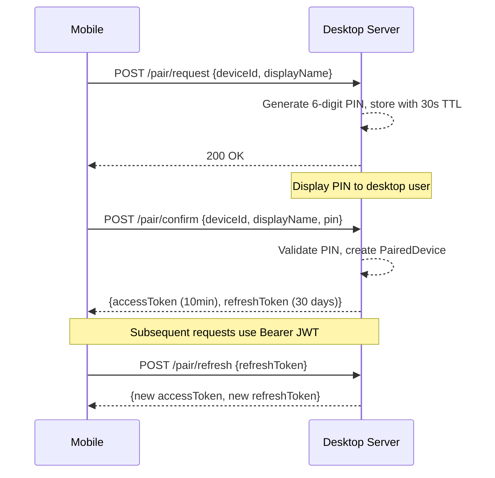

# Cross-Device Synchronization

> Part of the [Sufni.App architecture documentation](../ARCHITECTURE.md). This file covers the desktop sync server, the mobile client, and the pairing flow that connects them. Conflict semantics for the entity payloads live in [Persistence](persistence.md#conflict-resolution).

Desktop acts as a hub server; mobile devices sync with it.

## Pairing Flow

`ILocalDeviceIdentity` supplies one installation identity from the existing `DeviceId` key in secure storage on every platform. Concurrent callers share initialization, and a new ID is returned only after persistence completes. Pairing reads this identity and does not generate its own. Unpairing does not replace it.

The pairing client uses an injected `TimeProvider` for temporary discovery resolution deadlines. The inbound coordinator owns pending PINs and publishes `PairingChallenge` with one absolute `ExpiresAt`. The server prompt projects the remaining fraction with an injected UI timer. A late subscription cannot extend validity, and confirmation clears the prompt.

The mobile coordinator returns expected states when no server is discovered and when a PIN is rejected or expired (HTTP 401). Other request, confirmation and unpair failures carry a closed reason and optional diagnostics, logged once at the coordinator. Unpairing clears local credentials before the remote unpair request. A network failure leaves the device locally unpaired and produces a fixed notification. `PairingClientState` is `Unpaired | AwaitingPin | Paired`, derived from the pending request and the paired peer of the HTTP owner. `PairingClientCoordinator.InitializeAsync` loads installation/display identity and stored credentials once; `AppStartup` awaits it before it creates pages.

`SyncCoordinator.ConfirmPairingAndSyncAsync` drains an earlier run and clears the cursor table before it accepts new pairing credentials. The installation pairs with one hub, so every explicit re-pair starts a full baseline, also for the same certificate and incarnation. A cursor-reset failure prevents confirmation. After confirmation, typed progress lets the view model clear the PIN and ask the shell to go back immediately. The coordinator keeps and awaits the initial sync, and shutdown drains the entire operation. The coordinator has no navigation dependency.



Pairing request, confirmation, refresh and remote unpair are awaited `IInboundSyncCoordinator` commands with typed outcomes. A PIN is bound to the requesting device and the normalized display name, and expires after 30 seconds. Confirmation persists and publishes the paired device before it returns tokens. Confirmation and refresh responses include the hub database incarnation. The client persists it with its pairing credentials.

The hub persists SHA-256 refresh-token hashes, never the raw tokens. Rotation keeps the previous hash for one recovery request while the current refresh token is unused. Use of the current token replaces that recovery slot; use of the previous token consumes it. Both paths issue a fresh token and update the published device expiry. The repository checks and rotates credentials in one transaction.

Both directions use the same version/deletion/timestamp/writer ordering from [Persistence § Conflict Resolution](persistence.md#conflict-resolution). The hub preserves authored timestamps and versions. Deletion ledger entries travel in `SynchronizationData.deletions` after payload purge, and older content cannot revive them. Incoming session publication reads the committed winner, so a stale remote deletion cannot hide a retained local session.

## Server

`SynchronizationServerService` (`Sufni.App/Sufni.App.Desktop/SyncAndPairing/Services/SynchronizationServerService.cs`) embeds ASP.NET Core Kestrel on port 5575 with:

- **TLS**: Self-signed ECDSA P-256 certificate (password stored in `SecureStorage`), served with TLS 1.2 and TLS 1.3 enabled
- **JWT**: HS256 with a 64-byte random secret (stored in `SecureStorage`); `ISynchronizationTokenService` shares that persisted signing key between token issuance and bearer validation
- **Discovery**: mDNS advertisement as `_sstsync._tcp`
- **Rate limiting**: a fixed-window limiter throttles the anonymous `/pair/*` surface per remote IP: 10 requests per PIN-TTL window (30 s). This bounds PIN guesses per source per PIN lifetime. Excess requests get `429` with a `Retry-After` header and are logged. The partition key fails closed to `"unknown"` when the peer IP is unavailable.
- **Strict inbound JSON**: request bodies bind with `SynchronizationProtocol.ConfigureJson` options (reject duplicate keys and unmapped members, case-sensitive names, required non-nullable members and constructor parameters). First-party traffic passes because the client emits every snake_case key explicitly. The same server options preserve response naming; local and client serialization uses `AppJson`. See [Persistence § JSON Serialization](persistence.md#json-serialization).

`AppStartup` starts the server after database initialization and the first store refresh. Pairing and data endpoints directly await their owners. `AppShutdown` stops advertising, stops Kestrel and disposes its application before it disposes the shared service provider. Server startup returns `ServerStartResult.Started | Failed(reason, details)`. The service logs a startup failure once and cleans up a partially started host. `AppStartup` then publishes the server failure and starts no repair jobs. When no address is advertisable, the service logs a warning and still attempts advertisement.

All sync HTTP requests, including pairing, carry `X-Sufni-Sync-Protocol: 6`. The anonymous pairing group and the JWT-protected sync group both reject a missing or different value with `426 Upgrade Required`. Protocol version 6 has these payload rules:

- Push and pull use separate persisted cursors. One sampled `upper_bound` bounds each metadata snapshot.
- Session rows carry the derivation-window columns as authored metadata, like `timestamp`. The merge engine writes them in both remote-update variants, including the one that keeps the held processed generation.
- Session rows carry the authored velocity filter option. Processing fingerprints carry the app calibration version.
- The payload carries saved segments with source-owned anchors.
- Session rows carry no track links, session-window payloads or GPS metrics.

The client installs the header on the `HttpClient` of each peer. A new endpoint group must stay behind that service or add the same version gate. Kestrel caps sync request bodies at 256 MiB.

| Endpoint                       | Method | Auth | Purpose                                                     |
| ------------------------------ | ------ | ---- | ----------------------------------------------------------- |
| `/pair/request`                | POST   | No   | Start pairing, generates 6-digit PIN with 30s TTL           |
| `/pair/confirm`                | POST   | No   | Confirm PIN, returns access + refresh tokens                |
| `/pair/refresh`                | POST   | No   | Rotate both access and refresh tokens                       |
| `/pair/unpair`                 | POST   | No   | Revoke pairing (validates `deviceId` + refresh token in body) |
| `/sync/run/start`             | POST   | JWT  | Verify the hub incarnation and announce the run ID and ordered phase list |
| `/sync/run/end`               | POST   | JWT  | Complete the matching observed run |
| `/sync/push`                   | PUT    | JWT  | Receive one bounded `SynchronizationData` snapshot from mobile |
| `/sync/pull`                   | GET    | JWT  | Return changes in `(since, upper_bound]`                    |
| `/session/incomplete`          | GET    | JWT  | List session IDs the hub needs a blob for: missing-blob **fills** and held-blob **push-swaps** |
| `/session/data/{id}`           | GET    | JWT  | Download a processed telemetry blob as `application/octet-stream`; `X-Sufni-Processing-Fingerprint` carries the fingerprint of those bytes |
| `/session/data/{id}`           | PATCH  | JWT  | Upload a processed telemetry blob as `application/octet-stream` with optional `X-Sufni-Processing-Fingerprint`. Commits a matching generation; returns **204** for applied or ignored data and **409** for a pending or invalid transfer |
| `/session/source/incomplete`   | GET    | JWT  | List recorded-source ids this peer should upload: ordinary missing source rows plus referenced derivation source ids absent locally |
| `/session/source/data/{id}`    | GET    | JWT  | Download a recorded-source payload as `application/octet-stream`; source kind/name/hash travel in `X-Sufni-Source-*` headers and schema in `X-Sufni-Schema-Version` |
| `/session/source/data/{id}`    | PATCH  | JWT  | Upload a recorded-source payload as `application/octet-stream` with source kind/name/hash in `X-Sufni-Source-*` headers and schema in `X-Sufni-Schema-Version` |

A route group enforces authorization: `MapGroup("").RequireAuthorization()` wraps the ten JWT endpoints, with no per-endpoint attribute. The four `/pair/*` endpoints form a separate anonymous, rate-limited group. `/pair/unpair` stays in that group and authenticates by the `deviceId` and refresh token in its body, because a device that revokes itself may no longer hold a valid access token.

Session BLOB and recorded-source upload endpoints await `IInboundSyncCoordinator`, which serializes inbound writes through their publication:

- BLOBs use `ISessionSyncApplier` for generation validation, guarded persistence and session publication.
- Source uploads validate the hash, persist write-once captured content, and publish the snapshot that the repository returns before acknowledgement.
- Invalid source or BLOB payloads and pending generations return 409. A missing session returns 404 for a BLOB upload. Apply failures return 500. Invalid wire headers or content types return 400.

The server uses `TimeProvider` for certificate renewal, and token issuance uses it for JWT lifetime. The inbound coordinator owns PIN and refresh-token expiration through its injected clock. JWT bearer authentication keeps the framework's lifetime validation.

## Client

Outbound sync accepts cancellation through server discovery, transfer loops and HTTP sends and body reads. A canceled run is neutral. Each committed row batch publishes before the next phase. Source transfers publish committed sources while they drain cancellation. A shared token refresh finishes and persists rotated credentials before a canceled caller exits, so cancellation never abandons a credential rotation midway. The sync coordinator keeps its active run for shutdown and releases its state subscriptions on disposal. The inbound coordinator owns the interruption timer.

`SynchronizationPeer` uses its injected clock for certificate validity and the 30-second token-refresh margin. Sync delta bounds use database sequences.

`SyncCoordinator` runs the client workflow through `IBackgroundTaskRunner` in six phases after discovery. The coordinator owns phase sequencing, persistence, cursor writes and publication. Push and pull have independent sequence cursors. At run start, the client captures its local sequence upper bound. When the push cursor is zero, the run pulls the baseline before it pushes; otherwise it pushes and then pulls. The baseline pull lets the replica merge newer remote content before its first outbound selection. The next run picks up edits made after the captured bound.

1. **Push local changes** — select rows and deletion ledger entries whose `local_seq` lies in `(lastPushSequence, capturedUpperBound]`, PUT that bounded snapshot to `/sync/push`, then advance only `last_push_sequence` after success
2. **Pull remote changes** — GET `/sync/pull?since=` from the pull sequence, receive the server's `sync_seq` upper bound, and merge rows and deletion ledger entries in one SQLite transaction. Advance only `last_pull_sequence`, and only after processed-BLOB swap handling leaves the pull complete
3. **Push incomplete sessions** — for each session id the server advertises (a missing-blob *fill* or a held-blob *push-swap*), upload the local blob **and its stored fingerprint**. The server commits a fill or a push-swap when the fingerprint matches its target, returns 409 for a mismatched or pending transfer, and ignores an equivalent or ineligible generation with 204
4. **Pull incomplete sessions** — download blobs for two kinds of target and commit each only when the downloaded fingerprint matches the target (otherwise keep what is local and retry later): **fills** (local rows with no blob, target = the row's own stored fingerprint) and **swaps** (rows whose held blob has a different current-schema fingerprint than the one just pulled, target = the accepted remote fingerprint — see *Processed-BLOB coherence* below)
5. **Push incomplete recorded sources** — for each source id the server advertises, upload the local `RecordedSessionSourcePayload`
6. **Pull incomplete recorded sources** — for each local source id produced by `IRecordedSessionSourceSyncQuery`, download the server's `RecordedSessionSourcePayload`

Discovery resolves an atomic `PeerEndpoint` and captures one `ISynchronizationPeer` for the entire run. That peer owns its HTTP client, certificate pin, credentials and single-flight refresh. Address rediscovery updates only its endpoint; pairing replacement creates a new peer. A run links cancellation to the lifetime of the captured peer, so later requests cannot switch to a newly paired hub. Re-pairing and unpairing cancel old transfers, await an already-started credential rotation, and dispose the old client before another pairing can write secure credentials. Unpairing clears local credentials before its remote revocation request, which still validates the certificate of the old peer. Initialization deletes any stored `ServerUrl`; the endpoint comes only from discovery.

The client captures a `PeerIdentity` from the pinned certificate thumbprint of the peer and the database incarnation returned with its tokens. Both cursors use this identity. Address changes keep them, while a different hub or incarnation starts a baseline from zero. Run-start verifies the incarnation even while the access token is still current. The client proposes the cursor-dependent phase order of the identity. A mismatched incarnation returns the current value without starting hub activity. The client then loads the cursors of that identity and announces the corrected order before any row or payload transfer. A new identity starts with a pull-first baseline. Explicit re-pairing clears prior cursors before credentials are accepted.

The one `upper_bound` of the metadata snapshot applies to every synced table, including custom map layers, and to the deletion ledger. Core delta queries include updates and tombstones only in `(sinceExclusive, upperInclusive]`, with `local_seq` for push and `sync_seq` for pull. Authored timestamps never select deltas. Tracks are independent captured facts with the same delta bounds, so a changed session does not resend unchanged tracks.

The four blob/source transfer phases run with bounded client concurrency (`SyncTransferDop = 3`). Session pulls keep fill-before-swap phasing: the client downloads and commits all missing-blob fills before swap downloads start. Any unresolved transient swap holds back the pull cursor. The next run then replays the same bounded metadata delta and derives the swap work again.

Source sync runs after metadata sync, so both sides know which session ids and derivation windows exist before they ask for missing source payloads:

- The incomplete-source endpoints transfer a source row only when a side has none. A mismatch with the processed fingerprint marks the derived data stale; it never requests replacement of an existing source.
- For a derived session, the query uses the `source_session_id` of the session row, not the derived session id. It also asks for any referenced source ids that are absent locally.
- Push sends the stored source hash of the local row without rehashing the payload. The patch gate of the receiving server and the put-time validation of the repository still verify it.
- Pull rehashes each downloaded payload against its advertised source hash before it persists the payload. Imported payloads are decompressed for hashing; live payloads are normalized without their setup display name.
- A hash mismatch or a malformed compressed/JSON payload skips that item and leaves the source pending. A failure of the repository put itself fails the run.
- Source writes keep existing captured content, and publication uses the snapshot that persistence returns.
- The pull cursor has already advanced after metadata and processed-BLOB swaps. The missing-source queries retry source completeness independently, without a metadata replay.

Local workflow owners persist and prepare snapshots for publish-only stores. For row sync, endpoints await `IInboundSyncCoordinator.ApplyPushAsync` or `GetPullAsync`. A push serializes merge and publication. The merge returns `SynchronizationApplyResult` with the reconciled identities and pending swaps. The coordinator loads authoritative snapshots off-thread. It publishes bikes, setups, boards, sessions, tracks, custom layers and saved segments in one dispatcher batch, including ledger-only removals. A rejected remote delete therefore cannot hide retained local content. HTTP acknowledges only after publication. An apply failure returns 500. A malformed deletion entry rejects and rolls back the whole push with 400 and a warning diagnostic. `SessionSyncApplier` owns generation publication; the inbound coordinator owns source publication. Client pulls and hub pushes both await `SynchronizationApplier`. It merges through `ISyncDataStore`, prepares snapshots for the affected IDs and publishes one batch. The client does not refresh all stores after a run. Stores never read or write repositories, so publication does not repeat the persistence operation.

### Run activity

The run-start request carries a random run ID, the expected database incarnation and the actual ordered list of six transfer phases. Every later sync request carries `X-Sufni-Sync-Run` and `X-Sufni-Sync-Phase`. The server rejects malformed headers before the endpoint executes. The peer transport captures these values per HTTP request. The client sends run-end only after its phases settle normally, including runs that report pending items. Failures and cancellation do not claim completion.

The inbound coordinator publishes the declared phase and its position and does not infer steps from endpoint names. The desktop bar is determinate from those facts. One injected-clock timer marks a run interrupted after two minutes without a matching request. Accepted requests renew the deadline, and completion stops the timer. A new run replaces the displayed run. Old run IDs, requests from another device, and regressing phases cannot change the current run. An interrupted run stays terminal until a new run begins, and shell feedback reports a fixed retry message. The coordinator disposes the timer with its lifetime.

### Processed-BLOB coherence (download-then-swap)

`session.data` (the processed telemetry blob) never travels in `SynchronizationData`; only metadata does. A recompute can replace an *existing* blob, not only fill a missing one. The protocol therefore keeps one invariant: **the processed generation describes one coherent result**. A generation contains the blob, the fingerprint and `duration_seconds`, which are kept or replaced together. GPS metrics and their key are device-local and never travel in metadata or generation payloads.

- **Deferred metadata merge.** An inbound metadata update can arrive for a row that already holds a blob. The shared `Merge` path on client and hub then applies independent user metadata, including authored GPS alignment, but keeps the complete held processed generation. Alignment never waits for a BLOB, and a later BLOB never overwrites it. The row therefore never advertises a fingerprint or duration from bytes it does not hold.
- **Transient pull-swap set.** Both metadata directions use `ProcessedGenerationAcceptance.DecideProcessedGenerationTarget`:
  - It queues a current-schema incoming generation only when its fingerprint matches the local inputs and the held generation is stale. It holds the target when the source has not arrived.
  - Equal fingerprints keep the held bytes. A current incoming result can replace a stale or unparseable held fingerprint.
  - The client queues a *swap* with the id, the target fingerprint and the accepted target generation. The set is never persisted; each run derives it again from the metadata delta.
  - A network error or an unresolved swap (`404`, `409` or fingerprint mismatch) holds `last_pull_sequence` back. The next run pulls the same delta again and retries.
  - Fills are not swaps. Each run derives them from `data IS NULL`, independent of the cursor, so they are never lost.
- **Validate and match before commit.**
  - `SessionSyncApplier` validates the transferred MessagePack and its advertised target fingerprint. It then applies the same acceptance rule against current database inputs. A missing source leaves the transfer pending.
  - The client captures an immutable held-session snapshot before it downloads. The repository compares that fingerprint, the telemetry revision and the captured processing-input bundle in the commit transaction. An intervening recompute or transfer supersedes the write, which replaces no data and publishes no stale snapshot.
  - Swaps require and install the accepted `SessionProcessedGeneration`. Missing-BLOB fills normalize duration from the validated bytes. A fill cannot replace a generation that is already held.
  - Neither path advances `updated`. Invalid bytes leave the current generation untouched. Unresolved client swaps keep the pull cursor for retry. Session detail loading never fetches missing BLOBs.
- **Hub push-swap (push direction).** The desktop hub runs no pull phase. To *receive* a recomputed blob for a row it already holds, it records a durable push-swap request in the transaction of the deferred metadata merge.
  - `session_blob_swap_request` stores the session id, the target fingerprint and the serialized target generation.
  - The hub creates a request only when the incoming current-schema fingerprint is eligible against its current database inputs and the held one is not. It also creates one when the referenced source has not arrived, which keeps the accepted target until source sync completes. Invalid, legacy, equal or ineligible targets clear the request.
  - For a derived session, the input probe resolves the source through the incoming derivation window.
  - `GET /session/incomplete` advertises requests together with data-null fills. `PATCH /session/data` validates the bytes, commits the coherent generation only for a matching target, and clears the matching request in the same transaction.
  - A non-matching push-swap upload returns 409 and leaves the request pending. An equivalent or ineligible matching generation is ignored with 204. It clears only the request whose target fingerprint still matches, so it cannot erase a newer target.
- **Request cleanup and excluded rows.** Startup removes swap requests whose session is missing or soft-deleted, and database triggers remove them on physical or soft deletion. Rows that wait for their source keep the held BLOB and the pending target. Neither fills nor swaps commit until the source and dependencies are available. An incoming legacy fingerprint is not a valid target. An incoming result that matches the current inputs can replace a legacy held result. Every device recomputes the same source with the same options on the same binary, so fingerprints converge and swaps are normally rare.

"Incomplete," for the purpose of these phases, therefore means **missing _or_ awaiting a matching processed blob**.

`SyncCoordinator` (`Sufni.App/Sufni.App/SyncAndPairing/Coordinators/SyncCoordinator.cs`) publishes one replayed `SyncState` composed from pairing and its current operation. `IsPaired`, `IsRequestSent`, `IsRunning` and `CanSync` are derived properties of that snapshot. Shell and pairing views observe it on their UI dispatcher and hold no independent writable pairing flags. The stream stays connected for the coordinator lifetime, so a later observer receives the current state immediately. The coordinator owns the full client run:

- Row merges use the shared `SynchronizationApplier`, and BLOB commits use `SessionSyncApplier`. Committed source snapshots publish from the transfer drain, also after failure or cancellation.
- Mobile outbound sync reports a seven-step determinate run: resolve server, then six transfer phases. The remote client phases run through `IBackgroundTaskRunner`. Progress is marshalled back to the UI thread, so large BLOB downloads, source transfers and local patching do not block the mobile shell spinner.
- Desktop observes `IInboundSyncCoordinator.Activity`: `Idle`, `Running`, `Completed` or `Interrupted`. `SyncActivity` is the mutually exclusive idle/pairing/outbound/inbound/stopped state of the coordinator. Pairing prevents a second run during confirmation but does not show the global transfer spinner.
- Inbound row and source writes are awaited coordinator operations; processed BLOB commits use the session applier — see [Coordinators](ui-workflows.md#coordinators).

`MobileAppBootstrapper.RegisterMobileSync` registers `HttpApiService` together with `PairingClientCoordinator`. `AppComposition` registers `SyncCoordinator` on every platform. Desktop composition does not register `HttpApiService`.

`HttpApiService` (`Sufni.App/Sufni.App/SyncAndPairing/Services/HttpApiService.cs`) owns peer creation and retirement and the paired peer graph. Explicit initialization publishes a stored peer, confirmation publishes the newly credentialed peer, and credential clearing publishes its absence. `SynchronizationPeer` owns JWT auto-refresh. When the access token is within 30 seconds of expiry, it calls `/pair/refresh`, which rotates both the access and refresh tokens. If `/pair/refresh` itself returns 401, the peer clears the stored pairing credentials and the paired peer becomes absent. The client enables TLS 1.2 and TLS 1.3 to match the desktop server.

`SynchronizationCertificateValidator.TryValidate(...)` performs TLS validation and is stricter than a generic CN check. It rejects expired certificates and requires an exact subject match against the constant `SynchronizationProtocol.CertificateSubjectName` (`cn=com.sghctoma.sst-api`). It pins the **certificate thumbprint** captured at pairing time against `SecureStorage`. It does not validate the certificate chain, which makes LAN self-signed certificates viable. The thumbprint pin replaces the missing chain trust with TOFU.

`SynchronizationData` (`Sufni.App/Sufni.App/SyncAndPairing/Models/Synchronizable.cs`) is the sync payload:

```
SynchronizationData
├── UpperBound
├── Boards[]
├── Bikes[] (includes `rear_suspension` union JSON)
├── Setups[]
├── Sessions[] (metadata, tuning fields, duration, processing fingerprint; no blob)
├── Tracks[]
├── Segments[] (saved segments, JSON `segment`)
├── CustomTileLayers[]
└── Deletions[] (durable ledger entries)
```

Every bike sync row must carry the `rear_suspension` union. Deserialization rejects a payload that omits it, uses the legacy `rear_suspension_kind` / `linkage` / `leverage_ratio` triple, or contains a malformed union. This applies on the client pull path and on the desktop inbound push path. Only the local SQLite startup migration accepts legacy rear-suspension data.

Saved segments use the core paths. Client and hub apply the same authored-history merge rule, after sessions in the same transaction. Segments carry source-hash ownership and source-relative anchors and survive session deletion. Each session window derives segment visibility, including split windows received from a peer. Client and hub row application publish affected segments through the shared applier, in the same batch as related rows.

Processed telemetry blobs (`session.data`) and raw recorded sources (`session_recording_source.payload`) travel through the dedicated session-data and session-source endpoints, never through `SynchronizationData`. Their bodies are binary `application/octet-stream`. Row metadata travels in HTTP headers, so large BLOBs are not base64-encoded in JSON.

### Paired-device publication

`PairedDeviceCoordinator` owns local unpair persistence through `IPairedDeviceRepository` and then removes the device from the publish-only store. A failure leaves the published device present and returns a typed reason with optional diagnostic details. The inbound coordinator owns confirmation, refresh and remote unpair publication, and awaits it before it acknowledges the request.

### Run failures and unavailable servers

The client workflow returns `SynchronizationRunResult.Failed(reason, details)` when a phase throws, and logs the cause once with the peer identity. HTTP 426 is classified as `ProtocolMismatch`; other phase failures are `Synchronize`. `Completed` requires local completeness and no pending transfers. `IncompleteData` carries local missing-data counts and the identities, kinds and directions of pending items. The shell reports the pending count. For BLOB and source items, 404, 409, other HTTP transfer failures, network errors and timeouts leave the item pending while the run continues. Authentication and protocol failures fail the run. A cancellation by the caller is neutral, and committed source transfers still publish from the transfer drain.

A successful row push advances its cursor even when a later item stays pending. Applied or ignored swaps resolve their targets and let the pull cursor advance; unresolved swaps hold it. Fills and sources retry through the incomplete queries, independent of either cursor. A 204 acknowledgement is terminal for that item.

`SyncCoordinator` forwards typed failures to shell feedback without another log. Already-committed rows and sources stay published when a later phase fails or is canceled. When discovery finds no endpoint, the coordinator raises `ServerUnavailable` and starts no transfer phase. The shell shows fixed failure summaries with optional details and keeps progress and completion text unchanged.
