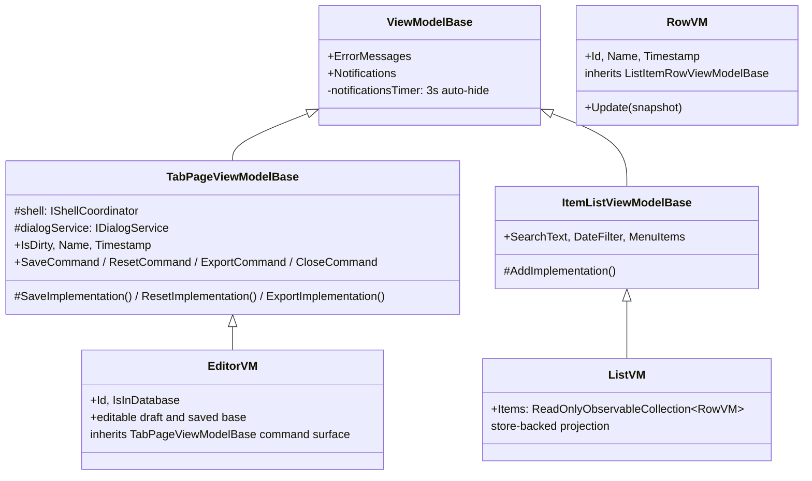

# UI View Models

> Part of the [Sufni.App architecture documentation](../ARCHITECTURE.md). This file covers presentation view-model categories and the session sub-page composition model. Layering invariants live in [UI Architecture](ui.md), read-state ownership lives in [UI State and Queries](ui-state.md), and coordinator/navigation ownership lives in [UI Workflows, Composition, and Navigation](ui-workflows.md).

## View Models



Shell list, row, tab and pending-delete bases live in `Shell/ViewModels/Base`.
`Shared/Base/ViewModelBase` retains generic notifications and subscription scopes.

There are five kinds of view model in the presentation layer:

- **Shell view models** — `ShellRootViewModel`, `ShellWorkspaceViewModel`,
  and `MainPagesViewModel` compose the app shell for both platform
  lifetimes. `ShellRootViewModel` is the root data context for `MainWindow`
  and `MainView`; it exposes the selected layout profile, platform
  capabilities, startup state, shutdown availability, the deferred primary page
  surface, and the shared workspace.
  `ShellWorkspaceViewModel` owns the logical tab collection, current tab,
  tab history, open/focus, background open, close, restore, back, and reorder
  behavior used by both compact and workspace presentations. `MainPagesViewModel`
  is the only place that holds references to multiple primary page view models
  at once; this is the explicit "view composition" carve-out from the
  no-VM-on-VM rule. It delegates GPX/video intents to coordinators and sends
  their results to `ShellFeedbackViewModel`; it holds no global feedback state.
  `ShellFeedbackViewModel` is the single app-lifetime projection of sync
  availability, pairing state and progress, and owns global sync/GPX/video
  notifications and errors. Both shells render its `ShellFeedbackBar`, so
  changing primary pages does not relocate or hide a result. `AppStartup` owns
  the initial store refresh and creates pages only after initialization and
  refresh succeed.

- **Feature page view models** — non-entity top-level screens such as `ImportSessionsViewModel` and the pairing pages. They own only screen-scoped state, bind directly to controls, attach subscriptions and browse lifetime in `Loaded` / `Unloaded`, and delegate workflows to coordinators and services. `ImportSessionsViewModel` is the canonical example: it keeps datastore / file selection, notifications, and errors; resolves `SelectedSetup` from `ISetupBoardQuery.FindByBoardId`; and delegates source observation, file listing, folder registration and the import itself to `ImportSessionsCoordinator`. For work that belongs to a screen, generated async-command `IsRunning` remains the busy-state source. Import runs belong to the coordinator: the import tab observes its replayed `SessionImportState` and renders progress/results. It releases the observation on final close. A reopened tab sees the same active batch. Each `Imported` event with undecided sensor findings adds a `SensorFindingsViewModel`; the list clears when a new run starts and on close.

- **List view models** (`ViewModels/ItemLists/`) — `BikeListViewModel`,
  `SetupListViewModel`, `SessionListViewModel`,
  `PairedDeviceListViewModel`, `LiveDaqListViewModel`. Most take a
  read-only store and project the
  store's `Connect()` change stream through DynamicData into a typed
  `ReadOnlyObservableCollection` of row view models:

  ```
  store.Connect()
      .Filter(filterSubject)              // search text + date range
      .TransformWithInlineUpdate(
          snapshot => new XxxRowViewModel(snapshot, coordinator),
          (row, snapshot) => row.Update(snapshot))
      .Bind(out items)                    // .SortAndBind for sessions
      .Subscribe();
  ```

  `BikeListViewModel` deliberately reorders this pipeline to
  `Transform → DisposeMany → Filter → Bind` so `DisposeMany` only
  fires when a row leaves the source store, not when the filter
  merely hides it — the trade-off is that the predicate sees the
  row VM rather than the raw snapshot.

  Each list owns its own `Items` `ReadOnlyObservableCollection`
  and pushes a fresh predicate to a `BehaviorSubject` whenever
  filter state changes. `ItemListViewModelBase` owns the shared
  `Loaded` / `Unloaded` subscription lifecycle: `Loaded` calls the
  concrete list's `AttachSubscriptions` once, `Unloaded` disposes that
  scope and lets the list clear its projected rows, and a later load
  reconnects and republishes the store's current state. It also contributes
  the cross-cutting search / date-filter / menu-item state and the
  `AddCommand` plumbing (it does not declare an `Items` property — there is
  nothing to shadow). Individual lists override `AddImplementation()` to
  request a new editor from the shell.
  `SessionListViewModel` follows the same projection shape but uses
  `IRecordedSessionProjection.ConnectSessions()` instead of
  `ISessionStore.Connect()`, so rows include processed-data presence,
  staleness, raw-source availability, and summary metrics without each
  row doing its own store lookups. It keeps the flat `Items` collection
  and exposes `DateGroups` as the grouped list surface
  used by the desktop sidebar and mobile pull-menu scroll view. Each list
  constructs its own menu items. `IShellActions` supplies the shared sync
  command and import availability; the session list owns `OpenImportCommand`,
  and its desktop view binds directly to it without finding a parent shell.
  The session list also owns `AlignGpsCommand`: a header button on desktop and
  an "align GPS" pull-menu item on mobile. It takes the sessions the list
  shows, so search and the date filter choose them. It asks for confirmation,
  runs `SessionCoordinator.AlignGpsAsync` behind the progress dialog and
  reports the counts in the list feedback, with an error when a session failed.
  Bike and setup lists own file import commands, feedback and read cancellation.
  Their desktop buttons and compact pull menus invoke the same command. A bike
  import opens a fresh unsaved draft; a setup import opens its newly persisted
  setup by ID. Unloading cancels file reads and suppresses late navigation; an
  accepted setup import still completes persistence and publication.

- **Row view models** (`ViewModels/Rows/`) — `BikeRowViewModel`,
  `SetupRowViewModel`, `SessionRowViewModel`,
  `PairedDeviceRowViewModel`, `LiveDaqRowViewModel`. Cheap,
  non-editable wrappers around a single snapshot. They expose a
  `Update(snapshot)` method that DynamicData calls when the underlying
  snapshot changes, plus an `IRelayCommand`-based open/delete surface
  inherited from `ListItemRowViewModelBase` (a single shared `x:DataType` for the
  `DeletableListItemButton` / `SwipeToDeleteButton` /
  `PairedDeviceListItemButton` controls). Open commands route to the shell; delete intents go to the owning list
  and entity coordinator. `LiveDaqRowViewModel` is an
  exception: it does not derive from `ListItemRowViewModelBase` because live DAQ
  rows are not deletable and use a custom row control with
  online/offline presentation.
  `SessionRowViewModel` wraps `RecordedSessionSummary` rather than
  `SessionSnapshot`; it keeps the unadorned `BaseName`, appends
  `(Stale)` or `(No Raw)` to the display name when appropriate, formats
  the always-visible row timestamp as local time only because the group
  header owns the date, formats the optional subtitle from unit-labelled
  duration plus GPS distance/ascent/descent. Staleness appears in the title;
  completion and video availability retain their own bound indicators.

- **Editor view models** (`ViewModels/Editors/`) — `BikeEditorViewModel`,
  `SetupEditorViewModel`, `SessionDetailViewModel`,
  `LiveDaqDetailViewModel`, `LiveSessionDetailViewModel`. Constructed
  by `IEditorFactory` from a snapshot or live-session context, never by
  another view model and never stored in a list. The shell owns the factory;
  feature view models request `EditorKey` surfaces and deleted-editor closure
  through `IShellCoordinator`. Coordinators return domain results.
  Persisted editors hold one immutable draft base for authored-field comparisons.
  Bike/setup dirtiness is established in the constructor, and successful saves
  keep any later edits dirty. Setup linkage selectors use immutable `JointSpec` values from the bike snapshot;
  they do not construct bike editor view models. The setup draft retains the selected
  bike ID; the selector resolves immutable snapshots by that ID. Its bike choices
  are populated before binding and observed until the editor closes, so view
  detachment and bike metadata replacement preserve selection and sensor inputs.
  Setup sensor sub-editors expose immutable `SensorDraft`
  inputs without their own saved baselines or JSON serialization. `SetupCoordinator`
  builds the persisted row and sensor JSON after applying shared `SetupSaveRules`.
  The setup editor owns the Board ID field text and accepts the GUID formats
  supported by `Guid.TryParse`. Empty or invalid input disables Save.
  Invalid input reports a field error through `INotifyDataErrorInfo`. Each
  edit updates dirtiness immediately, so Reset and the close prompt reflect
  the current Board ID text.
  A saved setup editor holds a `SetupTerrainLabelsViewModel` in `TerrainLabels`;
  a new setup has none. It reads `ITerrainLabelQuery.ForSetup` at creation and
  on each `Changes` item and shows the scale lines with the roughness label
  rows, then the steepness label rows. Both lists hold `SetupTerrainLabelItem`.
  A row names the class its stretch reads where it differs from the label, in
  the warning colour when the reading clashes with the label. Its
  commands act at once through `ITerrainLabelCoordinator` and the shell: open
  the ride, change the class through the class prompt of the row's kind, and
  delete after a confirmation. A failure goes to the editor's error messages. The section is
  not part of `SetupDraft`, so Save, Reset and dirtiness ignore it. Both setup
  layouts place it between the common fields and the error bar.
  Imported bikes enter the factory as a validated `BikeDraft` on `EditorKey.NewBike`;
  they do not replace another editor’s draft. Rear-suspension mode changes are
  awaited commands gated by the composed pointer capability; a pending or declined
  confirmation preserves the existing draft. The linkage canvas translates Avalonia
  gestures into point coordinates and selection commands before calling its editor.
  Editors derive editable state from the snapshot in `ResetImplementation`,
  and call back into the coordinator's `SaveAsync` / `DeleteAsync`. On
  a typed `Conflict` result they prompt the user via
  `IDialogService.ShowConfirmationAsync` and rebuild from the
  conflict's current snapshot. After accepting a successful save baseline,
  editors call `IShellCoordinator.CompleteEdit`; the shell returns to the
  previous surface in compact layout and keeps the current tab in workspace layout. Persisted-entity editors share the
  `TabPageViewModelBase` command surface, which is the single
  `x:DataType` used by the shared `CommonButtonLine` editor button
  strip. `LiveDaqDetailViewModel` and
  `LiveSessionDetailViewModel` are the two live-only exceptions: the
  diagnostics tab is a transport/configuration surface over the shared
  stream, while the live session tab is a create-only capture editor
  backed by `ILiveCaptureCoordinator`. `LiveDaqDetailViewModel` projects a
  throttled diagnostics snapshot from `LiveDaqSessionState` and also
  owns the disconnected-only Set Time / Replace Config / Upload CONFIG
  command flow, reusing `ViewModelBase.Notifications` and
  `ErrorMessages` while keeping management busy state separate from the
  live connect/disconnect workflow. The live session editor projects
  one foreground `LiveCaptureState` subscription from the capture coordinator,
  without its own throttling or dispatch. It retains controls, labels, the draft
  and save/reset outcomes, and persists through `LiveDaqCoordinator.SaveCaptureAsync(...)`.
  `LiveSessionAnalysisWorkspaceViewModel` owns analysis choices/readiness and
  observes current bike cutoffs through `IBikeStore`, reusing `DampingCutoffWorkflow`.
  `LivePagePresentationApplier` owns cancellable/drained page bakes; the editor
  composes `LiveSessionShellMobileWorkspaceViewModel` and the shared sidebar workspace.
  The bike editor holds the name on the tab. Each workspace projects one
  immutable editor state. Edits and controller intents that arrive during a
  publication wait until all subscribers receive the current state; controller
  intents then complete with acceptance. `BikeEditorIntentReducers` holds every
  intent rule, and the controller derives the geometry of each published state.
  The controller rejects stale analysis completions by generation.

  | Bike editor part | Responsibility |
  | --- | --- |
  | `BikeEditorStateController`, `BikeEditorActions` | Reduce intents and publish the accepted draft baseline, phase, inputs, geometry, selection and analysis. Accepting a save keeps newer inputs. |
  | `BikeEditorGeometryDeriver`, `BikeAuthoredDraftComparison` | Project the scale, effective angle, overlay, content bounds, current suspension specification, path and dirty state. |
  | `BikeDraftLoadController`, `BikeImageOpenController` | Load drafts and replacement images. The initial load survives view detachment. A failed initial decode retains the original draft for recovery. |
  | `BikeBitmapHandoff`, `BikeImageCanvasViewModel` | Decode off-thread, offer the image token to the reducer, and install only a matching bitmap. Replacement or close disposes the bitmap and its rotated cache. |
  | `BikeEditorAnalysisDemand` | Debounce, cancel and run the requested generation. Plot data can persist through same-mode refreshes. Axle paths require a matching specification. |
  | Frame, suspension, wheels, linkage, leverage-ratio and analysis workspaces | Project binding values and forward edits. Linkage rows retain their identity through a drag. |
  | `RearSuspensionModeSwitch` | Gate mode changes on pointer capability and confirm payload discard. |

  `SessionDetailViewModel` and `LiveSessionDetailViewModel` both
  compose session sub-pages from `ViewModels/SessionPages/` and expose
  workspace contracts for signals, media, analysis, sidebar, and mobile
  shell surfaces instead of putting every binding directly on the
  editor — see [Session Sub-Pages](#session-sub-pages) below.
  For recorded sessions, `RecordedSessionEditorState` is the projected state
  surface consumed by the signals, media, analysis, and mobile-shell
  workspaces. User-originated workspace setters call
  `RecordedSessionEditorActions` instead of mutating backing fields directly;
  `RecordedSessionEditorStateController` is the only reducer for those intents.
  It reduces each intent or typed input once and publishes one coherent state, including the current load data,
  selected page, analysis range, signal availability, map/media state, and
  analysis presentation. Preference-page getters read the reducer's current snapshot
  directly, so page notifications do not rely on the editor subscribing first.
  Reentrant intents wait until the current state has reached
  all subscribers. Signal and analysis workspaces hold one state reference and
  derive their binding properties from it; notifications see the whole new state.
  `SessionDetailViewModel` keeps one current state
  snapshot for its screen, operation and layout properties. Notes, settings,
  preferences, signal actions and analysis bindings are exposed through the
  workspaces; the editor keeps its composed pages and runtime objects private. Its binding fields
  form the editable draft; one immutable `SessionDraft` base supports reset,
  dirtiness and conflict checks. A `Created | Loaded | ApplyingDraft | Closed`
  lifecycle tracks load, reset and close. Close requests share one cleanup task.
  The editor composes internal parts with the same tab lifetime. Each state
  subscriber keeps the last state it received; it never reaches back into the
  editor for a potentially older state. Nine input subjects wire their results
  through the reducer, preserving reentrant publication ordering.

  | Part | Presentation responsibility |
  | --- | --- |
  | `RecordedSessionAnalysisDemand` | Owns the analysis result state, semantic keys, invalidation, requests and result publication. The reducer explicitly prepares analysis before publishing each distinct state; presentation subscription order does not establish this dependency. Insights visibility is a `Func<int, bool>` over the page collection, evaluated with the selected index from the received state; page membership changes call `OnPagesChanged`. Insights demand remains after leaving the page. |
  | `RecordedSessionTerrainController` | Follows the group of terrain status, setup scale key and label set, prioritizes pending sessions, and loads and classifies the current profile with its labels for the editor. A change of only the scale key or the label set keeps the loaded terrain until the new classes replace it. It selects the bike baseline identity and the scale catalogue synchronously on each summary commit and fits a changed baseline on the background runner. Closing the tab cancels and drains its reads and fits. |
  | `GpsOffsetSuggestionPrompt` | Estimates the GPS offset from the frame gyroscope after a load, once per track, telemetry, fixes and timeline. It offers a qualifying estimate when the tab is active and records the handled track ID. A failed estimate is logged once and shows nothing. |
  | `RecordedSessionLoadController` | Owns two-stage loading, progress, supersession and processed-telemetry retention. |
  | `SessionStalenessPrompt` | Owns prompt visibility, deduplication by required fingerprint pair, unavailable-input feedback, and single/bulk recompute choices. |
  | `RecordedSessionPreferencesController` | Owns the persisted preference baseline and pending local edits, derives effective preferences, forwards commits and retains pending writes. Processing completions return to the reducer with their captured draft. |
  | `SessionWindowEditController` | Owns the four window-edit commands and their common availability, result feedback and split navigation. |
  | `TimelineAlignmentController` | Owns the one GPS/video mark, six alignment commands and result feedback. |
  | `SignalPlotContextActions` | Owns range, segment and terrain label commands (roughness and steepness) and the per-row context menus, composed with autozoom, alignment and window edits. The label command needs a click inside the analysis range and loaded terrain, and calls the segment picker. |

  All these recorded-editor parts, including the recorded analysis, signals and
  media workspace adapters and signal-row actions, live in
  `Sessions/Detail/ViewModels/Editors`. The reusable capabilities do not depend
  on the recorded editor state. Recorded/live workspace contracts live in
  `Sessions/Presentation/SessionWorkspaceContracts.cs`.
  The analysis workspace receives the demand and `DampingCutoffWorkflow` directly
  and owns its range-selection command. The signals workspace owns its
  `SignalRowActionsController`, applies toggle states on each received state, and
  receives `SignalPlotContextActions` by reference. Header lists and context menus
  are stable runtime objects, outside reducer state. Travel airtime starts enabled
  in the initial state; loads preserve the user's explicit overlay choices.
  The media workspace applies map points and timeline context from its state
  subscription.
  The editor exposes `SensorFindings`, a `SensorFindingsViewModel` from
  `Sessions/SensorFindings/`, while the loaded generation is current. It builds a
  new one when the loaded telemetry changes and disposes it on close. The view
  model follows the session decisions in the store and sends Drop and Keep to
  `ISessionCoordinator.SetSensorDecisionAsync`; see
  [Sensor decisions](ui-workflows.md#sensor-decisions).

  Readiness and selection highlights are keyed background results. A telemetry or
  range change clears stale outputs; track-only augmentation keeps valid results.
  `RecordedPagePresentationApplier` alone projects preference refresh, sample rate,
  signal availability, processing options, temperature averages, damping percentages,
  chart loading/clearing and balance-page membership. It observes only editor
  state; load and preference controllers never update pages directly. Accepted
  analysis state retains full-session balance availability independently of the
  selected range, so selecting an empty range does not remove the balance page.
  Processing controls read the current editor draft or the committed session
  option. Completion settles only its captured draft; a later edit survives both
  the completion and publication of the preceding option. Superseded completions
  leave presentation untouched. Editable notes/settings remain the editor's draft. Damping previews use the current bike;
  failed/conflicting commits restore its projected cutoffs only while the tab is open.

  Stable runtime objects (pages, timeline, source visibility, map, video pane,
  segment picker and comparison) are composed once per editor and passed by
  reference. The segment picker also lists the terrain labels of the ride and
  labels a selection through the class prompt
  ([segments.md](segments.md#segments-picker)). Initial loading subscribes to preferences, domain and operation
  observations before restoring preferences, then starts the staged data load.
  Inactive-tab deferral applies in both layout profiles.

  Close requests share one cleanup task. Close cancels the editor lifetime token,
  stops reads and observations, releases telemetry retention and stops analysis.
  It awaits pending domain reactions and preference operations, then disposes
  workspaces, parts, reducer and input subjects. Reads reject cancelled or
  superseded results. Accepted coordinator writes continue after tab close;
  their late feedback, page/action updates and navigation are suppressed. A split
  published after close does not open a new tab. Application shutdown drains
  window edits (including recompute), GPS/video alignment and damping-cutoff writes
  before stopping recompute and disposing services.
  Recorded-session loading publishes decoded telemetry first through
  `ISessionLoader.LoadDetailAsync`, then
  awaits `LoadTrackAsync` under the same active load token and augments the
  loaded state only if that generation is still current. This lets built-in
  telemetry Signals become ready while the map and track-backed rows are still
  waiting, without introducing a second telemetry owner or restarting the
  telemetry generation when track data arrives. Both stages carry
  `SessionDetailLoadProgress`; `RecordedSessionLoadController` owns the UI-only
  preparing and applying stages, ignores progress and completions from canceled
  or superseded load tokens, and does not replace already-published first
  content with a later loading presentation. `RecordedSessionEditorStateController`
  maps pre-content progress into
  `SessionScreenPresentationState`, whose loading states always expose a
  concrete message and normalized `0..1` progress fraction. Both workspace and
  compact session shells show progress while `IsLoading` is true. `SessionScreenStateOverlay`
  renders loading, error and incomplete cards for both recorded shells and the
  live desktop shell. It uses role colors and accepts an optional fallback for a
  null message; the mobile shell supplies "Loading session data...". Loading
  states themselves require a message. Recorded operation overlays remain in
  their owning shell views.
  The recorded editor subscribes to `IRecordedSessionProjection.WatchSession`
  on its first `Loaded` and disposes that subscription on final tab close. View
  detach/reattach and layout changes keep the active load and telemetry retention.
  Initial or runtime domain snapshots pass to `SessionCoordinator.ReconcileStalenessAsync`;
  `SessionStalenessPrompt` prompts only for its `Required` result. Unchanged fingerprint pairs
  do not repeat a declined prompt; changed processing inputs may prompt again; inactive tabs in both layouts defer that prompt until selected. Unrecomputable stale snapshots report an
  error; processed data arriving for a current session reloads the
  presentation data. Domain reactions are retained and drained on final close;
  their failures use a fixed summary with separate diagnostics.

### Session Sub-Pages

The `ViewModels/SessionPages/` folders within the Sessions areas and `LiveDaq/` (e.g. `Sessions/Signals/ViewModels/SessionPages/`, `Sessions/Pages/ViewModels/SessionPages/`, `LiveDaq/ViewModels/SessionPages/`) hold the per-page view
models that `SessionDetailViewModel` (recorded sessions) and
`LiveSessionDetailViewModel` (live captures) compose into the mobile
session page surface. They share a tiny base, `PageViewModelBase`,
which extends `ObservableObject` and exposes only the immutable
`DisplayName` used as the page header. Page selection belongs to the
owning session workspace, not to individual pages: recorded sessions
project it from `RecordedSessionEditorState.Intent.SelectedPageIndex`
through `SessionShellMobileWorkspaceViewModel` and write changes through
`RecordedSessionEditorActions.SelectPageIndex`; live sessions store it
in `LiveSessionShellMobileWorkspaceViewModel`, which clamps it after page collection changes. Both surfaces expose
`SelectedPageIndex`, `SelectedPage`, `PageCount`, and
`SelectedPageDisplayName` through `ISessionShellMobileWorkspace`.
Pages do not own commands, notification bars, selected flags, or shell
navigation. The editor is the `TabPageViewModelBase` and keeps
the `Save` / `Reset` / `Close` surface.

Each editor composes an `ObservableCollection<PageViewModelBase> Pages`,
exposed through its mobile workspace. `SessionShellMobileView` binds that collection to a
`CarouselPage` and binds the shared selected index to both the
`CarouselPage` and `PipsPager`, so swipes and pips update the same
workspace-owned index. The two editors
compose different page sets:

- Recorded sessions: signals, spring, strokes, damping, position/velocity,
  balance, ground & comfort, insights, notes, preferences.
- Live captures: signals, spring, damping, notes, preferences; balance is
  inserted when the current live analysis produces balance data.

The recorded page applier and `LivePagePresentationApplier` add or remove `BalancePage`
at runtime based on full-session balance availability, so `Pages` is mutated
rather than rebuilt. Signals pages are constructed with the editor's signals and media
workspaces as constructor arguments — `RecordedSignalsPageViewModel` for
the recorded editor, `LiveSignalsPageViewModel` for the live editor.
Several analysis pages are also workspace-backed so their
presentation states and SVG surfaces can be built from the editor's
analysis service; notes and preferences remain the mostly local
parameterless pages. `PositionVelocityPageViewModel` is owned by the
recorded `SessionAnalysisWorkspaceViewModel`, which exposes it as
`ISessionAnalysisWorkspace.PositionVelocity` (null for live captures). The
same instance is the mobile page and the desktop tab content. It holds the
selected side and display mode as view state and derives the shown side,
the side-selector visibility, and its presentation state from the
workspace's front and rear analysis states. On desktop, the analysis view
builds one tab strip from the built-in tabs, adding Position/velocity after
Damping only when the workspace offers it, and places the selected
analysis body plus the segment comparison banner inside one vertical scroll
region; analysis plot hosts use natural fixed plot heights instead
of stretching to the current analysis pane height.

Most pages are projection surfaces: `SpringPageViewModel`, `DampingPageViewModel`
and `BalancePageViewModel` carry per-plot strings and `SurfacePresentationState`
values. Recorded pages consume the analysis workspace, with page-specific
projection owned by `RecordedPagePresentationApplier`; the live editor pushes
its analysis presentation directly. Recorded-session analysis pages distinguish unavailable
finished data from live warm-up: a stored session or selected range
with too little travel movement shows a no-data message without a
spinner, while live-session analysis keeps a waiting state because
the relevant stream samples may still arrive. `NotesPageViewModel` carries the description plus
fork/shock `SuspensionSettings`. Editors include those editable values in their
dirty tracking; the recorded editor compares them with its immutable draft base.

Two pages diverge from that pattern:

- **Signals pages** wrap the editor's signals workspace and a shared
  media workspace and forward bindings into a reusable
  `SignalRowsRoot`. The root owns a vertical `ScrollViewer` and a
  collapsible row hierarchy rather than a fixed signals grid:
  Travel hosts Velocity, IMU vibration RMS hosts Frame Pitch/Roll, and
  GPS speed hosts Elevation. Desktop signal roots live inside the signals/analysis
  splitter region and grow visible base rows once all preferred row
  content fits; mobile signal roots are measured by the page scroll and
  report preferred content height. Rows are draggable from their
  headers within that hierarchy: dropping on another row appends the
  dragged row to that row's children, while dropping in the divider
  band between root rows makes the dragged row a root row at that
  position. Row visibility is controlled
  by `TravelSignalState` / `VelocitySignalState` / `ImuSignalState` /
  `PitchRollSignalState` / `SpeedSignalState` / `ElevationSignalState`
  on the workspace
  (recorded: projected from
  `RecordedSessionEditorState.Presentation.Signals`; live: directly on
  `LiveSessionSignalsWorkspaceViewModel`). Child row titles
  are progressively inset by hierarchy depth. Expanded parent rows draw
  short connector branches in the child-row band, starting at each
  direct child row's top edge and stopping before that child row's
  header glyph; those branches disappear with the parent's expanded
  content. The guides stay in the left title/glyph gutter, avoid the
  glyph text itself, and do not enter plot chrome or shift plot
  content, so signal data remains vertically aligned across parent and
  child rows.
  The row hierarchy, each row's expanded/collapsed state, and manually
  resized root-row height ratios are stored in
  `SessionPreferences.SignalLayout` as stable row IDs plus normalized ratios.
  For recorded
  sessions, `RecordedSessionSignalsWorkspaceViewModel.SignalLayoutPreferences` projects the value
  loaded and saved through `ISessionCoordinator` preference workflows; live captures
  carry the current live signal layout preference into
  `LiveDaqCoordinator.SaveCaptureAsync(...)` so the newly saved
  session opens with the same row layout. The pure
  `SignalLayoutPreferenceTree` helper owns preference normalization,
  capture, root moves, child moves, duplicate removal, unknown-row
  skipping, missing-default appends, and cycle prevention; the Avalonia
  `SignalRowsRoot` owns materialization, drag/drop hit
  testing, brushes, manual row-size capture, and visual rebuilding. If
  any visible resizable root row has no stored height ratio, the signal layout
  falls back to default sizing so new or unknown panes do not inherit a
  partial old layout. Hidden rows are not
  duplicated in the signal hierarchy preference: plot visibility remains
  the existing `SignalDisplayPreferences` contract, so hidden rows keep
  their saved hierarchy position and reappear there when re-enabled.
- **`PreferencesPageViewModel`** exposes each signal's availability and smoothing,
  plus the velocity-filter slider and its commit event. Signal display preferences
  read the owning editor/workspace through getters and send immutable edits back
  through callbacks. `RefreshSignalDisplayPreferences` raises binding notifications
  after the owner changes; the page keeps no smoothing copy. Availability uses
  `ApplySignalAvailability`. The recorded editor projects the filter from the
  session row; `RecordedSessionPreferencesController` in `Sessions/Detail/ViewModels/Editors` sends commits to
  `ISessionCoordinator.SetProcessingOptionAsync` and displays the returned outcome.
  The coordinator owns persistence, recompute and conditional rollback. Live save
  puts the selected option on the new session.

  Signal display, analysis modes, signal layout and pane ratios remain in
  one effective `SessionPreferences` projection in the recorded editor state.
  `RecordedSessionPreferencesController` observes the persisted baseline through
  `ISessionPreferences` and overlays pending local edits in intent order. These
  are distinct facts: committed device-local preferences and unacknowledged view
  edits. Each save acknowledgement retires its edit; an older acknowledgement
  cannot overwrite a newer pending edit. A failed save retires its edit and
  reports the failure, revealing the committed value unless a later edit covers
  it. Unrelated persisted changes remain visible while saves are pending.
  Observation runs synchronously with the UI-thread publication that precedes
  save completion. Restore cannot replace an already observed baseline.
  `SessionCoordinator.LoadPreferencesAsync` / `SavePreferencesAsync` own
  reads/writes and return safe typed failures; initial load failure leaves defaults.
  Desktop splitters write normalized pane ratios; absent ratios use the layout defaults. Live save
  seeds those preferences for the new session after persistence.

The desktop session shell declares the media pane's 400-pixel default in XAML;
saved layout preferences override it. No media-width value travels through
track loading, recorded editor state, or live/recorded workspace contracts.

`TabPageViewModelBase` (`Shell/ViewModels/Base/TabPageViewModelBase.cs`) is the
shared base for everything that opens as a top-level tab or stacked
view (editors, the import view and the pairing client view). It takes
`IShellCoordinator` and `IDialogService` via its constructor and
provides the shared `IsDirty` machinery, the
`SaveCommand`/`ResetCommand`/`ExportCommand`/`CloseCommand`
implementation, and the `OpenPreviousPageCommand` that delegates to
`shell.GoBack()`. The `CloseCommand` flow uses
`IDialogService.ShowCloseConfirmationAsync` to prompt for save / discard
/ cancel before letting the shell close the tab. Choosing save closes only if
the editor is clean afterward; a failed save or declined conflict reload keeps
it open. The setup draft base, including sensor values, advances only after the coordinator
reports `Saved`, so a failed sensor-only save remains dirty.

`ViewModelBase` (`Shared/Base/ViewModelBase.cs`) extends
`ObservableObject` and contributes the notification / error-message
collections plus the 3-second auto-hide timer that pauses on pointer
hover. The base receives `TimeProvider` and `IUiThreadDispatcher`; its subclasses
receive those dependencies through composition or their owning factories.
Pending-delete entries project shell-owned undo windows and forward undo/dismiss
intent. `PendingDeletes` owns their clock, persistence and lifetime; lists have
no delete timers or commit callbacks. Primary-page descriptors are immutable
wrappers around their content; they do not inherit notification state or create
a dispatcher. Navigation surface belongs to `IShellCoordinator`, not
`ViewModelBase`; small projection-only view models such as session
pages, sensor-configuration rows, and linkage parts use
`ObservableObject` directly when they do not need the shared
notification/error surface. `ViewLocator` maps those known
projection view models through its explicit view-factory table.

Session Insights receives telemetry, range, selected modes, cutoffs and target
profile. Its service derives damping percentages inside the analysis context;
callers cannot supply percentages from a different range or previous result.

## Device-local preferences

`Sessions/Models/SessionPreferences.cs` owns session preference values;
`Sessions/Services/Preferences` owns their persisted-document conversion and read/
write contract. `Shell/Services/Preferences` owns the composite installation
preference file and the launch snapshot. Generic smoothing levels live beside
shared plot processing. The session signal hierarchy and collapsible pane controls
live under `Sessions`, beside the layout values they render.

Session analysis options, signal visibility/smoothing, signal layout, pane ratios,
theme, layout profile and selected map layer belong to this installation. They do
not travel during sync. `AppPreferences` serializes documents through the background
runner and commits with an atomic file rename; observed session and map values
publish on the UI dispatcher after persistence. Initial replay and subscription
share the document gate so a concurrent write cannot be missed. Custom map-layer
definitions are separate synced store facts.

The recorded signal and analysis workspaces expose the same tab-owned `TerrainScopeViewModel`. Preset and class options report their distance within the current time range and are disabled outside the current preset. Presets other than All need grade, and a profile without grade adds a note. A scope chip in the Terrain row header shows the scope and its selected distance; its flyout selects a preset and restores the default scope. The compact signal header and the analysis banners also show the legends in that flyout. Analysis pages show a banner with the scope, selected distance and excluded stopped time. The default scope keeps the banner quiet; a chosen scope highlights it. An empty selection states that no ground matches and offers to use all ground. Live workspaces have no terrain scope.

Recorded list rows append a terrain summary from a current profile, for example "Descent 3.1 km · 42% rough · Climb 1.2 km". Each part needs 300 m. Descent is all non-climb moving distance and needs grade. The rough share comes from the stored ride class summary and appears only for the `Classified` class state; it counts classified non-climb distance. A pending, failed or unavailable summary immediately removes that subtitle component, and a pending or unavailable class state removes the rough share.

Ground & comfort is a card under the Bike response cards, on the mobile page and in the desktop tab, so live sessions do not show it. It tells one story about the ground in scope in two steps. Ground shows the distance per roughness class of the ride on its setup scale. Absorbed is a table with a row per class and headed columns: fork and shock activity (against your usual when it is ready), frame g as felt, and vibration passed to the frame against your usual. The last column appears only when a level has that figure. The shared `GroundComfortView` renders the `GroundComfortReport` of the Insights result. The four stroke-phase vibration cards follow below in a collapsed "Stroke detail" section of the card. The desktop tab lays them out in columns and the mobile page stacks them. Without the summary, a note from the Insights result says why: the ride has no terrain profile, or a segment comparison is active.

`GroundComfortReports` builds the Ground & comfort report inside the Insights result from the terrain profile, the effective terrain scope, the analysis range and a fitted baseline. A segment comparison leaves out the scope, so the summary is absent there, and live Insights has no profile. Without classes the card has no rows and shows only its notes. Notes name a missing baseline or IMU; the frame note asks for a fork or rear axle IMU as well. The Insights analysis key carries the terrain scope, so a scope change recomputes the summary even when the selection is unchanged.

Recorded Session Insights ends with a Climbing card when the analysis range holds enough pedalled climbing. `ClimbingReports` builds it inside the Insights result from the terrain profile and the analysis range, so it ignores the terrain scope. It states the climb distance, time and ascent, the pedalled share of climb time, rear bob in mm and as a share of travel, cadence, the mean travel of each end while climbing and on descents, and the smooth and technical split. It states figures only, with no advice.

Recorded sessions have a Bike response page after Insights: `BikeResponsePageViewModel` on mobile and the desktop tab key `bike-response`. The workspace offers it through `HasBikeResponse`, which live workspaces leave false. `SessionBikeResponseView` heads the page with the analysis range. It shows the same-trail comparison card ([segments.md](segments.md#same-trail-terrain)), which starts with the tune changes of `SegmentComparisonViewModel.TuneReport`, and the "Bike response against your usual" card. The Ground & comfort card follows, and the mobile page also shows the terrain scope banner. The response comes from the Insights result, so selecting the page or tab demands Insights. One sentence states the baseline: no terrain profile, a baseline that is still loading, its progress toward the required rides or descent distance, missing variation, a read failure, or the rides and descent distance it comes from with the sensor each end reads. A fitted baseline adds the shared `TerrainResponseReportView`. `TerrainResponseReports.AgainstUsual` builds its `TerrainResponseReport` from the typed response rows. The report lists observation verdicts per end for findings outside the repeat range, or one summary line when there are none. A guide line explains the chart. The Fork and Shock headings sit once above the chart. The chart shows Activity, Hardest compressions and Fastest rebounds per end as signed bars on one shared scale. Each bar has a track over the whole scale and a band that marks the repeat range, with the scale limits under each end. Measure labels carry a tooltip that explains the measure. It has one card for all descent ground and one per roughness level from 150 m, each with its distance, share of descents and mean speed. Cards under 300 m have dimmed bars and a "Low confidence" badge, and verdicts from that ground carry the same badge. The badge tooltip says why. The report leaves out vibration passed to the frame, which Ground & comfort shows. A partially fitted model shows the state of each missing target in place of its figure. A marked experimental hint names the character of most rough ground per end, big hits or chatter, from `TerrainCharacter` within the analysis range. It needs no baseline and does not change the verdicts. A baseline read failure appears in the panel while the recording’s valid terrain remains available.
