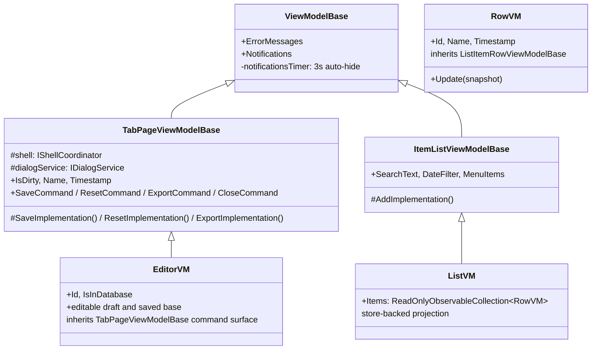

# UI View Models

> Part of the [Sufni.App architecture documentation](../ARCHITECTURE.md). This file covers presentation view-model categories and the session sub-page composition model. Layering invariants live in [UI Architecture](ui.md), read-state ownership lives in [UI State, Read Graphs, and Queries](ui-state.md), and coordinator/navigation ownership lives in [UI Workflows, Composition, and Navigation](ui-workflows.md).

## View Models



Shell list, row, tab and pending-delete bases live in `Shell/ViewModels/Base`.
`Shared/Base/ViewModelBase` retains generic notifications and subscription scopes.

There are five kinds of view model in the presentation layer:

- **Shell view models** — `ShellRootViewModel`, `ShellWorkspaceViewModel`,
  and `MainPagesViewModel` compose the app shell for both platform
  lifetimes. `ShellRootViewModel` is the root data context for `MainWindow`
  and `MainView`; it exposes the selected layout profile, platform
  capabilities, startup state, shutdown availability, the deferred primary page
  surface, and the shared workspace.
  `ShellWorkspaceViewModel` owns the logical tab collection, current tab,
  tab history, open/focus, background open, close, restore, back, and reorder
  behavior used by both compact and workspace presentations. `MainPagesViewModel`
  is the only place that holds references to multiple primary page view models
  at once; this is the explicit "view composition" carve-out from the
  no-VM-on-VM rule. It delegates GPX/video intents to coordinators and sends
  their results to `ShellFeedbackViewModel`; it holds no global feedback state.
  `ShellFeedbackViewModel` is the single app-lifetime projection of sync
  availability, pairing state and progress, and owns global sync/GPX/video
  notifications and errors. Both shells render its `ShellFeedbackBar`, so
  changing primary pages does not relocate or hide a result. `AppStartup` owns
  the initial store refresh and invokes page creation only after initialization
  and refresh succeed.

- **Feature page view models** — non-entity top-level screens such as `ImportSessionsViewModel` and the pairing pages. They own only screen-scoped state, bind directly to controls, attach subscriptions and browse lifetime in `Loaded` / `Unloaded`, and delegate workflows to coordinators and services. `ImportSessionsViewModel` is the canonical example: it keeps datastore / file selection, notifications, and errors; resolves `SelectedSetup` from `ISetupBoardQuery.FindByBoardId`; asks `ITelemetryDataStoreService` to browse, load files, and register storage-provider folders; and delegates the actual import lifecycle to `ImportSessionsCoordinator`. For work that belongs to a screen, generated async-command `IsRunning` remains the busy-state source. Import runs belong to the coordinator: the import tab observes its replayed `SessionImportState` and renders progress/results. It releases the observation on final close. A reopened tab sees the same active batch.

- **List view models** (`ViewModels/ItemLists/`) — `BikeListViewModel`,
  `SetupListViewModel`, `SessionListViewModel`,
  `PairedDeviceListViewModel`, `LiveDaqListViewModel`. Most take a
  read-only store and project the
  store's `Connect()` change stream through DynamicData into a typed
  `ReadOnlyObservableCollection` of row view models:

  ```
  store.Connect()
      .Filter(filterSubject)              // search text + date range
      .TransformWithInlineUpdate(
          snapshot => new XxxRowViewModel(snapshot, coordinator),
          (row, snapshot) => row.Update(snapshot))
      .Bind(out items)                    // .SortAndBind for sessions
      .Subscribe();
  ```

  `BikeListViewModel` deliberately reorders this pipeline to
  `Transform → DisposeMany → Filter → Bind` so `DisposeMany` only
  fires when a row leaves the source store, not when the filter
  merely hides it — the trade-off is that the predicate sees the
  row VM rather than the raw snapshot.

  Each list owns its own `Items` `ReadOnlyObservableCollection`
  and pushes a fresh predicate to a `BehaviorSubject` whenever
  filter state changes. `ItemListViewModelBase` owns the shared
  `Loaded` / `Unloaded` subscription lifecycle: `Loaded` calls the
  concrete list's `AttachSubscriptions` once, `Unloaded` disposes that
  scope and lets the list clear its projected rows, and a later load
  reconnects and republishes the store's current state. It also contributes
  the cross-cutting search / date-filter / menu-item state and the
  `AddCommand` plumbing (it does not declare an `Items` property — there is
  nothing to shadow). Individual lists override `AddImplementation()` to
  request a new editor from the shell.
  `SessionListViewModel` follows the same projection shape but uses
  `IRecordedSessionProjection.ConnectSessions()` instead of
  `ISessionStore.Connect()`, so rows include processed-data presence,
  staleness, raw-source availability, and summary metrics without each
  row doing its own store lookups. It keeps the flat `Items` collection
  for compatibility and exposes `DateGroups` as the grouped list surface
  used by the desktop sidebar and mobile pull-menu scroll view. Each list
  constructs its own menu items. `IShellActions` supplies the shared sync
  command and import availability; the session list owns `OpenImportCommand`,
  and its desktop view binds directly to it without finding a parent shell.
  Bike and setup lists own file import commands, feedback and read cancellation.
  Their desktop buttons and compact pull menus invoke the same command. A bike
  import opens a fresh unsaved draft; a setup import opens its newly persisted
  setup by ID. Unloading cancels file reads and suppresses late navigation; an
  accepted setup import still completes persistence and publication.

- **Row view models** (`ViewModels/Rows/`) — `BikeRowViewModel`,
  `SetupRowViewModel`, `SessionRowViewModel`,
  `PairedDeviceRowViewModel`, `LiveDaqRowViewModel`. Cheap,
  non-editable wrappers around a single snapshot. They expose a
  `Update(snapshot)` method that DynamicData calls when the underlying
  snapshot changes, plus an `IRelayCommand`-based open/delete surface
  inherited from `ListItemRowViewModelBase` (a single shared `x:DataType` for the
  `DeletableListItemButton` / `SwipeToDeleteButton` /
  `PairedDeviceListItemButton` controls). Open commands route to the shell; delete intents go to the owning list
  and entity coordinator. `LiveDaqRowViewModel` is an
  exception: it does not derive from `ListItemRowViewModelBase` because live DAQ
  rows are not deletable and use a custom row control with
  online/offline presentation.
  `SessionRowViewModel` wraps `RecordedSessionSummary` rather than
  `SessionSnapshot`; it keeps the unadorned `BaseName`, appends
  `(Stale)` or `(No Raw)` to the display name when appropriate, formats
  the always-visible row timestamp as local time only because the group
  header owns the date, formats the optional subtitle from unit-labelled
  duration plus GPS distance/ascent/descent. Staleness appears in the title;
  completion and video availability retain their own bound indicators.

- **Editor view models** (`ViewModels/Editors/`) — `BikeEditorViewModel`,
  `SetupEditorViewModel`, `SessionDetailViewModel`,
  `LiveDaqDetailViewModel`, `LiveSessionDetailViewModel`. Constructed
  by `IEditorFactory` from a snapshot or live-session context, never by
  another view model and never stored in a list. The shell owns the factory;
  feature view models request `EditorKey` surfaces and deleted-editor closure
  through `IShellCoordinator`. Coordinators return domain results.
  Persisted editors hold one immutable draft base for authored-field comparisons.
  Bike/setup dirtiness is established in the constructor, and successful saves
  keep any later edits dirty. Setup linkage selectors use immutable `JointSpec` values from the bike snapshot;
  they do not construct bike editor view models. Setup sensor sub-editors expose immutable `SensorDraft`
  inputs without their own saved baselines or JSON serialization. `SetupCoordinator`
  builds the persisted row and sensor JSON after applying shared `SetupSaveRules`.
  Imported bikes enter the factory as a validated `BikeDraft` on `EditorKey.NewBike`;
  they do not replace another editor’s draft. Rear-suspension mode changes are
  awaited commands gated by the composed pointer capability; a pending or declined
  confirmation preserves the existing draft. The linkage canvas translates Avalonia
  gestures into point coordinates and selection commands before calling its editor.
  Editors derive editable state from the snapshot in `ResetImplementation`,
  and call back into the coordinator's `SaveAsync` / `DeleteAsync`. On
  a typed `Conflict` result they prompt the user via
  `IDialogService.ShowConfirmationAsync` and rebuild from the
  conflict's current snapshot. After accepting a successful save baseline,
  editors call `IShellCoordinator.CompleteEdit`; the shell returns to the
  previous surface in compact layout and keeps the current tab in workspace layout. Persisted-entity editors share the
  `TabPageViewModelBase` command surface, which is the single
  `x:DataType` used by the shared `CommonButtonLine` editor button
  strip. `LiveDaqDetailViewModel` and
  `LiveSessionDetailViewModel` are the two live-only exceptions: the
  diagnostics tab is a transport/configuration surface over the shared
  stream, while the live session tab is a create-only capture editor
  backed by `ILiveSessionService`. `LiveDaqDetailViewModel` projects a
  throttled diagnostics snapshot from `LiveDaqSessionState` and also
  owns the disconnected-only Set Time / Replace Config / Upload CONFIG
  command flow, reusing `ViewModelBase.Notifications` and
  `ErrorMessages` while keeping management busy state separate from the
  live connect/disconnect workflow. The live session editor projects
  signals/media/analysis state from the live session service and
  persists through `LiveDaqCoordinator.SaveCaptureAsync(...)`.
  The bike editor likewise keeps presentation concerns at this edge:
  `IBikeCoordinator` exposes neutral bike-editor result contracts, and
  `LoadImageAsync` returns encoded bytes rather than an Avalonia bitmap.
  The editor decodes bytes through `IBackgroundTaskRunner`, then gives the prepared
  bitmap to `BikeImageCanvasViewModel`. Shared bike snapshots contain only image
  presence; an image-bearing editor loads a full draft before enabling save/export.
  Initial draft loading belongs to the tab and survives view detachment. Closing
  cancels and awaits that load and any selected-image decode, then disposes the
  canvas bitmap and rotated cache. Replacing an image or rotation also disposes
  the previous bitmap/cache. Decode failures preserve the previous editable image.

  `SessionDetailViewModel` and `LiveSessionDetailViewModel` both
  compose session sub-pages from `ViewModels/SessionPages/` and expose
  workspace contracts for signals, media, analysis, sidebar, and mobile
  shell surfaces instead of putting every binding directly on the
  editor — see [Session Sub-Pages](#session-sub-pages) below.
  For recorded sessions, `RecordedSessionEditorState` is the projected state
  surface consumed by the signals, media, analysis, and mobile-shell
  workspaces. User-originated workspace setters call
  `RecordedSessionEditorActions` instead of mutating backing fields directly;
  `RecordedSessionEditorStateController` is the only reducer for those intents.
  It reduces each intent or typed input once and publishes one coherent state, including the current load data,
  selected page, analysis range, signal availability, map/media state, and
  analysis presentation. Reentrant intents wait until the current state has reached
  all subscribers. Signal and analysis workspaces hold one state reference and
  derive their binding properties from it; notifications see the whole new state.
  `SessionDetailViewModel` keeps one current state
  snapshot for read properties and property notifications. Its binding fields
  form the editable draft; one immutable `SessionDraft` base supports reset,
  dirtiness and conflict checks without timestamp pinning. A `Created | Loaded |
  ApplyingDraft | Closed` lifecycle replaces load/disposal/reset flags, and close
  requests share their cleanup task.
  `RecordedSessionEditorEffects` drives named effects such as analysis
  command refresh, map/media synchronization, preference persistence and
  dirty tracking. Analysis requests derive directly from the accepted editor
  state and semantic result keys; no suppression scheduler sequences them.
  Readiness and selection highlights are keyed background results. The reducer
  clears old outputs with a telemetry/range change and renders pending readiness
  until the matching result arrives; track-only augmentation keeps valid results.
  Selection toggles only update the active selections. Balance-tab insertion uses
  the worker's full-session availability, so an empty selected range retains it.
  `RecordedPagePresentationApplier` is limited to page-owned chart/string
  projection and balance-page insertion; core signal, analysis, map, media, and
  loaded-data availability come from `RecordedSessionEditorState`. Stable
  runtime objects such as the page collection, timeline link,
  source-visibility store, map view model, video pane (see
  [video.md](video.md)), segments picker (see
  [segments.md](segments.md#segments-picker)), and segment comparison (see
  [segments.md](segments.md#matching-and-comparison)) are owned directly by the
  editor and passed to workspaces
  by reference; state emissions update projected presentation without replacing
  those objects. The recorded signals, media, analysis, and mobile-shell
  workspaces own state subscriptions and are disposed on final editor close.
  Internal collaborators in `ViewModels/Editors/` keep
  flows off the editor itself: `SignalRowActionsController` builds the
  built-in signal-row header actions (airtime and analysis-selection toggles)
  by reading the current signal state and emitting an editor intent.
  `ApplyActionStates(state)` projects all twelve toggles from each accepted state;
  Damping-cutoff editing reads its bike owner and persisted values from the
  current domain snapshot. Preview/commit intents update the editor state;
  cancellation and failed writes restore current projected values. Saved responses
  do not overwrite a newer projection. Load results no longer carry a second
  cutoff context.
  `ProcessingPreferenceWorkflow` forwards committed processing-option edits to
  `SessionCoordinator` and renders its typed result; persistence and conditional
  rollback stay in that coordinator. The editor retains pending preference
  operations and drains them on close. Session
  detail loading uses one local-only `ISessionLoader.LoadDetailAsync` path;
  inactive-tab deferral is supplied
  by `EditorFactory` for both profiles and evaluated against current tab activity. Collaborators reach the
  editor through the `ISessionOperationGateway` contract rather than delegate
  bundles.
  Recorded-session loading publishes decoded telemetry first through
  `ISessionLoader.LoadDetailAsync`, then
  awaits `LoadTrackAsync` under the same active load token and augments the
  loaded state only if that generation is still current. This lets built-in
  telemetry Signals become ready while the map and track-backed rows are still
  waiting, without introducing a second telemetry owner or restarting the
  telemetry generation when track data arrives. Both stages carry
  `SessionDetailLoadProgress`; `SessionDetailViewModel` owns the UI-only
  preparing and applying stages, ignores progress and completions from canceled
  or superseded load tokens, and does not replace already-published first
  content with a later loading presentation. `RecordedSessionEditorStateController`
  maps pre-content progress into
  `SessionScreenPresentationState`, whose loading states always expose a
  concrete message and normalized `0..1` progress fraction. Both workspace and
  compact session shells show progress while `IsLoading` is true.
  The recorded editor subscribes to `IRecordedSessionProjection.WatchSession`
  on its first `Loaded` and disposes that subscription on final tab close. View
  detach/reattach and layout changes keep the active load and telemetry retention.
  Initial or runtime domain snapshots pass to `SessionCoordinator.ReconcileStalenessAsync`;
  the editor prompts only for its `Required` result. Unchanged fingerprint pairs
  do not repeat a declined prompt; changed processing inputs may prompt again; inactive tabs in both layouts defer that prompt until selected. Unrecomputable stale snapshots report an
  error; processed data arriving for a current session reloads the
  presentation data. Domain reactions are retained and drained on final close;
  their failures use a fixed summary with separate diagnostics.

### Session Sub-Pages

The `ViewModels/SessionPages/` folders within the Sessions areas and `LiveDaq/` (e.g. `Sessions/Signals/ViewModels/SessionPages/`, `Sessions/Pages/ViewModels/SessionPages/`, `LiveDaq/ViewModels/SessionPages/`) hold the per-page view
models that `SessionDetailViewModel` (recorded sessions) and
`LiveSessionDetailViewModel` (live captures) compose into the mobile
session page surface. They share a tiny base, `PageViewModelBase`,
which extends `ObservableObject` and exposes only the immutable
`DisplayName` used as the page header. Page selection belongs to the
owning session workspace, not to individual pages: recorded sessions
project it from `RecordedSessionEditorState.Intent.SelectedPageIndex`
through `SessionShellMobileWorkspaceViewModel` and write changes through
`RecordedSessionEditorActions.SelectPageIndex`; live sessions store it
directly on `LiveSessionDetailViewModel`. Both surfaces expose
`SelectedPageIndex`, `SelectedPage`, `PageCount`, and
`SelectedPageDisplayName` through `ISessionShellMobileWorkspace`.
Pages do not own commands, notification bars, selected flags, or shell
navigation — the editor is still the `TabPageViewModelBase` and keeps
the `Save` / `Reset` / `Close` surface.

Each editor exposes an `ObservableCollection<PageViewModelBase>
Pages`. `SessionShellMobileView` binds that collection to a
`CarouselPage` and binds the shared selected index to both the
`CarouselPage` and `PipsPager`, so swipes and pips update the same
workspace-owned index. The two editors
compose different page sets:

- Recorded sessions: signals, spring, strokes, damping, position/velocity,
  balance, vibration, insights, notes, preferences.
- Live captures: signals, spring, damping, notes, preferences; balance is
  inserted when the current live analysis produces balance data.

Both editors add or remove `BalancePage` at runtime via an
`EnsureBalancePage(bool)` helper based on whether the current
telemetry produces a balance plot, so `Pages` is mutated rather than
rebuilt. Signals pages are constructed with the editor's signals and media
workspaces as constructor arguments — `RecordedSignalsPageViewModel` for
the recorded editor, `LiveSignalsPageViewModel` for the live editor.
Several analysis pages are also workspace-backed so their
presentation states and SVG surfaces can be built from the editor's
analysis service; notes and preferences remain the mostly local
parameterless pages. `PositionVelocityPageViewModel` is owned by the
recorded `SessionAnalysisWorkspaceViewModel`, which exposes it as
`ISessionAnalysisWorkspace.PositionVelocity` (null for live captures). The
same instance is the mobile page and the desktop tab content. It holds the
selected side and display mode as view state and derives the shown side,
the side-selector visibility, and its presentation state from the
workspace's front and rear analysis states. On desktop, the analysis view
builds one tab strip from the built-in tabs, adding Position/velocity after
Damping only when the workspace offers it, and places the selected
analysis body plus the segment comparison banner inside one vertical scroll
region; analysis plot hosts use natural fixed plot heights instead
of stretching to the current analysis pane height.

Most pages are pure projection surfaces over data the editor pushes
in: `SpringPageViewModel`, `DampingPageViewModel` (the Damping page), and
`BalancePageViewModel` carry per-plot strings and
`SurfacePresentationState` values that the editor sets after each
analysis run. Recorded-session analysis pages distinguish unavailable
finished data from live warm-up: a stored session or selected range
with too little travel movement shows a no-data message without a
spinner, while live-session analysis keeps a waiting state because
the relevant stream samples may still arrive. `NotesPageViewModel` carries the description plus
fork/shock `SuspensionSettings` and exposes its own
`IsDirty(Session)` so the editor can fold notes-page edits into its
`IsDirty` evaluation. The editors do not subscribe to most of these —
they write to the page from analysis result handlers.

Two pages diverge from that pattern:

- **Signals pages** wrap the editor's signals workspace and a shared
  media workspace and forward bindings into a reusable
  `SignalRowsRoot`. The root owns a vertical `ScrollViewer` and a
  collapsible row hierarchy rather than a fixed signals grid:
  Travel hosts Velocity, IMU vibration RMS hosts Frame Pitch/Roll, and
  GPS speed hosts Elevation. Desktop signal roots live inside the signals/analysis
  splitter region and grow visible base rows once all preferred row
  content fits; mobile signal roots are measured by the page scroll and
  report preferred content height. Rows are draggable from their
  headers within that hierarchy: dropping on another row appends the
  dragged row to that row's children, while dropping in the divider
  band between root rows makes the dragged row a root row at that
  position. Row visibility is still controlled
  by `TravelSignalState` / `VelocitySignalState` / `ImuSignalState` /
  `PitchRollSignalState` / `SpeedSignalState` / `ElevationSignalState`
  on the workspace
  (recorded: projected from
  `RecordedSessionEditorState.Presentation.Signals`; live: directly on
  `LiveSessionSignalsWorkspaceViewModel`). Child row titles
  are progressively inset by hierarchy depth. Expanded parent rows draw
  short connector branches in the child-row band, starting at each
  direct child row's top edge and stopping before that child row's
  header glyph; those branches disappear with the parent's expanded
  content. The guides stay in the left title/glyph gutter, avoid the
  glyph text itself, and do not enter plot chrome or shift plot
  content, so signal data remains vertically aligned across parent and
  child rows.
  The row hierarchy, each row's expanded/collapsed state, and manually
  resized root-row height ratios are stored in
  `SessionPreferences.SignalLayout` as stable row IDs plus normalized ratios.
  For recorded
  sessions, `SessionDetailViewModel.SignalLayoutPreferences` projects the value
  loaded and saved through `ISessionCoordinator` preference workflows; live captures
  carry the current live signal layout preference into
  `LiveDaqCoordinator.SaveCaptureAsync(...)` so the newly saved
  session opens with the same row layout. The pure
  `SignalLayoutPreferenceTree` helper owns preference normalization,
  capture, root moves, child moves, duplicate removal, unknown-row
  skipping, missing-default appends, and cycle prevention; the Avalonia
  `SignalRowsRoot` still owns materialization, drag/drop hit
  testing, brushes, manual row-size capture, and visual rebuilding. If
  any visible resizable root row has no stored height ratio, the signal layout
  falls back to default sizing so new or unknown panes do not inherit a
  partial old layout. Hidden rows are not
  duplicated in the signal hierarchy preference: plot visibility remains
  the existing `SignalDisplayPreferences` contract, so hidden rows keep
  their saved hierarchy position and reappear there when re-enabled.
- **`PreferencesPageViewModel`** exposes each signal's availability and smoothing,
  plus the velocity-filter slider and its commit event. Signal display preferences
  read the owning editor/workspace through getters and send immutable edits back
  through callbacks. `RefreshSignalDisplayPreferences` raises binding notifications
  after the owner changes; the page keeps no smoothing copy. Availability uses
  `ApplySignalAvailability`. The recorded editor projects the filter from the
  session row; `ProcessingPreferenceWorkflow` in `Sessions/Detail/ViewModels/Editors` sends commits to
  `ISessionCoordinator.SetProcessingOptionAsync` and displays the returned outcome.
  The coordinator owns persistence, recompute and conditional rollback. Live save
  puts the selected option on the new session.

  Signal display, analysis modes, signal layout and pane ratios remain in
  one `SessionPreferences` value in the recorded editor state, observed through
  `ISessionPreferences`. There is no separate preference-store or intent-state
  copy. `SessionCoordinator.LoadPreferencesAsync` / `SavePreferencesAsync` own
  reads/writes and return safe typed failures; load failure shows defaults. Desktop splitters
  write normalized pane ratios; absent ratios use the layout defaults. Live save
  seeds those preferences for the new session after persistence.

The desktop session shell declares the media pane's 400-pixel default in XAML;
saved layout preferences still override it. No media-width value travels through
track loading, recorded editor state, or live/recorded workspace contracts.

`TabPageViewModelBase` (`Shell/ViewModels/Base/TabPageViewModelBase.cs`) is the
shared base for everything that opens as a top-level tab or stacked
view (editors and the import view). It takes
`IShellCoordinator` and `IDialogService` via its constructor and
provides the shared `IsDirty` machinery, the
`SaveCommand`/`ResetCommand`/`ExportCommand`/`CloseCommand`
implementation, and the `OpenPreviousPageCommand` that delegates to
`shell.GoBack()`. The `CloseCommand` flow uses
`IDialogService.ShowCloseConfirmationAsync` to prompt for save / discard
/ cancel before letting the shell close the tab. Choosing save closes only if
the editor is clean afterward; a failed save or declined conflict reload keeps
it open. The setup draft base, including sensor values, advances only after the coordinator
reports `Saved`, so a failed sensor-only save remains dirty.

`ViewModelBase` (`Shared/Base/ViewModelBase.cs`) extends
`ObservableObject` and contributes the notification / error-message
collections plus the 3-second auto-hide timer that pauses on pointer
hover. The base receives `TimeProvider` and `IUiThreadDispatcher`; its subclasses
receive those dependencies through composition or their owning factories.
Pending-delete entries project shell-owned undo windows and forward undo/dismiss
intent. `PendingDeletes` owns their clock, persistence and lifetime; lists have
no delete timers or commit callbacks. Primary-page descriptors are immutable
wrappers around their content; they do not inherit notification state or create
a dispatcher. Navigation surface belongs to `IShellCoordinator`, not
`ViewModelBase`; small projection-only view models such as session
pages, sensor-configuration rows, and linkage parts use
`ObservableObject` directly when they do not need the shared
notification/error surface. `ViewLocator` still maps those known
projection view models through its explicit view-factory table.

Session Insights receives telemetry, range, selected modes, cutoffs and target
profile. Its service derives damping percentages inside the analysis context;
callers cannot supply percentages from a different range or previous result.

## Device-local preferences

`Sessions/Models/SessionPreferences.cs` owns session preference values;
`Sessions/Services/Preferences` owns their persisted-document conversion and read/
write contract. `Shell/Services/Preferences` owns the composite installation
preference file and the launch snapshot. Generic smoothing levels live beside
shared plot processing. The session signal hierarchy and collapsible pane controls
live under `Sessions`, beside the layout values they render.

Session analysis options, signal visibility/smoothing, signal layout, pane ratios,
theme, layout profile and selected map layer belong to this installation. They do
not travel during sync. `AppPreferences` serializes documents through the background
runner and commits with an atomic file rename; observed session and map values
publish on the UI dispatcher after persistence. Initial replay and subscription
share the document gate so a concurrent write cannot be missed. Custom map-layer
definitions are separate synced store facts.
