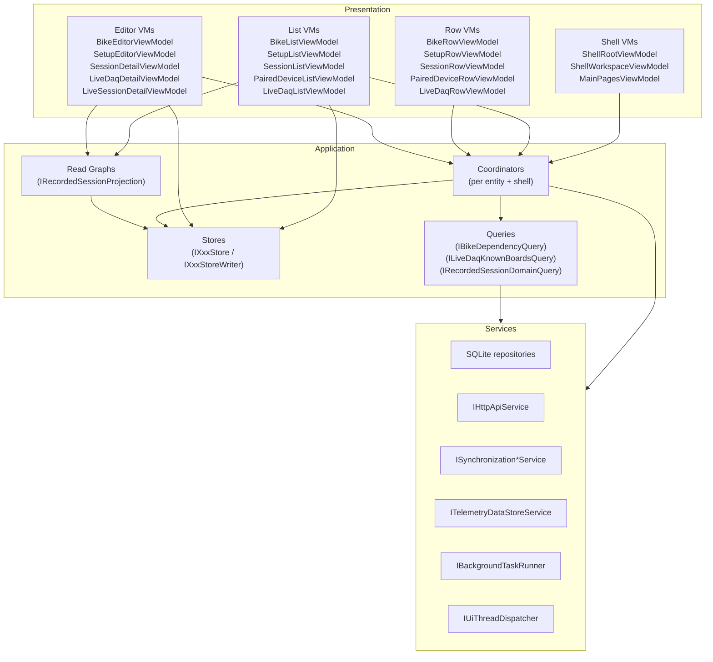

# UI Architecture

> Part of the [Sufni.App architecture documentation](../ARCHITECTURE.md). This file is the presentation-layer entry point: invariants, layering, threading, explicit result shapes, and testing boundaries.

The presentation code is organized in five layers with a strict
one-way dependency chain:

```
Views → ViewModels → Coordinators / Stores / Queries → Services → Platform
```

CommunityToolkit.Mvvm source generators (`[ObservableProperty]`,
`[RelayCommand]`) drive bindings; views are XAML with compiled
bindings; shared read state is reactive and uses DynamicData
(`SourceCache<T, TKey>` → `ReadOnlyObservableCollection<T>`).

Focused presentation references:

- [UI State, Read Graphs, and Queries](ui-state.md) — stores, recorded-session read graph, and query patterns.
- [UI Workflows, Composition, and Navigation](ui-workflows.md) — coordinators, DI, and shell navigation.
- [UI View Models](ui-view-models.md) — shell, page, list, row, editor, and session sub-page view models.
- [Controls Library](controls.md) — reusable mobile and desktop controls.
- [Theming](theming.md) — theme snapshots, resource bridge, runtime theme service, and theme ownership.
- [Plot Rendering](plot-rendering.md) — ScottPlot-backed plot classes and display-time rendering pipeline.

The app root is shared across platform lifetimes. `ShellRootViewModel` is the
root data context for both the desktop `MainWindow` and mobile `MainView`; it
composes the primary page surface (`MainPagesViewModel`) with the logical tab
workspace (`ShellWorkspaceViewModel`). The active `IAppEnvironment.LayoutProfile`
selects the compact or workspace shell view through `ViewLocator`, while
`AppCapabilities` and `InputCapabilities` decide which actions and gestures are
available inside that presentation.

## Architectural Invariants

Global sync, GPX and video feedback belongs to `ShellFeedbackViewModel`, rendered
by one feedback bar in the active shell. Feature-local editor/list messages keep
their own lifetimes. A single app-owned `ShellDispatcherExceptionHandler` logs
unexpected dispatcher exceptions and routes a generic message to the same shell
feedback owner; ordinary flows retain their own outcomes.

These boundaries are the invariants worth preserving even if type names
or feature wording evolve:

- A view model owns screen state, command flow, and binding-friendly projection.
- A persisted store owns shared read state for one entity family and publishes
  prepared snapshots/removals through its writer interface. It does not persist
  or load repository data. Runtime-only stores own runtime publication for their
  own data.
- A read graph owns a joined projection across stores and publishes derived state for screens that need more than one entity family.
- A query answers a business question that crosses domains or requires derived reasoning; it does not own the shared collection.
- A coordinator owns workflows with side effects and
  long-lived event subscriptions. It persists through services and supplies
  prepared snapshots to store writers without mutating caches directly.
  Cross-aggregate writes live in workflow transaction runners or command services
  that publish store state only after the SQLite transaction commits.
- A service or factory owns infrastructure-facing work such as datastore construction, file-picker lifetime, platform integration, and explicit background execution. Infrastructure-facing contracts stay presentation-neutral: for example, the bike editor service and coordinator return image bytes and neutral result records, while Avalonia image decoding stays in the bike editor's presentation objects.
- Screen-scoped caches belong to the screen that owns their lifecycle. Recorded-session analysis uses a per-open-session result state for cancellation and cached records, backed by a shared stateless analysis computer.

Persisted stores backed by `SourceCacheStoreBase` refresh full snapshots with
DynamicData `EditDiff`, using each snapshot's value equality to add/update/remove
only changed keys instead of clearing and repopulating the cache. Snapshot
equality is therefore a UI contract. `BikeSnapshot` implements handwritten
equality so two snapshots with fresh-but-equal `ImageBytes` arrays do not emit a
spurious update.

## Layered Architecture



Rules enforced by convention:

- A view model may depend on coordinators, **read-only** stores, read graphs, queries, services, and other shell composition view models. It may not depend on another feature view model or on a store writer. Any remaining direct feature-VM dependency outside shell composition is technical debt, not a pattern to copy.
- Feature coordinators depend on services, **read/write** stores, other coordinators, queries and dialogs. They do not navigate or construct editors. `ShellWorkspaceCoordinator` alone owns `IEditorFactory`; view models send `EditorKey` requests through `IShellCoordinator`. The factory receives the shell in `CreateEditor` rather than its constructor, keeping composition acyclic.
- The shell owns editor open/focus/restore/close and post-save navigation. Successful editors accept their baseline before requesting `CompleteEdit`; editor deletion closes the matching tab without an extra back step.
- Dialogs are split across two seams on the same `DialogService` singleton: `IDialogService` is the prompt contract view models and coordinators consume (`Show*` methods only, no Avalonia types), while `IDialogHost` is the wiring contract `App` uses at startup to set the owner window, overlay host, and window-versus-overlay presentation mode.
- A service or factory may depend on platform or infrastructure APIs and may create concrete datastores, own file-picker lifetime, and own background execution. View models ask services and factories to do this work; they do not `new` concrete infrastructure types.
- Stores depend on publication infrastructure, not repositories or domain services. A read graph may depend on read-only stores and pure derivation services. A query may depend on services or read-only stores.
- Controls in `Views/Controls/` and `DesktopViews/Controls/` resolve nothing from the DI container — parent views supply everything via bindings or attached behaviours.

## Threading & Lifecycle

`AppStartup` awaits database initialization and the first coherent store refresh
before primary pages are created. Both shells render a blocking startup/failure
surface until readiness. Tile-layer initialization and subscription wiring precede
server startup; retention work then runs under startup ownership.
Database reset archives the closed database and requires a new launch. See
[Startup and database recovery](ui-workflows.md#startup-and-database-recovery).

Desktop shutdown closes tabs through their close policy, cancels and awaits
owned work, finalizes pending deletes, stops the server, disposes the provider,
and closes logs. A canceled prompt aborts shutdown. Native window closing is
held until this drain finishes. Mobile background finalizes pending deletes and
flushes logs while retaining the current tabs.

Thread ownership is explicit:

- The UI thread is reserved for bound-property updates, `ObservableCollection` mutation, notifications, native picker interaction, and lightweight read-store lookups.
- Filesystem work, network work, datastore enumeration, SST parsing, PSST generation, and similar slow operations must cross an explicit background boundary (`IBackgroundTaskRunner` or a service-owned equivalent) before they run.
- Code paths that need a testable UI-thread boundary use `IUiThreadDispatcher`; view/control code and Avalonia UI primitives such as `DispatcherTimer` may still use Avalonia's dispatcher directly. Sync, pairing, session sync application, map layers, themes and list/undo owners require those dependencies. Acquisition requires them as well.
- UI cadence uses `IUiTimerScheduler`, registered as `DispatcherUiTimerScheduler`. View models receive it through constructors; `App` and `DialogService` supply the inherited `UiTimers.Scheduler` property on each window/view root for XAML-created descendants. Plot refresh, gestures and zoom-close completion use that root scheduler. There is no static scheduler override.
- Acquisition polling uses a clock-driven `PeriodicTimer`; collection snapshots and publication cross its required UI dispatcher. Drive probing and datastore creation run through the background runner.
- Singleton page view models do not imply always-on work. Browse lifetimes and store subscriptions attach in `Loaded` and tear down in `Unloaded`. In particular, `ItemListViewModelBase` owns this lifecycle for every entity list: concrete lists build their store projection in `AttachSubscriptions`, clear projected rows after detach, ignore duplicate `Loaded` calls while already attached, and rebuild from the store's current state when loaded again.
- Recorded-session editors load once per tab, retain subscriptions and processed telemetry across view detach/reattach, and cancel/dispose on final close. Inactive tabs defer staleness prompts in both profiles. Layout switching belongs to the shell and keeps dirty background tabs.
- Views connect those commands with the `ViewLifecycle` attached properties in `Shared/Views/ViewLifecycle.cs`, not with `Xaml.Behaviors` triggers: `LoadedCommand` (with optional `LoadedCommandParameter`) and `UnloadedCommand` follow Avalonia's `Loaded` / `Unloaded` events, and `AttachedToVisualTreeCommand` / `DetachedFromVisualTreeCommand` follow the visual-tree events for views that need that earlier timing. A command runs on every occurrence of its event and only when `CanExecute` allows it, so a view that is detached and attached again unloads and loads again.
- Import/setup and recorded-session subscriptions observe on their injected UI dispatcher, with Rx owning queued-delivery cancellation when a subscription is disposed. Import progress uses the same explicit dispatcher; no ambient synchronization context is captured.
- Persisted stores share `StorePublication`: cache edits in a UI-thread batch defer per-store notifications, then emit one commit identifying changed stores. Joined consumers derive on that commit; ordered per-store notifications alone do not make `CombineLatest` coherent.
- Notification expiry and pending-delete undo windows use injected clocks. The
  shell-owned `PendingDeletes` workflow retains undo windows and in-flight
  commits independently of list attachment. Lists project its state; the owner
  dispatches coordinator work through the background runner.
- Prefer generated async-command state such as `Command.IsRunning` as the busy-state source of truth instead of maintaining duplicate booleans.
- Plot views coalesce `RefreshPlot()` calls through one render-priority
  dispatcher post. Multiple property/theme/reload triggers in the same UI turn
  collapse into one ScottPlot refresh.
- ScottPlot draws on Avalonia's render thread while holding `Plot.Sync`.
  Time-series plot views rebuild their plottables under the same lock, so a
  frame never reads a half-cleared plot.
- Recorded-session maps initialize lazily. `SessionDetailViewModel.SetMapState`
  calls `MapViewModel.InitializeAsync()` only the first time the map state
  reserves layout (`SurfacePresentationState.ReservesLayout`); `Hidden` map
  state does not initialize the map.
- `MainWindow` accepts an optional `IWindowBehavior`, owns its attachment until
  close, and delegates automation-peer creation to it. Only the macOS head
  registers an implementation. It owns the raw Control+Tab key-up workaround
  and returns an inert window automation peer
  (`InertWindowAutomationPeer`): it has no automation children and stops
  advertising `IRootProvider`. The native bridge otherwise materializes peers
  through two root-provider paths that bypass tree descent —
  `RootProvider_GetFocus` (every focus change once an AX client has touched the
  window) and `RootProvider_GetPeerFromPoint` (AX hit-testing) — and every
  materialized peer is permanently retained by an element/node ownership cycle
  in `Avalonia.Native`. Hiding `IRootProvider` fails the bridge's
  `IsRootProvider()` guards on both paths, so no Avalonia control below the
  window can be materialized. This intentionally makes the application
  inaccessible to macOS accessibility clients; remove the workaround once the
  upstream lifecycle is fixed.

### Cancellation & Result Coherence

Background workflows whose results can be superseded should take a
`CancellationToken` from their caller and propagate it through the
coordinator/service chain.

- The owner cancels when its lifetime ends or before replacing a request. Page-scoped work ends on `Unloaded`; recorded-session loading ends on tab close.
- Cancellation is a neutral exit, not a failure outcome. Do not translate `OperationCanceledException` into domain results such as `Failed`, `Unavailable`, or user-facing errors.
- Replaceable read/refresh workflows should be cancellable. Once a workflow has crossed into persistence or other committed side effects, prefer explicit result shapes over best-effort cancellation.

Result application must still enforce coherence after awaited work returns:

- A canceled or superseded workflow must not apply UI state, overwrite newer data, or clear busy indicators that belong to newer work.
- The component that owns the current workflow identity should only clear or dispose its current cancellation state when the completing workflow is still the active one.
- If multiple refresh triggers arrive while only the latest result matters, coalesce them or drop stale completions rather than partially merging old and new state.
- `SessionListViewModel` coalesces row-change batches before rebuilding
  date groups, so a multi-change store update produces one
  `SynchronizeDateGroups` pass and preserves expansion state by group key.

## Result Shapes

`SessionDeleteResult` is `Deleted | Failed(reason, details)` with
`SessionDeleteFailureReason.Delete`. Both editor deletion and pending-delete
feedback use the fixed summary and preserve diagnostic details. A failed
transaction retains the session and its preferences.

`RecordedSessionReprocessResult` is `Processed | Failed(reason, details)`.
`SessionProcessingFailureReason` distinguishes invalid rear configuration,
calibration calculation failure, no usable travel, and invalid travel data.
Typed failures are forwarded without another log or persistence attempt.

`SessionRecomputeResult` is `Recomputed | Superseded | NotRecomputable | Missing |
Failed | ProcessingFailed`. Generic failures carry `SessionRecomputeFailureReason.Recompute | ProcessingOption`;
processing failures retain the processing reason. Missing sessions are skipped in
bulk recompute. `SessionEditResult.Applied` can carry the typed recompute failure
after the edit commits, keeping diagnostics separate through the editor gateway.

`LiveSessionSaveResult` is `Saved | Failed | ProcessingFailed`. Generic failures
carry `LiveSessionSaveFailureReason.Save`; processing failures keep the capture
available for retry and do not persist a session/source. `Saved` still carries
its existing publication warning.

`SessionImportResult` carries imported snapshots and typed per-file failures.
`SessionImportFailure` is `OperationFailed | ProcessingFailed` with file identity
and operation. `SessionImportFailureReason` covers import, invalid file,
publication, trash, acknowledgement and batch failure. `SessionImportEvent` is
`Imported | Failed | Progress`; failed events carry the same failure as the
completed result. Import feedback adds the file name to the fixed summary and
keeps technical details in the expander.

`MapLayerWriteResult` is `Saved | Failed(reason, details)` with
`MapLayerFailureReason.Add | Select`. Add failure leaves the catalog unchanged;
selection failure preserves a newly saved layer and retains the previous
selection. Map views render fixed summaries and expandable diagnostics.

`GpxImportResult` is `Canceled | Completed | Failed`. Completion and failure
retain imported/already-imported counts; a failed batch stops without undoing
previous writes. `GpxImportFailureReason.InvalidFile | Import` maps to fixed
summaries with optional details; shell feedback displays both partial completion
counts and failures. Caller cancellation propagates.

`BoardIdInspection` is `Found(BoardId) | TimedOut | Unreachable`; caller
cancellation propagates. Network import admits only identified datastores.
`DataStoreDiscoveryIssue` is `DaqUnavailable | Failed(reason, details)`;
`DataStoreDiscoveryFailureReason.Scan | Connect` supplies fixed summaries.
The import page renders unavailability as a notification and failure diagnostics
in the error expander.

Mobile pairing returns `RequestPairingResult.Sent | ServerUnavailable | Failed`,
`ConfirmPairingResult.Paired | PinRejected | Failed`, and
`UnpairResult.Unpaired | LocalOnly | Failed`. Failures carry
`PairingFailureReason.Request | Confirm | Unpair` and optional details. No server,
a rejected/expired PIN, and local-only unpairing are notification states. Only a
successful confirmation asks the shell to return to the previous page.

`PairedDeviceUnpairResult` is `Unpaired | Failed(reason, details)`;
`PairedDeviceUnpairFailureReason.Unpair` maps to a fixed summary. Pending-delete
completion carries `FailurePresentation`, retaining details for the error bar
without putting exception text in the summary.

`BikeEditorAnalysisResult` is `Computed | NotApplicable | Unsolvable | Failed`.
Hardtails are not applicable; incomplete drafts and typed invalid-geometry inputs
are unsolvable. Unexpected failures carry `BikeAnalysisFailureReason.Analyze`
with optional details and no longer disappear into the unavailable state.

Bike save returns `BikeSaveResult.Saved | Conflict | InvalidRearSuspension | Failed`.
Its failure carries `BikeSaveFailureReason.Save | Analysis` and optional details.
Cutoff updates return `BikeDampingSpeedCutoffUpdateResult.Saved | Conflict | Missing | Failed`
with `BikeDampingCutoffFailureReason.Save`; a missing bike disables cutoff editing.
Deletion returns `BikeDeleteResult.Deleted | InUse | Failed` with
`BikeDeleteFailureReason.Delete`. These failures use fixed summaries and optional
technical details. The bike coordinator persists changes and supplies prepared
snapshots to its store; there are no bike store mutation results.

Bike file workflows also use closed reasons: `BikeFileImportResult` and
`BikeImportResult` are `Imported | Canceled | InvalidFile | Failed`,
`BikeExportResult` is `Exported | Canceled | Failed`, `BikeImageLoadResult` is
`Loaded | Canceled | Failed`, and `LeverageRatioImportResult` is `Imported |
Canceled | Invalid | Failed`. Picker and I/O failures carry their flow's reason
and optional details. Image decode failure has its own presentation reason.
CSV validation stays beside the curve; workflow failures use the editor error
bar so diagnostics can expand without replacing the curve or leaking into text.

Setup save returns `SetupSaveResult.Saved | Conflict | Failed`, deletion returns
`SetupDeleteResult.Deleted | Failed`, import returns `SetupImportResult.Imported |
Canceled | InvalidFile | Failed`, and export returns `SetupExportResult.Exported |
Canceled | Failed`. Failures carry the corresponding `SetupSaveFailureReason.Save`,
`SetupDeleteFailureReason.Delete`, `SetupImportFailureReason.Import` or
`SetupExportFailureReason.Export` plus optional details. Import publication failure
still reports failure after the transaction has committed.

`SynchronizationRunResult` is `Completed | IncompleteLocalData | Failed(reason, details)`.
Completeness verification still owns the incomplete counts. The client workflow
logs run failures once and returns `SyncFailureReason.Synchronize | ProtocolMismatch`;
the coordinator forwards the reason without re-logging. Discovery without an
endpoint raises `ServerUnavailable`, displayed as a notification. Progress and
completion `Message` values remain ordinary text.

Video imports return `VideoImportResult.Cancelled | Linked | NoMatchingSession | Failed`;
alignment returns `VideoAlignmentResult.Updated | ClipMissing | Failed`. Their
failures carry `VideoImportFailureReason` or `VideoAlignmentFailureReason` with
optional diagnostic details. `FailurePresentation` supplies fixed summaries;
no matching session and missing clips are notification states.

Saved-segment changes return `SegmentChangeResult.Applied | SessionMissing |
SegmentMissing | Invalid(Message) | Failed(reason, details)`. Missing entities
produce notifications; validation remains a fixed message. Persistence/publication
failures use `SegmentWriteFailureReason.Create | Rename | Delete` and expandable
diagnostics.

Strava connection returns `StravaConnectResult.Connected | ValidationFailed |
MissingRequiredScope | RateLimited | Failed`. Segment fetch returns
`StravaSegmentFetchResult.Loaded | NotConnected | MissingSessionTiming |
ReconnectRequired | NoMatchingActivity | NoUsableSegments | RateLimited | Failed`.
Failures carry `StravaConnectFailureReason.Connect` or
`StravaSegmentFetchFailureReason.Load` and optional details. Other cases remain
status or validation messages; the dialog and picker separate failure diagnostics
from their fixed summaries.

Server launch returns `ServerStartResult.Started | Failed(reason, details)` with
`ServerStartFailureReason.Start`. The shell maps failure to the blocking
`StartupFailureReason.Server` state without logging the same failure again.

`FailurePresentation` maps closed reasons to fixed summaries and keeps diagnostic
details separate. Startup uses `StartupFailureReason.Database | Startup | Server |
Reset`; its blocking screen and shared error bars expose details through a
collapsed expander. Cancellation remains neutral, and outer layers do not log
an already-classified failure again.

Failure-policy migration is incomplete in the current code: live capture and
management, acquisition listing/folder selection, recorded preferences and
analysis/reconciliation, session/track loading, and segment comparison still
have presentation-owned catches or string failure payloads. Their current
ownership is described in the corresponding subsystem documents.

Operations with multiple semantically distinct outcomes return a sealed
record hierarchy with a private constructor so callers must
pattern-match on known cases instead of relying on bool flags, `null`,
or magic strings. This convention applies to both coordinator and
service contracts when the caller's next step differs by outcome.

Store writer APIs publish prepared facts and return no business results.
Persistence errors propagate to workflow owners; stores neither catch exceptions
nor return mutation-result unions.

`SessionSaveResult` is `Saved(Id, NewBaselineUpdated) | Conflict(CurrentSnapshot) |
Missing | Failed(reason, details)`, with `SessionSaveFailureReason.Save`.
`SessionEditResult` is `Applied(RecomputeFailure?) | Missing | Failed(reason, details)`;
`SessionEditFailureReason` distinguishes `Edit` from `Rejected`. Missing sessions
show notification state and cannot complete a save or close a dirty editor.
GPS alignment returns `GpsOffsetResult.Applied | NoMatchingTrack | SessionMissing |
Failed(reason, details)` with `GpsOffsetFailureReason.Save`. Unavailability is
shown as a notification; persistence failures retain technical details.

`BikeSaveResult.Saved` additionally carries
a `BikeEditorAnalysisResult AnalysisResult` so the editor can react
to leverage-ratio recomputation without a second round-trip; the
other `Saved` variants are payload-only. Editors pattern-match on
the result and, on conflict, prompt the user via `IDialogService`
before reloading the snapshot. The coordinator detects conflicts by
comparing the baseline `Updated` value the editor opened on against
the store's current snapshot — so a sync arrival or another tab's
save during an edit cannot silently overwrite the user's changes.
The live session path is deliberately separate:
`SaveLiveCaptureAsync(...)` is create-only and returns
`Saved(SessionId, Updated, PublicationWarning?)`, `Failed(reason, details)` or
`ProcessingFailed(reason, details)` because there
is no optimistic-concurrency baseline for an in-memory live capture.

Recorded-session recompute follows the same explicit-result pattern but is
**baseline-free**: `SessionCoordinator.RequestRecomputeAsync(sessionId, reason)`
returns `Recomputed(NewBaselineUpdated)`, `Superseded`,
`NotRecomputable(SessionStaleness)`, `Missing`, `Failed(reason, details)` or
`ProcessingFailed(reason, details)`, where
`RecomputeReason` records why the recompute was requested (logging only). The
`SessionRecomputeEngine` owns per-session, cancel-and-replace serialization and
recompute liveness, so a user's own recompute never false-conflicts: a run
displaced by a newer explicit request resolves to `Superseded`, a run whose DB
inputs change underneath it re-enqueues itself until it converges, and the
refreshed result reaches the editor through the recorded-session projection rather
than this return value (see [recompute flow](ui-state.md#recorded-session-projection)).

Recorded-session analysis requests use the same stale-result discipline on the
read side. Analysis inputs are versioned by the open editor; result computation
runs off the UI thread, publishes back through the UI dispatcher, and is ignored
if the range, mode, cutoffs, telemetry generation, or editor lifecycle changed
before completion.

The same convention is used for infrastructure-facing service outcomes
such as `StorageProviderRegistrationResult` (`Added` / `AlreadyOpen`)
and for small sealed event hierarchies such as `SessionImportEvent`
(`Imported` / `Failed` / `Progress(Current, Total)`) when a long-running workflow streams
progress back to the UI.

## Testing Boundaries

The architecture is intended to be tested in layers:

- View model tests assert screen-scoped behavior such as property changes, stale-result guards, `Loaded` / `Unloaded` lifecycle, generated command or local busy-state transitions, and progress-driven notification updates through explicit dispatcher fakes.
- Read-graph tests assert joined projections and derived-change flags across session, setup, bike, and recorded-source updates.
- Coordinator tests assert workflow semantics such as persistence, store writes, branching, result shapes, per-file progress emission, and background-runner usage.
- Service tests cover infrastructure ownership when the behavior is non-trivial, for example datastore registration or duplicate detection.

## Further Details

Detailed presentation-layer references live in focused files:

- [UI State, Read Graphs, and Queries](ui-state.md) covers stores, recorded-session read graphs, and query patterns.
- [UI Workflows, Composition, and Navigation](ui-workflows.md) covers coordinators, dependency injection, and shell navigation.
- [UI View Models](ui-view-models.md) covers shell, page, list, row, editor, and session sub-page view models.
- [Controls Library](controls.md) covers reusable mobile and desktop controls.
- [Theming](theming.md) covers theme snapshots, the resource bridge, runtime theme service, and theme ownership.
- [Plot Rendering](plot-rendering.md) covers ScottPlot-backed plot classes and the display-time rendering pipeline.

Bike and setup JSON model parsing propagates malformed-document exceptions to
the file-import boundary. The bike editor service and setup coordinator classify
invalid files and log the cause once at Warning; model parsers do not log.
